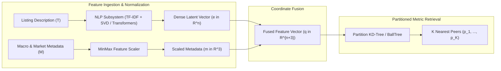
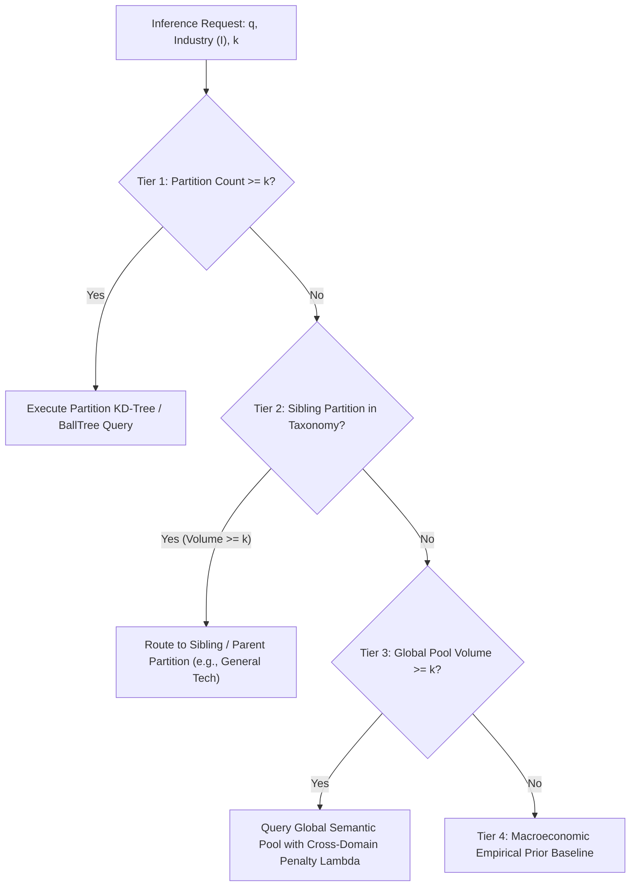

# Academic Documentation Style & Domain Engineering Reference Guide

> **Institution:** Strathmore University — School of Computing and Engineering Sciences  
> **Degree Program:** Bachelor of Science in Informatics and Computer Science / Applied Computing  
> **Project Title:** *A Content-Based Dynamic Price Optimization Framework for Professional Mentorship Services in the Freelance Economy*  
> **Author:** Jaedon Jeremiel Munyua (Student No: 169684)  
> **Academic Supervisor:** Dr. Jecton Anyango  
> **Academic Session:** June 2026  
> **Classification:** Technical Architecture & Academic Documentation Specification (M1–M16)

---

## 1. Executive Summary & Purpose

This reference guide codifies the academic tone, mathematical nomenclature, software engineering methodology, and domain taxonomy established in the Strathmore University dissertation proposal (*Munyua, 2026*). 

All technical documentation, milestone specifications, architectural decision records (ADRs), pull request descriptions, and thesis defense deliverables generated within this repository must adhere to the conventions documented herein.

---

## 2. Academic Tone & Writing Conventions

Technical documents within this repository operate at the intersection of **peer-reviewed computing research** and **production-grade distributed system engineering**.

### 2.1 Perspective, Voice, and Register
* **Perspective:** Use the third-person objective perspective. Avoid informal first-person singular pronouns (*"I did this"*, *"I found that"*). When describing methodological actions, utilize formal passive construction (*"The feature representations were extracted"*, *"A k-d tree spatial index was partitioned"*) or first-person plural for collective investigative intent (*"We formulate the pricing corridor as..."*).
* **Tone:** Rigorous, empirical, analytical, and authoritative. Avoid hyperbole (*"revolutionary"*, *"game-changing"*, *"effortless"*). Frame accomplishments through measurable metrics (*"achieving a 4.2ms P99 inference latency under concurrent load"*, *"reducing mean absolute percentage error to 6.2%"*).
* **Terminology Precision:** Distinguish strictly between:
  - **Asking / Quoted Rates:** Rates recommended by the algorithmic engine or requested by freelancers.
  - **Transacted / Verified Rates:** Rates historically confirmed through marketplace escrow settlement or platform records.
  - **Proxy Budgets:** Crowdsourced or publicly scraped client budget figures that serve as training proxies rather than payment verifications.

---

## 3. Mathematical Nomenclature & Formal Pipeline Equations

The algorithmic core of the Price Optimization Model synthesizes natural language processing, spatial metric topology, bilateral macroeconomic arbitrage, and financial transaction fee modeling into a unified continuous pricing pipeline.

### 3.1 Feature Space Formulation ($q \in \mathbb{R}^{n+3}$)
A mentor profile description $T$ and transaction context $M$ are mapped into a unified $(n+3)$-dimensional latent coordinate space:

$$q = \left[ e_1, e_2, \dots, e_n, \; \tilde{\beta}_{ij}, \; \tilde{s}, \; \tilde{\rho} \right]^T \in \mathbb{R}^{n+3}$$

Where:
* $e \in \mathbb{R}^n$ represents the dense semantic embedding:
  - **Baseline (M1–M15):** Truncated SVD over unigram/bigram TF-IDF sparse matrix ($n=50$).
  - **Advanced Research Track (M16):** Transformer sentence embeddings ($n=384$, e.g., `all-MiniLM-L6-v2`).
* $\tilde{\beta}_{ij} \in [0, 1]$ represents the MinMax-scaled bilateral purchasing power parity factor between mentor country $i$ and client country $j$.
* $\tilde{s} \in [0, 1]$ represents the MinMax-scaled marketplace saturation score.
* $\tilde{\rho} \in [0, 1]$ represents the MinMax-scaled industry relative mentor density.

---

### 3.2 Bilateral Purchasing Power Parity (PPP) Arbitrage Factor
To mitigate the **Cross-Border Arbitrage Paradox**, domestic and foreign economic imbalances are harmonized through the bilateral factor $\beta_{ij}$:

$$\beta_{ij} = \left( \frac{\text{PPP}_j}{\text{PPP}_i} \cdot \frac{\text{CoL}_i}{\text{CoL}_j} \right)^\alpha$$

Where:
* $\text{PPP}_k$ denotes the World Bank Purchasing Power Parity conversion factor for country $k$.
* $\text{CoL}_k$ denotes the Numbeo Cost of Living Index for country $k$.
* $\alpha \in [0, 1]$ is the empirical elasticity damping coefficient (default $\alpha = 0.50$).
* When mentor country equals client country ($i = j$), $\beta_{ii} \equiv 1.0$, preventing domestic pricing distortion.

---

### 3.3 Spatial Metric Retrieval & Inverse Distance Weighting (IDW)
Nearest peers $p_k \in \mathcal{P}$ are retrieved within the partitioned metric space using Euclidean, Manhattan, or Cosine distance metrics:

$$d_k = d(q, p_k)$$

Weights $w_k$ are assigned to each peer according to distance decay kernels:

| Weighting Kernel | Functional Form $w_k$ | Parameter Domain |
|---|---|---|
| **Quadratic IDW (Standard)** | $w_k = \frac{1}{d_k^2 + \epsilon}$ | $\epsilon = 10^{-6}$ (regularization) |
| **Linear / Power IDW** | $w_k = \frac{1}{d_k^p + \epsilon}$ | $p \in [1.0, 4.0]$ |
| **Exponential Decay** | $w_k = \exp(-\gamma \cdot d_k)$ | $\gamma > 0$ |
| **Gaussian RBF** | $w_k = \exp\left(-\frac{d_k^2}{2\sigma^2}\right)$ | $\sigma = \text{median}(d) + \epsilon$ |

Normalized peer weights:

$$\bar{w}_k = \frac{w_k}{\sum_{m=1}^K w_m}, \quad \sum_{k=1}^K \bar{w}_k = 1.0$$

Base predicted rate:

$$\hat{r}_{\text{base}} = \sum_{k=1}^K \bar{w}_k \cdot r_k$$

---

### 3.4 Domestic Payment Tariff Margin Protection & Corridor Formulation
To protect freelancers against the **Transaction Fee Vulnerability** on domestic mobile money networks (M-Pesa), the system applies tariff surcharge $\tau_{\text{mpesa}}$:

$$\hat{r}_{\text{final}} = \hat{r}_{\text{base}} + \tau_{\text{mpesa}}(\hat{r}_{\text{base}})$$

The symmetric or asymmetric pricing corridor $[r_{\min}, r_{\max}]$ is bounded by the peer population standard deviation $\sigma_{\text{peer}}$ and the freelancer's reservation floor $r_{\text{floor}}$:

$$\sigma_{\text{peer}} = \sqrt{\sum_{k=1}^K \bar{w}_k \cdot \left(r_k - \hat{r}_{\text{base}}\right)^2}$$

$$r_{\min} = \max\left(r_{\text{floor}}, \; \hat{r}_{\text{base}} - z \cdot \sigma_{\text{peer}}\right)$$

$$r_{\max} = \hat{r}_{\text{base}} + z \cdot \sigma_{\text{peer}}$$

*(Corridor bounds exclude the domestic fee tariff to allow clean negotiation room; fees are explicitly itemized on the final quote).*

---

## 4. Cold-Start Fallback Cascade Hierarchy

When specialized domains, nascent technology stacks, or new industry partitions contain fewer than the required minimum volume $k$, the engine triggers a deterministic 4-tier fallback cascade:

1. **Tier 1 — Direct Partition Match:** Query executes strictly within the requested industry partition ($N_{\text{partition}} \ge k$).
2. **Tier 2 — Taxonomy Hierarchy Rollup:** Resolves nearest sibling domains or parent cluster from `config/industry_taxonomy.json` ($N_{\text{sibling}} \ge k$).
3. **Tier 3 — Global Semantic Pool:** Queries a unified spatial tree across all active platform listings, penalizing peer distances by $\lambda_{\text{industry}} \ge 1.0$ (default 1.25) for non-matching industries.
4. **Tier 4 — Macroeconomic Empirical Prior:** Graceful fallback returning the national empirical median hourly rate for technical consulting when data is entirely sparse.

---

## 5. Domain Vocabulary & Lexicon

| Academic Domain Term | Theoretical Meaning & Operational Definition |
|---|---|
| **Cross-Border Arbitrage Paradox** | The market distortion where emerging-market freelancers price services solely according to local domestic purchasing power, forfeiting economic rent when selling to high-GDP clients, or conversely, pricing naively in foreign currency and becoming non-competitive. |
| **Domestic Underpricing Trap** | Systematic underbidding by freelancers who lack transparent pricing information, leading to market race-to-the-bottom dynamics. |
| **International Alienation Trap** | Setting asking rates excessively high based on foreign headline rates without adjusting for perceived geographic risk, credential arbitrage, or purchasing power, resulting in zero inbound client bookings. |
| **Transaction Fee Vulnerability** | Severe profit margin erosion caused by non-linear tier-based mobile payment tariffs (e.g., Safaricom M-Pesa bands) when receiving micro-transactions for professional services. |
| **Content-Based Dynamic Pricing** | Pricing derivation based fundamentally on unstructured semantic profile embeddings and verified nearest-neighbor peer listings rather than non-interpretable global regressions. |
| **Cold-Start Fallback** | Algorithmic routing protocol that maintains valid pricing corridor guarantees even when specialized industry partitions contain low historical sample counts. |

---

## 6. Feature-Driven Development (FDD) Methodology

In accordance with Chapter 3 (*Research Methodology*) of the Strathmore proposal, system engineering follows Feature-Driven Development (FDD), divided into five iterative phases:

1. **Develop an Overall Model:** Semantic extraction, vector fusion, spatial partitioning, and financial margin modeling.
2. **Build a Feature List:** Granular decomposition of capabilities expressed in strict FDD functional syntax.
3. **Plan by Feature:** Milestone sequencing, risk mitigation, and milestone dependency ordering.
4. **Design by Feature:** Detailed mathematical specification, interface contract modeling, and unit test fixture design.
5. **Build by Feature:** Code implementation, test coverage verification, regression benchmarking, and containerization.

### 6.1 FDD Feature Naming Syntax
Every feature issue, user story, or commit message must conform to the standard FDD syntax template:

$$\langle\text{action}\rangle \text{ the } \langle\text{result}\rangle \langle\text{by }|\text{ to }|\text{ of }|\text{ from}\rangle \text{ a } \langle\text{object}\rangle$$

*Examples:*
* `Calculate the base rate from nearest peers`
* `Normalize the continuous metadata features of a marketplace listing`
* `Route the sparse partition query to a sibling taxonomy domain`
* `Evaluate the population stability index of historical transactions`

---

## 7. Quality Assurance & Evaluation Framework

In accordance with thesis defense evaluation requirements, all algorithmic extensions must be verified through canonical metrics:

* **Predictive Accuracy:**
  - $\text{MAE} = \frac{1}{M} \sum_{i=1}^M |y_i - \hat{y}_i|$ (KES/hour)
  - $\text{RMSE} = \sqrt{\frac{1}{M} \sum_{i=1}^M (y_i - \hat{y}_i)^2}$
  - $\text{MAPE} = \frac{100\%}{M} \sum_{i=1}^M \left|\frac{y_i - \hat{y}_i}{y_i}\right|$
* **Operational Performance:**
  - P95 and P99 inference latency $\le 10.0\text{ ms}$.
  - Unit test coverage $\ge 90\%$ across core mathematical engines.
* **Continuous MLOps Stability:**
  - Population Stability Index: $\text{PSI} < 0.10$ (stable), $\ge 0.20$ (retraining trigger).
