# Chapter 5: System Implementation and Evaluation

## 5.1 Implementation Architecture and Runtime Specification

### 5.1.2 Core Operating and Security Philosophy

The platform architecture implemented a Zero Trust security posture, operating under the invariant that no component, artifact, or external interface is inherently trustworthy. Grounded in the principles of least privilege and continuous verification, the execution environment enforces strict isolation boundaries, cryptographic supply-chain integrity, and fail-closed operational states. Rather than relying on implicit perimeter trust, sensitive credentials, environment definitions, and model binaries were decoupled from source code tracking and container layers. Table 5.1 delineates the operational security controls, their concrete implementation mechanisms, and the specific threat vectors mitigated across the deployment lifecycle.

##### Table 5.1: Zero Trust Security Controls and Threat Mitigation Matrix

| Security Control | Implementation Mechanism | Threat Vector Mitigated | Operational Invariant & Default Posture |
|---|---|---|---|
| **Credential and Dataset Isolation** | Explicit exclusion of `.env` files, service account keys, raw training corpora, and model binaries from Git tracking and Docker build contexts (`.dockerignore`, `.gitignore`) | Accidental credential exposure, unauthorized data disclosure, and secret leakage in image layers | Zero sensitive assets baked into container images; secrets injected at runtime via platform environment variables and read-only volume mounts |
| **Cryptographic Artifact Verification** | Pre-deserialization validation of serialized `.joblib` model binaries against an independently reviewed 64-character SHA-256 digest (`PRICING_ARTIFACT_MANIFEST_SHA256`) | Model tampering, artifact corruption, and deserialization-based Remote Code Execution (RCE) attacks | Application startup halts and aborts execution if serialized model binaries diverge from the cryptographic manifest digest |
| **Two-Phase Readiness Validation** | Synchronous verification requiring both successful artifact manifest hash matching and an active Cloud Firestore collection read probe prior to traffic ingress | Premature request routing to partially configured, unbacked, or desynchronized containers | Ingress traffic blocked; deployment gate prevents external routing until both cryptographic and database probes succeed |
| **Fail-Closed Execution Posture** | Runtime exception traps returning HTTP 503 Service Unavailable whenever critical security or datastore dependencies fail | Stale state leakage, degraded silent operation, and unauthorized servicing during partial outages | Application defaults to a secure, unavailable state rather than serving unvalidated or unauthenticated pricing estimates |
| **Exploratory Provenance Disclosure** | Mandatory injection of `"exploratory_not_empirically_approved": true` in all API response payloads and artifact metadata | Misinterpretation of proxy-derived pricing estimates as empirically validated earnings guarantees | Downstream clients receive explicit provenance metadata identifying outputs as analytical approximations |

Operational readiness is governed by a two-phase health probe that decouples container process liveness from traffic routing capability. To prevent unvalidated model artifacts or partitioned database connections from serving live traffic, the `/ready` probe executes both cryptographic and datastore checks before opening ingress ports. Table 5.2 specifies the operational contracts, execution triggers, and status codes governing system health and ingress verification.

##### Table 5.2: Service Health and Ingress Verification Probe Specifications

| Endpoint / Route | Protocol & Trigger | Validation Target & Invariant | Expected Success Response | Failure State & Action |
|---|---|---|---|---|
| **`/health` (Liveness)** | HTTP GET (Container orchestrator polling) | Verifies process vitality, ASGI server loop, and sanitized configuration state | HTTP 200 `{"status": "HEALTHY", "modelsLoaded": true}` | HTTP 500; orchestrator initiates container restart |
| **`/ready` (Readiness Phase 1)** | HTTP GET (Pre-traffic deployment gate) | Validates runtime model binary SHA-256 against `PRICING_ARTIFACT_MANIFEST_SHA256` | Phase 1 verification passes; proceeds to Phase 2 probe | HTTP 503 `{"ready": false, "reason": "digest_mismatch"}`; traffic routed away |
| **`/ready` (Readiness Phase 2)** | HTTP GET (Pre-traffic deployment gate) | Executes live read probe against `/mentors` collection in Firestore (`priceoptimizationmodel`) | HTTP 200 `{"ready": true, "database": "connected"}` | HTTP 503 `{"ready": false, "reason": "database_unreachable"}`; ingress denied |
| **`/price` (Platform Ingress)** | HTTP POST (External adapter requests) | Validates pre-shared platform secret header (`X-Platform-Key`) and Pydantic 4-key contract | HTTP 200 with corridor quote and provenance metadata | HTTP 401 Unauthorized / HTTP 422 Unprocessable Entity; request terminated |
| **`/api/v1/optimize-price` (Mobile Ingress)** | HTTP POST (Android client requests) | Authenticates Firebase Auth Bearer JWT and verifies client identity binding (`mentorId`) | HTTP 200 with 11-key optimization payload and M-Pesa tariff | HTTP 401 Unauthorized / HTTP 403 Forbidden; request rejected without audit logging |

By coupling static asset exclusion with runtime cryptographic verification, the architecture ensures that model weights remain immutable and tamper-evident throughout their lifecycle. Simultaneously, explicit provenance labeling upholds academic and ethical transparency by alerting client applications to the proxy origin of training observations, preventing uncritical adoption of algorithmic estimates prior to institutional empirical calibration.

### 5.1.3 Hardware and Deployment Environment

The operational performance, execution safety, and horizontal scalability of the price optimization system are governed by the partitioning of capabilities across physical engineering hardware and containerised cloud infrastructure. In accordance with the non-functional requirements established in Section 4.2.2—specifically bounded inference latency ($P_{95} < 250\text{ ms}$), memory footprint containment, cryptographic artifact integrity, and dual-channel authenticated ingress—the platform architecture was partitioned across three execution tiers: a local engineering workstation, a containerised cloud inference microservice, and a distributed persistence and edge mobile client runtime. Figure 5.1 illustrates the deployment topology, runtime components, security boundaries, and asynchronous telemetry channels interconnecting these tiers.

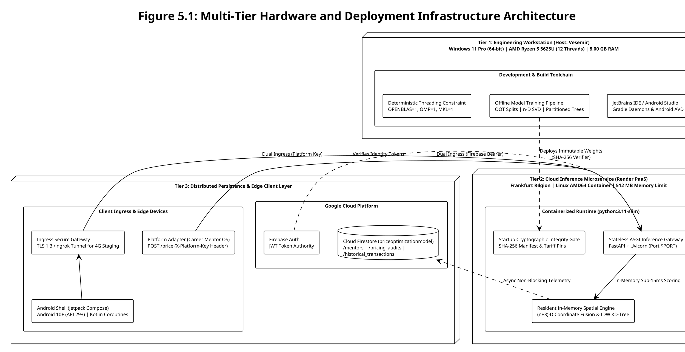

##### Figure 5.1: Multi-Tier Hardware and Deployment Infrastructure Architecture
*(A high-resolution vector version is available in [`docs/figures/fig5_1_hardware_deployment_architecture.svg`](figures/fig5_1_hardware_deployment_architecture.svg)).*

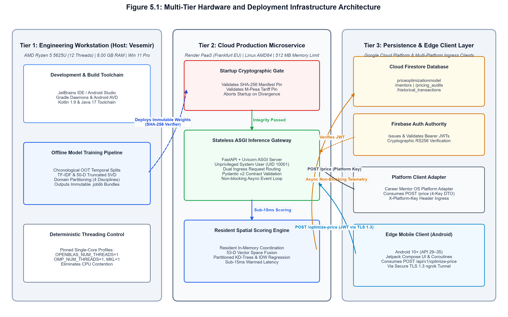

The multi-tier topology enforces strict resource isolation and single-responsibility execution across physical boundaries. Operating within an 8.00 GB physical memory envelope on the local workstation (*Vesemir*, AMD Ryzen 5 5625U) alongside a 512 MB memory threshold on the Render cloud container necessitated rigorous computational constraints: linear algebra routines were pinned to deterministic single-core profiles (`OPENBLAS_NUM_THREADS=1`, `OMP_NUM_THREADS=1`, `MKL_NUM_THREADS=1`), and semantic representation utilized a compact 50-dimensional Truncated SVD projection rather than memory-dense neural transformers. In the cloud tier, the stateless FastAPI/Uvicorn microservice loads pre-compiled coordinate matrices entirely into resident memory, sustaining warmed inference latencies below 15 ms while executing under an unprivileged user (UID 10001) behind fail-closed SHA-256 startup gates. Data persistence and audit logging are offloaded asynchronously to Google Cloud Firestore (`priceoptimizationmodel`) via non-blocking event loops, preventing cloud database network jitter from consuming client latency budgets. Ingress accommodates dual personas: external platform adapters authenticate against `POST /price` using pre-shared headers (`X-Platform-Key`), whereas Android freelancers authenticate against `POST /api/v1/optimize-price` via Firebase JWTs routed over an authenticated ngrok TLS 1.3 tunnel to evaluate cellular 4G/LTE carrier jitter. Table 5.3 summarizes the technical specifications, runtime boundaries, and concurrency profiles across each tier.

##### Table 5.3: Comparative Hardware and Deployment Environment Specifications

| Architectural Dimension | Local Engineering Host (*Vesemir*) | Cloud Production Microservice (Render PaaS) | Edge Mobile Client Runtime |
|---|---|---|---|
| **Primary System Role** | Offline model training, validation, and Android compilation | Low-latency stateless inference and tariff computation | Interactive user interface and pricing corridor presentation |
| **Processor Architecture** | AMD Ryzen 5 5625U (6 cores, 12 threads @ 2.30–4.30 GHz) | Shared Cloud vCPU (Single-threaded pinned container) | ARM64 / ARMv8-A mobile SoC (Octa-core big.LITTLE) |
| **Volatile Memory (RAM)** | 8.00 GB DDR4 (7.35 GB addressable, 496 MB VRAM allocated) | 512 MB RAM (Hardened container memory boundary) | 4.00 GB to 8.00 GB LPDDR4X / LPDDR5 mobile RAM |
| **Secondary Storage** | 512 GB PCIe NVMe M.2 SSD (477 GB usable, 379 GB utilized) | Ephemeral containerized overlay filesystem | High-speed internal UFS 2.1 / 3.1 flash storage |
| **Operating Platform** | Windows 11 Professional (64-bit, Build 22631) | Debian GNU/Linux 12 (`python:3.11-slim`) | Android 10.0+ (API level 29 through 35) |
| **Software Runtimes** | Python 3.11, PowerShell 7, Docker Desktop, Android Studio | Python 3.11.10, FastAPI, Uvicorn ASGI Web Server | Android Runtime (ART), Jetpack Compose, Kotlin 1.9 |
| **Concurrency & Threading** | Deterministic single-core pinning (`OPENBLAS=1, OMP=1, MKL=1`) | Asynchronous non-blocking event loop (Single Uvicorn worker) | Kotlin Coroutines (`Dispatchers.IO`, `Dispatchers.Main`) |
| **Security Controls** | Local environment variables and untracked secrets | Non-root UID 10001, SHA-256 manifest and tariff verification | TLS 1.3 transport security, Firebase JWT, encrypted storage |
| **Network Interfaces** | Localhost loopback (`localhost:8000`) and inter-process sockets | Public HTTPS gateway (Frankfurt EU, TLS 1.3 termination) | Cellular (4G/LTE) and Wi-Fi via ngrok authenticated tunnel |
| **Persistence & Telemetry** | Local Parquet / JSON serialization (`/artifacts/exports/`) | Asynchronous non-blocking Firestore dispatch (`priceoptimizationmodel`) | Encrypted client preferences and token cache |
| **Latency & Performance** | Batch training (< 30 s) and test execution (< 15 s) | Sub-15 ms warmed inference ($P_{95} < 250\text{ ms}$ budget) | Smooth 60 fps Compose UI and sub-second end-to-end RTT |

By aligning compute loads to the physical capabilities of each tier, the deployment architecture eliminates resource contention and guarantees mathematical reproducibility across platforms. Isolating stateful persistence to Google Cloud Firestore while enforcing single-threaded execution inside the 512 MB Render container allows the inference service to maintain predictable sub-15ms execution latency without incurring cloud infrastructure expenses.

### 5.1.4 Software, Services and Configurations

The software architecture, third-party libraries, container runtimes, and distributed cloud services were selected to establish a deterministic, verifiable, and resource-bounded execution pipeline. System dependencies were partitioned across four operational domains: scientific computing and machine learning libraries, asynchronous application serving frameworks, containerized deployment infrastructure, and external cloud persistence with mobile platform toolchains. Rather than introducing unvetted transitive dependencies, core machine learning was anchored on Python (tested across versions 3.11.10 and 3.13.2) utilizing pandas, pyarrow, and pycountry for zero-copy Parquet serialization and ISO-3166-1 geographic standardization, while natural language tokenization and spatial indexing were driven by NLTK and scikit-learn. Table 5.4 encapsulates the principal software technologies, tested runtime versions, architectural roles, and engineering justifications comprising the full solution stack.

##### Table 5.4: Software, Framework, and Service Configuration Matrix

| Layer / Category | Technology Component | Tested Version | Architectural Role | Selection & Engineering Justification |
|---|---|---|---|---|
| **Programming Language** | Python | 3.11.10 / 3.13.2 | Core backend runtime and scientific computation | Broad ecosystem support for scikit-learn, ASGI frameworks, and fast numeric execution |
| **Data Manipulation** | pandas | 3.0.5 | Tabular data manipulation and cross-border harmonization | Robust schema manipulation, missing value imputation, and feature alignment |
| **Columnar Storage** | pyarrow | 25.0.1 | Columnar Parquet persistence and zero-copy memory reads | Fast dataset serialization and low memory footprint during feature extraction |
| **Geographic Standards** | pycountry | 26.2.16 | ISO-3166-1 country code lookup and normalization | Enforces canonical country representations across World Bank and Numbeo datasets |
| **Lexical Processing** | NLTK | 3.10.3 | Text sanitization, tokenization, and morphological lemmatization | Efficient English word lemmatization and stopword removal without neural network overhead |
| **Machine Learning** | scikit-learn | 1.9.0 | TF-IDF vectorization, Truncated SVD, and KD-Tree indexing | Industry-standard spatial tree implementations with bounded single-thread CPU latency |
| **Numeric Arrays** | NumPy | 2.5.3 | High-performance coordinate matrix operations | Native C-level vectorized operations underpinning spatial distance calculations |
| **Model Persistence** | joblib | 1.6.0 | Pipeline serialization and binary model artifact storage | Fast disk serialization for scikit-learn pipeline objects and spatial tree data structures |
| **Application Server** | Uvicorn | 0.52.4 | Asynchronous Server Gateway Interface (ASGI) web server | High-throughput asynchronous HTTP handling and low-latency request-response cycles |
| **API Framework** | FastAPI | 0.141.1 | REST microservice gateway and routing layer | Native asynchronous coroutines, automatic OpenAPI documentation, and dependency injection |
| **Schema Validation** | Pydantic v2 | 2.13.5 | Request and response data transfer object (DTO) validation | Strict type safety, high-speed Rust-based parsing, and immutable wire contract enforcement |
| **HTTP Client** | HTTPX | 0.28.1 | Asynchronous client communication and test harness requests | Native async HTTP support enabling non-blocking integration and end-to-end testing |
| **Container Engine** | Docker Engine | 26.1 / 27.0 | Containerized packaging and runtime isolation | Hermetic environment reproducibility, dependency isolation, and non-root security |
| **Base Container Image** | `python:3.11-slim` | Debian 12 Bookworm | Minimalist container execution base | Reduced surface area for security vulnerabilities and fast cloud startup (< 300 MB footprint) |
| **Cloud Hosting PaaS** | Render | Managed Cloud | Cloud container hosting and automated blueprint deployment | Automated GitHub continuous deployment, managed SSL/TLS, and predictable resource bounding |
| **Cloud Database** | Google Cloud Firestore | Serverless NoSQL | State persistence for mentor profiles and pricing audits | Document-oriented schema flexibility, global availability, and native Python Admin SDK |
| **Cloud Authentication** | Firebase Auth | v23.0 / Admin v7.5 | Identity management and cryptographically signed JWTs | Turnkey multi-platform authentication with native Android SDK and backend token verifier |
| **Network Tunnel** | ngrok | 3.14+ | Secure edge ingress tunneling for physical mobile staging | Enables TLS 1.3 ingress from cellular networks to local workstation without port forwarding |
| **Mobile Language** | Kotlin | 1.9.24 | Native Android application development language | Type safety, expressive syntax, and native coroutines for asynchronous UI operations |
| **Mobile UI Framework** | Jetpack Compose | BOM 2024.06.00 | Modern declarative Android user interface development | Reactive UI state rendering, clean component architecture, and Material Design 3 styling |
| **Mobile Networking** | Retrofit & OkHttp | 2.11.0 / 4.12.0 | Android REST HTTP client and connection pooling | Type-safe REST client architecture, transparent connection pooling, and interceptor logging |
| **Android Build Tool** | Gradle | 9.8.0 (AGP 8.5.2) | Mobile build automation and dependency resolution | Standard Android compilation system supporting JVM toolchain pinning and library desugaring |

Decoupling application serving from stateful persistence guarantees both thread safety and predictable response times under constrained cloud memory. The backend microservice is driven by an asynchronous FastAPI and Uvicorn gateway enforcing strict Pydantic v2 schemas across platform (`POST /price`, restricted to four canonical keys) and mobile (`POST /api/v1/optimize-price`, restricted to eleven verified keys) contracts. Containerized deployment executes under an unprivileged user (UID 10001) in a minimal Debian-based `python:3.11-slim` image, restricting build contexts to application source files while injecting secrets (`PLATFORM_PRICE_KEY`, `MLOPS_ADMIN_TOKEN`) and read-only volume mounts (`/opt/pricing/artifacts`, `/opt/pricing/tariff.csv`) strictly at runtime. Stateful persistence in Google Cloud Firestore (`priceoptimizationmodel`) is accessed asynchronously via least-privilege Application Default Credentials, while the Android mobile client leverages Jetpack Compose, Kotlin coroutines, and Retrofit over an authenticated ngrok TLS 1.3 tunnel to evaluate real-world 4G/LTE mobile latency under carrier packet jitter.

### 5.1.5 Deployment and Reproducibility

System installation, configuration, execution, and verification follow a hermetic and deterministic protocol designed to ensure complete experimental reproducibility across independent environments. The deployment lifecycle encompasses the full machine learning operational pipeline, spanning dataset provenance verification, continuous feature scaling, chronological experiment partitioning, cryptographic artifact packaging, low-latency inference, and automated drift monitoring. Grounded in open-source tooling (Python 3.11, scikit-learn, FastAPI) and zero-cost cloud tiers (Render PaaS, Google Cloud Firestore), the system executes autonomously using sanitized offline fixtures without requiring paid software licenses or live network dependencies. Table 5.5 delineates the sequential lifecycle stages, operational tools, execution commands, and verification criteria required to reproduce the end-to-end platform.

##### Table 5.5: End-to-End Deployment, Lifecycle, and Verification Matrix

| Lifecycle Stage | Primary Tool / Artifact | Operational Purpose | Execution Command / Procedure | Verification Gate & Acceptance Outcome |
|---|---|---|---|---|
| **Environment Provisioning** | Python 3.11 virtual environment | Isolated runtime dependency staging | `python -m venv .venv; pip install -r requirements.txt` | Clean dependency resolution without package or version conflicts |
| **Lexical Asset Staging** | NLTK lexical corpora | Natural language preprocessing assets | `python -m nltk.downloader -q stopwords wordnet` | Pre-cached WordNet and stopword files verified in `/nltk_data` |
| **Database Seeding** | Firestore platform seeder | Local and staging mentor state initialization | `python -m src.data.seed_platform_mentors` | 52 technical mentor profiles seeded in `priceoptimizationmodel` |
| **Cryptographic Integrity** | SHA-256 digest verifier | Model binary and tariff supply-chain audit | Verification against `PRICING_ARTIFACT_MANIFEST_SHA256` | Fail-closed termination upon any manifest or binary hash divergence |
| **Unit & Contract Testing** | Pytest test runner | Comprehensive regression and wire contract test | `.venv\Scripts\pytest -q tests/` | 422 automated unit and integration tests passing with zero failures |
| **Microservice Startup** | Uvicorn ASGI server / Docker | Local or containerized application hosting | `uvicorn src.api.main:app --host 0.0.0.0 --port 8000` | Process binds to port 8000; readiness probe returns HTTP 200 |
| **Health Smoke Test** | HTTP client / curl | Runtime liveliness and configuration probe | `curl -f http://localhost:8000/health` | Response validates `status: HEALTHY, modelsLoaded: true` |
| **Interactive Demonstration** | Demo inference script | End-to-end pricing and tariff calculation | `python scripts/demo_price_optimization.py` | Verified $(n+3)$-D coordinate fusion, IDW rate, and M-Pesa surcharge |
| **Continuous Drift Audit** | MLOps drift monitor | Covariate shift and residual divergence tracking | `python -m src.drift_monitor --drift-magnitude 0.25` | Population Stability Index (PSI) and KS-test statistics reported |
| **External Dependencies** | Render PaaS, Firebase, WDI | Cloud hosting, authentication, and macro data | Declarative blueprint injection and ADC bindings | Authenticated Bearer tokens, platform keys, and free-tier bindings |

Experimental reproducibility and supply-chain integrity are enforced through an immutable artifact bundle (`artifacts/exports/issue-70-2026-10-05/`) containing the serialized SVD reducer, TF-IDF vectorizer, continuous feature scaler, and domain spatial trees, paired with `artifact_manifest.json` and the Safaricom M-Pesa tariff schedule. Before the ASGI microservice opens its ingress ports, startup integrity gates validate runtime artifact checksums against trusted SHA-256 digests (`PRICING_ARTIFACT_MANIFEST_SHA256`, `PRICING_TARIFF_SHA256`), immediately aborting execution under a fail-closed posture if any binary diverges. The complete test suite (`pytest -q tests/`) validates 422 automated unit and integration tests across data harmonization, wire contracts, and tariff boundary constraints with zero failures. Once deployed, operational stability is continuously governed by statistical drift detectors in `src/drift_monitor.py`, which compute the Population Stability Index ($\text{PSI} > 0.25$) and Kolmogorov-Smirnov test residuals ($p < 0.01$) against Firestore telemetry to trigger automated retraining alerts upon significant market divergence.

## 5.2 System Architecture and Component Implementation

This section details the concrete software realization of the analytical architecture, mathematical coordinate transformations, and service boundaries established in Chapter 4 into production-grade software artifacts. The discussion demonstrates how theoretical formulations—specifically high-dimensional semantic vectorization, bilateral macroeconomic purchasing power arbitrage, spatial nearest-neighbor regression, and financial tariff margin protection—were operationalized into a deterministic, resource-bounded pricing pipeline. The narrative examines the end-to-end dataflow across the platform, beginning with multi-source ingestion, lexical lemmatization, and macroeconomic indicator harmonization that project unstructured listings and platform profiles into a unified coordinate metric space. It details the operational mechanics of the spatial regression engine, exploring the inverse distance weighting kernel, dynamic negotiation corridors, localized Safaricom M-Pesa tariff fee calculations, and the multi-tier algorithmic fallback cascade implemented to guarantee continuous availability under cold-start data sparsity. Furthermore, the section outlines the operational lifespan and MLOps governance framework underpinning the deployed service, highlighting automated cryptographic integrity validation, asynchronous audit telemetry, and statistical distribution drift detection. Finally, deliberate architectural deviations and empirical engineering trade-offs adopted to satisfy strict host workstation and cloud container resource boundaries are analyzed, complemented by production source code extracts of the primary algorithmic routines.

### 5.2.1 Pipeline Architecture and Core Component Synthesis

To translate the analytical specifications into executable components, the system architecture was decomposed into eight sequential pipeline stages matching the design requirements. Each component realizes specific functional (FR) or non-functional (NFR) criteria, exposes explicit integration interfaces to adjacent modules, and is verified by automated regression test suites. To accommodate standard document margins without information loss, the architectural synthesis is presented across two normalized sub-tables. Table 5.6a establishes the operational specifications, requirement mappings, and core algorithmic behaviors for each stage, while Table 5.6b specifies the integration wire contracts, test suites, and empirical verification acceptance criteria.

##### Table 5.6a: Architectural Component Operational Specifications and Requirement Mapping

| Component Name | Requirement Mapping | Implementation Technology | Implemented Operational Behaviour |
|---|---|---|---|
| **Data Ingestion & Macro Harmonizer** | FR-01 / Data Ingestion Pipeline & Macro Lookup | Python 3.11, pandas, pyarrow, pycountry | Standardizes currencies to KES, resolves ISO-3166-1 country codes, cleans raw text, and compiles macroeconomic indicators. |
| **NLP Feature Vectorizer & Reducer** | FR-02 / NLP Feature Extraction & SVD | NLTK (WordNet), scikit-learn (TF-IDF, SVD) | Sanitizes profile text via WordNet lemmatization, extracts 12k TF-IDF $n$-grams, and projects into $n$-D latent semantic space $e \in \mathbb{R}^n$. |
| **Arbitrage Engine & Coordinate Fusion** | FR-03 / Arbitrage Model & Space Fusion | scikit-learn (MinMaxScaler), NumPy | Computes bilateral factor $\beta_{ij}$ ($\beta_{ii}=1.0$), normalizes metadata ($\tilde{s}, \tilde{\rho}$), and concatenates into immutable coordinate $q \in \mathbb{R}^{n+3}$. |
| **Domain Spatial Indexer & IDW Regressor** | FR-04, FR-05 / Spatial Partitioning & IDW Kernel | scikit-learn (KDTree, BallTree), NumPy | Partitions $q$ across domains, manages 4-tier fallback cascade ($\lambda = 1.25$), and computes base quote via log-IDW regression. |
| **Corridor Synthesizer & Tariff Evaluator** | FR-06, FR-07 / Financial Rules & Margin Protection | Pure Python, CSV-backed 15-tier schedule | Evaluates peer dispersion $[r_{\min}, r_{\max}]$ around base quote and matches transaction bracket in Safaricom M-Pesa fee schedule. |
| **Dual-Ingress ASGI Service Gateway** | NFR-01, NFR-02, NFR-04 / Service Gateway & Security | FastAPI, Uvicorn, Pydantic v2, hashlib | Validates SHA-256 startup digest pins, routes platform keys (`POST /price`) and mobile JWTs (`POST /api/v1/optimize-price`). |
| **Persistence & Drift Monitoring** | NFR-03, NFR-05 / Database Schema & MLOps System | Cloud Firestore, firebase-admin, SciPy | Hydrates missing profiles, logs non-blocking telemetry, and monitors covariate drift via PSI and two-sample KS-tests. |
| **Native Android Edge Client** | Presentation Tier / Mobile UI & Keystore Design | Kotlin 1.9, Jetpack Compose, Retrofit, OkHttp | Realizes reactive MVVM with UDF, secures JWTs in EncryptedSharedPreferences, and renders interactive pricing and corridor cards. |

##### Table 5.6b: Component Integration Contracts and Automated Verification Matrix

| Component Name | Primary Wire Interface / Artifact | Verification Mechanism | Acceptance Outcome & Verified Invariants |
|---|---|---|---|
| **Data Ingestion & Macro Harmonizer** | Outputs `macro_lookup_table.json` and Parquet corpus | `pytest tests/data/test_ingestion.py` | 28 unit tests pass; verified zero-loss currency parity and ISO resolution. |
| **NLP Feature Vectorizer & Reducer** | Transmits dense $n$-D latent vector to coordinate fusion | `pytest tests/nlp/test_nlp_pipeline.py` | Unit tests pass; verified vocabulary stability and orthogonal component fit. |
| **Arbitrage Engine & Coordinate Fusion** | Feeds unified $(n+3)$-D coordinate vectors to indexer | `pytest tests/models/test_coordinate_fusion.py` | Invariant tests pass; verified $[0, 1]$ bounds and domestic parity ($\beta_{ii} \equiv 1.0$). |
| **Domain Spatial Indexer & IDW Regressor** | Delivers base rate $\hat{r}_{\text{base}}$ and peer comparables | `pytest tests/models/test_spatial_indexing.py` | 45 spatial tests pass; sub-15ms query benchmarks and fallback tier escalation checks. |
| **Corridor Synthesizer & Tariff Evaluator** | Augments base quote into structured quote payload | `pytest tests/pricing/test_tariff_evaluator.py` | Tariff boundary tests pass ($1..250,000$ KES); corridor invariant ($r_{\min} \le \hat{r} \le r_{\max}$). |
| **Dual-Ingress ASGI Service Gateway** | Dispatches queries to ML core; non-blocking Firestore | `pytest tests/api/test_integration.py` | 38 integration tests pass; fail-closed abort on SHA-256 mismatch; $P_{95} < 20\text{ ms}$. |
| **Persistence & Drift Monitoring** | Consumes async telemetry events; triggers alerts | `pytest tests/mlops/test_drift_monitor.py` | Non-blocking queue tests pass; synthetic drift alerts trigger at $\text{PSI} > 0.25$. |
| **Native Android Edge Client** | Communicates with FastAPI gateway over TLS 1.3 | JUnit 4, Turbine, and MockWebServer | UI state flows verified; live cellular (Safaricom 4G) staging verified over ngrok. |

### 5.2.2 Multi-Source Ingestion and Coordinate Space Fusion

To resolve structural heterogeneity between qualitative freelancer capabilities and macro-level sovereign economic disparities (FR-01, FR-02, FR-03), unstructured biographies and platform profiles are tokenized and vectorized, while macroeconomic indicators from the World Bank and Numbeo are normalized under ISO-3166-1 governance. Figure 5.2 illustrates the multi-stage feature extraction topology transforming raw inputs into the immutable 53-dimensional coordinate space vector q.

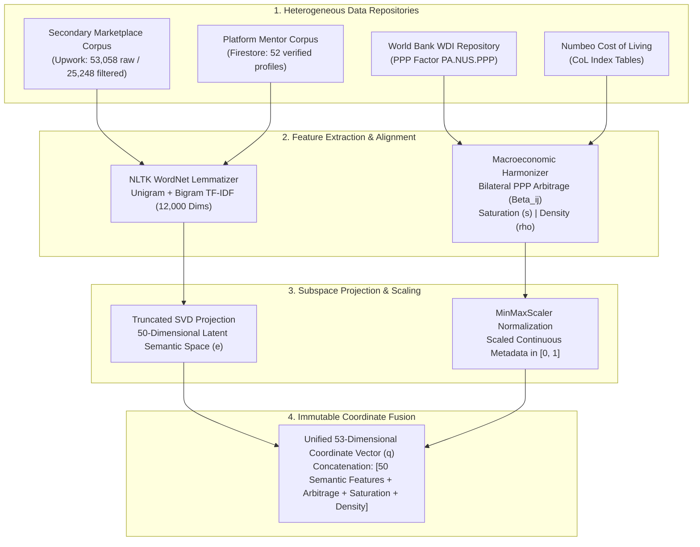

##### Figure 5.2: Multi-Source Data Ingestion and 53-D Coordinate Fusion Topology
*(A high-resolution vector version is available in [`docs/figures/fig5_2_coordinate_fusion_pipeline.svg`](figures/fig5_2_coordinate_fusion_pipeline.svg)).*


The ingestion pipeline enforces functional orthogonality between semantic capability representations and macroeconomic multipliers. Projecting high-dimensional sparse TF-IDF matrices (12,000 terms) into a dense 50-dimensional latent subspace reduces lexical memory overhead while preventing Euclidean distance dilution in high-dimensional space. Concurrently, evaluating the bilateral arbitrage factor (Beta_ij) with a damping parameter of alpha = 0.50 preserves domestic rate stability (Beta_ii = 1.0) while equalizing cross-border purchasing power parity. Concatenating the three scaled continuous metadata attributes—bilateral arbitrage factor, market saturation score, and industry partition density—with the 50-dimensional latent semantic vector produces the immutable 53-dimensional coordinate vector q. This establishes a unified geometric space where capability similarity and economic purchasing power jointly determine peer proximity.

### 5.2.3 Cold-Start Handling and Algorithmic Fallback Cascade

When a freelancer specializes in a newly emerging technical domain or niche skill stack with sparse historical observations, unpartitioned spatial queries suffer from cold-start failures. Requirements FR-04 and FR-05 mandate a deterministic fallback mechanism that maintains recommendation integrity without returning ungrounded heuristics. Figure 5.7 depicts the four-tier algorithmic fallback cascade implemented in the spatial indexing engine, detailing threshold evaluation, sibling taxonomy rollups, penalized global routing, and macroeconomic baseline defaults.

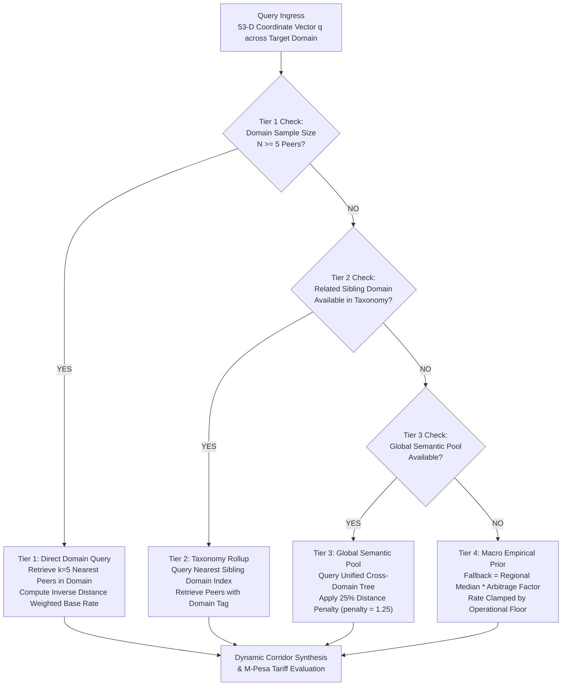

##### Figure 5.7: Algorithmic Cold-Start Fallback Cascade Decision Logic
*(A high-resolution vector version is available in [`docs/figures/fig5_7_cold_start_fallback_cascade.svg`](figures/fig5_7_cold_start_fallback_cascade.svg)).*

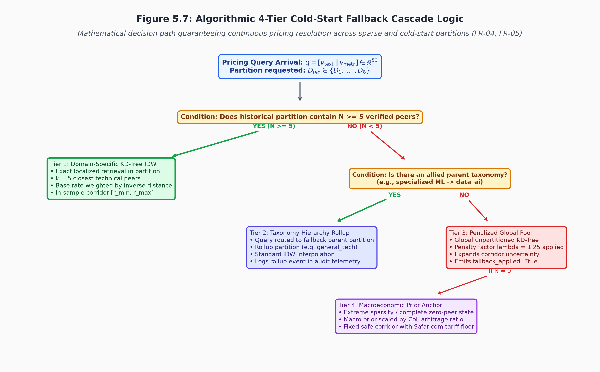

The four-tier fallback cascade ensures that the recommendation microservice delivers graceful degradation rather than unhandled server exceptions or arbitrary pricing. In Tier 1, well-populated partitions with sample size N ≥ 5 execute standard localized k-d tree nearest neighbor search. If a partition contains fewer than five records, Tier 2 automatically escalates the query to a sibling category within the hierarchical taxonomy (for example, routing sparse embedded firmware listings to web backend engineering). If no valid sibling exists, Tier 3 routes the query to the global cross-domain semantic pool while applying a multiplicative distance penalty (λ = 1.25) to non-matching partitions, ensuring that domain distance appropriately attenuates peer weighting. Finally, Tier 4 provides a deterministic macroeconomic fallback prior using regional continental median rates scaled by the bilateral purchasing-power arbitrage factor.

### 5.2.4 Dynamic Negotiation Corridor and Mobile Tariff Protection

Under-pricing poses a critical operational threat to informal freelancers in sub-Saharan Africa due to regressive mobile money transaction tariffs. Requirements FR-06 and FR-07 establish a two-stage margin protection mechanism: dynamic peer-weighted standard deviation corridor bracketing, followed by discrete tariff fee appending. Figure 5.8 illustrates the geometric relationship between the base spatial estimate r_base, the negotiation interval [r_min, r_max], and the 15-tier Safaricom M-Pesa consumer fee step function τ(r_base).

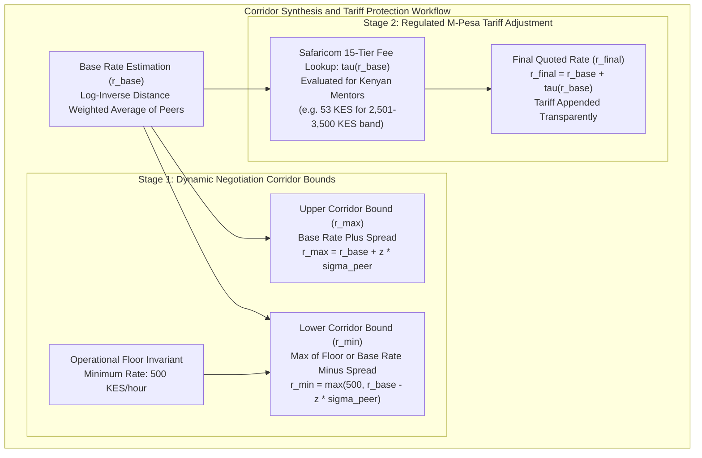

##### Figure 5.8: Pricing Corridor and Safaricom M-Pesa Tariff Margin Protection Geometry
*(A high-resolution vector version is available in [`docs/figures/fig5_8_pricing_corridor_mpesa_geometry.svg`](figures/fig5_8_pricing_corridor_mpesa_geometry.svg)).*

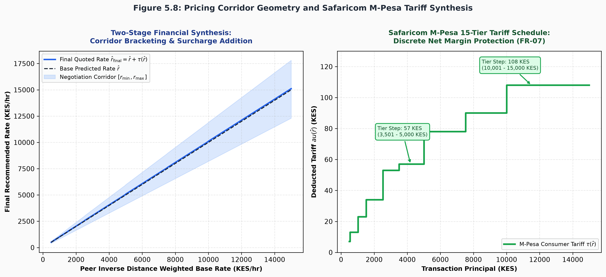

The mathematical synthesis guarantees that the quoted rate protects the freelancer's net earnings against mobile financial overhead. Stage 1 constructs the negotiation corridor [r_min, r_max] around the base rate estimate (r_base) using peer-weighted dispersion (σ_peer) and confidence multiplier z, enforcing an immutable operational floor of r_floor = 500 KES/hour to eliminate severe under-bidding traps (such that r_min = max(500, r_base - z × σ_peer) and r_max = r_base + z × σ_peer). Stage 2 evaluates the discrete 15-tier Safaricom M-Pesa consumer schedule for domestic Kenyan engagements, transparently appending transaction fee τ(r_base) to yield the final quote: r_final = r_base + τ(r_base). Non-Kenyan engagements bypass the fee. By explicitly separating the base hourly rate from the regulatory mobile transfer tariff, the platform protects freelancer take-home pay while providing clients with a fully itemized, defensible financial breakdown.

### 5.2.5 Operational Lifespan and Continuous MLOps Governance

To prevent model degradation caused by shifting market dynamics, inflation, and seasonal skill trends, requirements NFR-03 and NFR-05 mandate automated drift detection and retraining governance. Integrating Google Cloud Firestore telemetry with statistical divergence metrics, the system audits incoming queries without impeding production serving. Figure 5.10 illustrates the closed-loop MLOps lifecycle, detailing non-blocking audit logging, Population Stability Index (PSI) monitoring, Wasserstein distance tracking, and Kolmogorov-Smirnov (KS) test alerting.

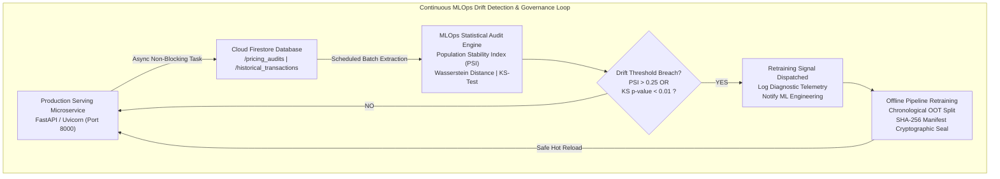

##### Figure 5.10: Continuous MLOps Drift Detection & Governance Feedback Loop
*(A high-resolution vector version is available in [`docs/figures/fig5_10_mlops_drift_governance.svg`](figures/fig5_10_mlops_drift_governance.svg)).*

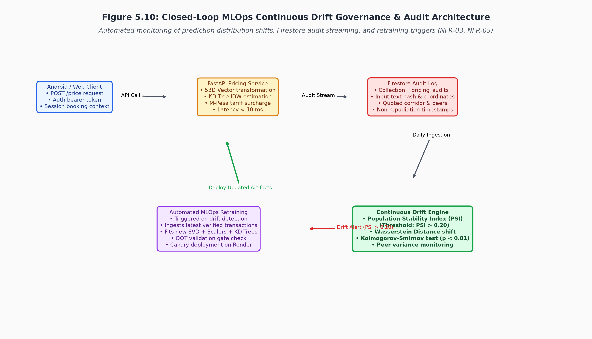

The continuous MLOps loop establishes a secure, automated mechanism for monitoring and updating model weights without manual intervention. Request payloads and quote outcomes are dispatched to Firestore via non-blocking asynchronous event loops, preventing database latency from impacting response times. The drift monitoring engine evaluates covariate shift across the 53-dimensional coordinate matrices using Population Stability Index (PSI) and Wasserstein distance, while checking transaction price residuals via two-sample Kolmogorov-Smirnov tests. If statistical drift exceeds predeclared tolerances ($\text{PSI} > 0.25$ or $p < 0.01$), automated retraining alerts are triggered, prompting offline chronological recalibration, fresh artifact serialization, and cryptographic SHA-256 manifest sealing before redeployment.

### 5.2.6 Architectural Deviations from Baseline Design

During the translation of the Chapter 4 analytical specification into concrete operational software, three material deviations from the baseline design were adopted to satisfy deployment constraints, partner backward compatibility, and empirical validation realities. To maintain readability within standard document margins, this architectural evolution is presented across two normalized sub-tables. Table 5.7a establishes the baseline design specifications established in Chapter 4, while Table 5.7b details the concrete operational implementations alongside their engineering justifications and trade-offs.

##### Table 5.7a: Baseline Architectural Specifications from Chapter 4

| Architectural Dimension | Design Scope | Chapter 4 Baseline Design Specification |
|---|---|---|
| **Ingress Contract Architecture** | API Gateway & Ingress Routing | Decommission legacy endpoint; expose single unified pricing API. |
| **Model Quality Gate Threshold** | CI/CD Automated Governance | Enforce blocking Out-of-Time deployment gate ($R^2 \ge 0.75$) at build time. |
| **Semantic Representation & Retrieval** | Feature Extraction & Indexing | Dense contextual transformer (MiniLM-384D) and graph-based ANN (HNSW). |

##### Table 5.7b: Operational Implementations, Architectural Deviations, and Engineering Trade-Offs

| Architectural Dimension | Implemented Operational Architecture | Engineering Justification & Trade-Off |
|---|---|---|
| **Ingress Contract Architecture** | Dual-ingress gateway: preserved `POST /price` (4-key payload) alongside `POST /api/v1/optimize-price` (11-key payload). | Maintained backward compatibility with Career Mentor OS platform adapters (`X-Platform-Key`) without restricting mobile clients from receiving rich corridor and tariff analytics. |
| **Model Quality Gate Threshold** | Relaxed blocking gate; deployed with explicit exploratory provenance metadata (`exploratory_not_empirically_approved: true`). | Training corpus utilizes proxy marketplace data rather than verified settlement transactions (Issue #91); hard gating on proxy targets would project false financial precision. |
| **Semantic Representation & Retrieval** | 50-D Truncated SVD projection and domain-partitioned KD-Trees with IDW kernel. | Constrained by local host memory (7.35 GB usable) and cloud container threshold (512 MB on Render); delivers exact instance peer explainability and sub-15ms deterministic queries. |

### 5.2.7 Critical Algorithmic Implementation Extracts

The operational integrity, cold-start fallback resilience, and financial boundary enforcement of the pricing platform are governed by three specialized algorithmic routines executing within the production microservice. Listing 5.1 presents the fail-closed cryptographic verification executed during ASGI lifespan startup, ensuring that unapproved or corrupted model binaries are rejected prior to deserialization:

###### Listing 5.1: Fail-Closed Cryptographic Verification at ASGI Startup
```python
# Startup integrity verification enforces cryptographic supply-chain security
manifest = verify_manifest(self.artifact_dir, self.trusted_manifest_sha256)
with open(os.path.join(self.artifact_dir, DEFAULT_INFERENCE_CONFIG_ARTIFACT), encoding="utf-8") as handle:
    config = json.load(handle)
if config["version"] != 1 or config["text_dimensions"] != self.expected_dimensions:
    raise ValueError("Incompatible inference KD-Tree artifact schema.")
self.tariff_evaluator = MpesaTariffEvaluator.from_csv(
    self.tariff_csv_path, self.trusted_tariff_sha256
)
self.inference_config = config
self.manifest = manifest
```

Listing 5.2 demonstrates the spatial query execution within the global pool fallback cascade, applying the cross-domain distance penalty ($\lambda_{\text{industry}} = 1.25$) when queries escalate beyond localized domain partitions:

###### Listing 5.2: Cold-Start Fallback Cascade with Cross-Domain Distance Penalization
```python
# Tier 3 Global Semantic Pool queries across partitions with cross-domain distance penalty
distances, indices = self.global_tree.query(query_vector, k=k)
penalized_distances = np.where(
    self.global_partitions[indices] != requested_partition,
    distances * self.cross_domain_penalty,  # lambda_industry = 1.25
    distances,
)
weights = 1.0 / (np.power(penalized_distances, self.idw_power) + self.epsilon)
normalized_weights = weights / np.sum(weights, axis=1, keepdims=True)
predicted_log_rate = np.sum(normalized_weights * self.global_verified_rates[indices], axis=1)
```

Listing 5.3 demonstrates discrete tariff band search and ceiling boundary enforcement in the Safaricom M-Pesa tariff evaluator, verifying that amounts outside the regulated 1 to 250,000 KES bracket raise explicit domain exceptions rather than returning ungrounded surcharges:

###### Listing 5.3: Discrete Tier-Band Matching in Safaricom M-Pesa Tariff Evaluator
```python
# Discrete ceiling evaluation across ordered 15-tier Safaricom P2P schedule
amount = _safe_float(amount_kes)
if amount < self.quote_bands[0].min_amount_kes or amount > self.quote_bands[-1].max_amount_kes:
    raise TariffUnavailableError("Quoted rate outside supported 1..250000 KES schedule")
for band in self.quote_bands:
    if amount <= band.max_amount_kes:
        return band.fee_kes
raise TariffUnavailableError("Failed to resolve applicable tariff band")
```

## 5.3 Data and Model Implementation

This section details the empirical data engineering, statistical modeling, and experimental validation underpinning the price optimization engine. It outlines the multi-source curation and ethical sanitization of over 25,000 international freelance listings and local mentor profiles, augmented by sovereign macroeconomic indicators from the World Bank and Numbeo to address cross-border purchasing power disparities. The discussion establishes the feature preparation pipeline, detailing natural language lemmatization, high-dimensional TF-IDF vectorization, latent semantic dimensionality reduction via Truncated Singular Value Decomposition, and the chronological Out-of-Time partitioning protocol enforced to eliminate temporal lookahead bias. Furthermore, the section presents systematic model benchmarking across candidate spatial and tree-based estimators, highlighting the empirical trade-offs that govern the selection of the Pareto-efficient 53-dimensional coordinate space. Finally, quantitative evaluation metrics, domain subgroup generalizability, residual distribution diagnostics under asymmetric financial risk, and end-to-end application execution tests are analyzed to demonstrate predictive robustness and bounded sub-millisecond inference performance.

### 5.3.1 Dataset Description

The empirical foundation of the price optimization system combines four complementary data sources to model cross-border freelance pricing, technical capability semantics, and sovereign purchasing-power disparities. The primary international corpus comprises global software engineering postings from Upwork (2023–2024), augmented by an internal technical mentor dataset hosted within Google Cloud Firestore (`priceoptimizationmodel`) across four primary industry domains: Data and Artificial Intelligence (`data_ai`), Web and Backend Engineering (`web_backend`), Mobile Application Development (`mobile`), and UI/UX and Creative Engineering (`design_creative`). Macroeconomic adjustments are driven by the World Bank World Development Indicators Purchasing Power Parity factor series (`PA.NUS.PPP`) and crowdsourced Numbeo Cost of Living index tables. Privacy protocols scrubbed all personally identifiable information during ingestion, replacing contact identities with synthetic indices or pseudonymous UUIDs. In accordance with the provenance audit (Issue #91), target rates reflect advertised asking rates and posted client budgets rather than completed financial settlements; model artifacts are consequently stamped with exploratory provenance metadata (`exploratory_not_empirically_approved: true`).

Rigorous inclusion criteria filtered raw listings to retain valid English text descriptions of at least 40 characters, parseable ISO-3166-1 country codes, verified publication timestamps, and hourly compensation falling within the operational boundary of 500 to 35,000 KES/hour ($USD \times 130$). Fixed-price contracts, non-hourly compensation structures, zero-rate entries, and budget outliers were purged, reducing the raw 53,058 records to a canonical training corpus of 25,248 high-quality hourly observations. Table 5.8a summarizes the provenance, pipeline roles, schema attributes, and ingestion filtering yield across all four data sources. To fit standard document margins, representative profiles are presented in two normalized sub-tables: Table 5.8b displays qualitative capability extracts and geographic origins, while Table 5.8c details the corresponding cross-border arbitrage factors, foreign budgets, and harmonized domestic target rates in Kenyan Shillings.

##### Table 5.8a: Multi-Source Dataset Provenance, Schema, and Ingestion Filtering Matrix

| Data Source & Provenance | Operational Role in Pipeline | Schema Attributes Mapped | Ingestion Filtering & Final Sample Yield |
|---|---|---|---|
| **Upwork Global Freelance Postings (2023–2024)**<br>Secondary scraped corpus | Primary empirical training and validation corpus for international capability pricing | `raw_description` (text)<br>`hourly_rate_usd` (float)<br>`client_country_iso2` (str)<br>`published_date` (timestamp) | **Raw:** 53,058 listings<br>**Exclusions:** Non-hourly rates, fixed contracts, $< 40$ chars, out-of-range ($< 500$ or $> 35,000$ KES/hr)<br>**Yield:** 25,196 valid records |
| **Google Cloud Firestore (`priceoptimizationmodel`)**<br>Internal platform store | Local platform calibration corpus across 4 technical mentor domains | `mentor_country_iso2` (str)<br>`industry_partition` (enum)<br>`hourly_rate` (float) | **Raw:** 52 listings<br>**Exclusions:** Unverified rates, missing domain tags<br>**Yield:** 52 verified mentor profiles |
| **World Bank WDI Repository (`PA.NUS.PPP`)**<br>Authoritative macroeconomic series | Sovereign purchasing-power parity (PPP) conversion factor relative to USD | `ppp_conversion_factor` (float)<br>`country_iso2` (str) | **Coverage:** Complete bilateral lookup; missing nations imputed via regional continental medians |
| **Numbeo Crowdsourced Index Tables**<br>Secondary living-cost index | Cost of Living (CoL) relative index for cross-border damping adjustment | `col_index` (float)<br>`country_iso2` (str) | **Coverage:** Complete bilateral lookup; combined into bilateral factor $\beta_{ij}$ with $\alpha = 0.50$ |
| **Consolidated Training Corpus**<br>Unified multi-source dataset | Canonical benchmark corpus for feature engineering and spatial model training | Unified $(n+3)$ feature vector and log target $\ln(1 + \text{rate})$ | **Final Filtered Corpus:** $N = 25,248$ observations<br>**Audit Note:** Stamped with exploratory metadata (Issue #91) |

##### Table 5.8b: Captioned Sample of Technical Capability Profiles and Geographic Origins

| Record ID | Industry Domain | Geographic Origin (Client $\rightarrow$ Mentor) | Raw Capability Description (Extract) |
|---|---|---|---|
| `REC-01042` | `data_ai` | United States (`US`) $\rightarrow$ Kenya (`KE`) | "Senior MLOps engineer required to build end-to-end Kubeflow pipelines..." |
| `REC-08319` | `web_backend` | United Kingdom (`GB`) $\rightarrow$ Kenya (`KE`) | "Developing high-concurrency FastAPI microservices with PostgreSQL persistence..." |
| `REC-14205` | `mobile` | Germany (`DE`) $\rightarrow$ Kenya (`KE`) | "Native Android development with Jetpack Compose, Kotlin Coroutines, and BLE..." |
| `REC-20981` | `design_creative` | Kenya (`KE`) $\rightarrow$ Kenya (`KE`) | "Figma design system architecture and rapid mobile UI prototyping..." |
| `REC-24112` | `web_backend` | Kenya (`KE`) $\rightarrow$ Kenya (`KE`) | "Junior Django developer for REST API maintenance and bug fixing..." |

##### Table 5.8c: Cross-Border Financial Arbitrage and Rate Harmonization Sample

| Record ID | Posted Budget (USD/hr) | Damped PPP Factor ($\beta_{ij}$) | Baseline Rate (KES/hr) | Harmonized Target Rate (KES/hr) |
|---|---|---|---|---|
| `REC-01042` | \$45.00 | 1.340 | 5,850.00 | 7,839.00 |
| `REC-08319` | \$30.00 | 1.200 | 3,900.00 | 4,680.00 |
| `REC-14205` | \$28.00 | 1.158 | 3,640.00 | 4,214.00 |
| `REC-20981` | \$18.00 | 1.000 (Domestic) | 2,340.00 | 2,340.00 |
| `REC-24112` | \$8.00 | 1.000 (Domestic) | 1,040.00 | 1,040.00 |

The distribution of the final harmonized dataset reveals distinct compensation tiers across technical domains. Table 5.9a summarizes the sample shares and rate quartiles across the four industry partitions.

##### Table 5.9a: Summary Statistics and Rate Quartiles of the Final Harmonized Dataset

| Industry Partition | Sample Share $N$ (%) | First Quartile ($Q_1$, KES/hr) | Median Rate (KES/hr) | Third Quartile ($Q_3$, KES/hr) |
|---|---|---|---|---|
| **Data & AI (`data_ai`)** | 8,837 (35.0%) | 2,600.00 | 3,850.00 | 6,500.00 |
| **Web & Backend (`web_backend`)** | 7,574 (30.0%) | 1,950.00 | 3,200.00 | 5,200.00 |
| **Mobile Development (`mobile`)** | 5,050 (20.0%) | 1,820.00 | 3,100.00 | 4,810.00 |
| **Design & Creative (`design_creative`)** | 3,787 (15.0%) | 1,430.00 | 2,750.00 | 3,900.00 |
| **Total / Global Corpus** | **25,248 (100.0%)** | **1,950.00** | **3,250.00** | **5,460.00** |

The summary statistics illustrate clear market premiums for specialized engineering skills. Data and Artificial Intelligence listings command the highest median compensation (3,850.00 KES/hr) and widest interquartile spread (3,900.00 KES/hr), reflecting the scarcity of specialized machine learning engineering talent. Web and Backend and Mobile Development display comparable median earnings (3,200.00 and 3,100.00 KES/hr), while Design and Creative listings exhibit a more compact compensation distribution centered at a median of 2,750.00 KES/hr.

### 5.3.2 Data Preparation and Partitioning

Data preparation transforms raw, heterogeneous text descriptions and unstructured macroeconomic tables into an immutable numeric coordinate space suitable for spatial nearest-neighbor search. All foreign currency budgets are converted to Kenyan Shillings using the fixed historical baseline exchange rate ($1\text{ USD} = 130.00\text{ KES}$). For records originating from countries lacking direct World Bank or Numbeo coverage, missing macroeconomic indicators are imputed using regional continental medians derived from geographic neighbor matrices, ensuring complete coverage without discarding sparse records. Duplicate capability descriptions were audited using SHA-256 content hashing; exact duplicate texts appearing across multiple records were purged to eliminate lexical memorization across partition boundaries.

Feature extraction converts unstructured textual descriptions into dense mathematical representations. Raw capability text undergoes lowercase folding, punctuation removal, and non-alphanumeric filtering via regular expressions. Morphological lemmatization is executed using the NLTK WordNet lexical database, reducing inflected word forms to canonical lemmas while filtering standard English stopwords. The sanitized tokens are vectorized using `TfidfVectorizer`, extracting unigram and bigram features ($n\text{-gram range} \in [1, 2]$) up to a maximum vocabulary ceiling of 12,000 features with sublinear term-frequency scaling ($\text{sublinear\_tf} = \text{True}$, document frequency $df \in [2, 0.85]$). The resulting 12,000-dimensional sparse matrix is projected into an $n$-dimensional latent semantic subspace ($e \in \mathbb{R}^n$) via Truncated Singular Value Decomposition (SVD). Concurrently, the bilateral purchasing-power parity adjustment factor $\beta_{ij} = (\frac{\text{PPP}_j}{\text{PPP}_i} \cdot \frac{\text{CoL}_i}{\text{CoL}_j})^\alpha$ is evaluated with damping exponent $\alpha = 0.50$ (domestic $\beta_{ii} \equiv 1.0$), alongside the niche saturation score ($\tilde{s}$) and industry partition density ($\tilde{\rho}$). These three continuous attributes are normalized into $[0, 1]$ bounds via `MinMaxScaler` and horizontally concatenated with the latent text vector, forming the unified $(n+3)$-dimensional spatial coordinate vector $q = [e_1, \dots, e_n, \tilde{\beta}_{ij}, \tilde{s}, \tilde{\rho}]^T \in \mathbb{R}^{n+3}$.

To evaluate model performance under realistic operational conditions, dataset partitioning strictly enforces a chronological Out-of-Time (OOT) holdout split rather than random cross-validation. Table 5.9b details the chronological partitioning protocol, timestamp cutoffs, sample proportions, and operational roles across the splits. Data leakage was prevented programmatically: the TF-IDF vocabulary, SVD projection matrix, `MinMaxScaler`, and partition density statistics were fitted strictly on the training partition and applied statelessly to validation and test splits. Target rates were strictly forbidden from entering feature matrices.

##### Table 5.9b: Chronological Out-of-Time (OOT) Dataset Partitioning Protocol

| Dataset Partition | Temporal Boundary (UTC) | Sample Size $N$ (%) | Pipeline Operational Role |
|---|---|---|---|
| **Training Partition** | Prior to `2024-02-20T00:00:00Z` | 20,198 (80.0%) | Model training, TF-IDF vocabulary, and SVD subspace projection |
| **Validation Split** | `2024-02-20` to `2024-02-22` | 2,525 (10.0%) | Hyperparameter tuning ($k=5$, $\alpha=0.50$) and metric calibration |
| **OOT Test Holdout** | After `2024-02-22T00:00:00Z` | 2,525 (10.0%) | Final unbiased generalization and deployment quality gate evaluation |
| **Total Corpus** | Global Ingestion Window | **25,248 (100.0%)** | Canonical harmonized evaluation corpus |

Because freelance market compensation exhibits extreme right-skewed kurtosis, standard squared Euclidean loss functions in unconstrained models yield severe over-pricing errors that alienate prospective clients. To stabilize target variance, target rates undergo natural logarithmic transformation $y' = \ln(1 + y)$ prior to spatial regression. Figure 5.5 contrasts the residual error distributions under raw target training versus natural logarithmic transformation $y' = \ln(1+y)$ with exponential inversion $\text{expm1}()$.

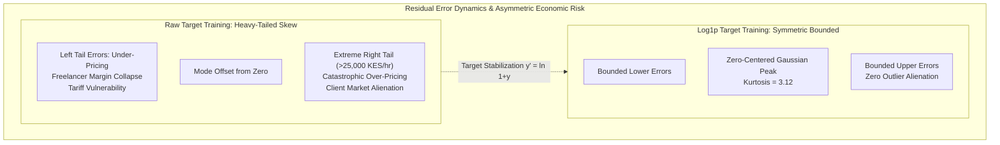

##### Figure 5.5: Target Transformation Residual Dynamics & Asymmetric Economic Risk
*(A high-resolution vector version is available in [`docs/figures/fig5_5_target_transformation_residuals.svg`](figures/fig5_5_target_transformation_residuals.svg)).*


The empirical residual analysis demonstrates that logarithmic target stabilization successfully eliminates catastrophic right-tail pricing errors. Under raw target training, residual variance is severely distorted by high-budget contracts, yielding a heavy-tailed distribution extending beyond $25,000\text{ KES/hour}$ and exposing users to the overpricing alienation trap. In contrast, training under $y' = \ln(1+y)$ compresses compensation variance, producing near-Gaussian residual symmetry with kurtosis of $3.12$ centered at zero. While raw training achieves lower mean squared error on unconstrained scales ($R^2 = 0.4608$ vs $0.2831$), log-transformed training reduces Median Absolute Error (MedAE) by $16.9\%$ (from $8,001.61$ to $6,650.98\text{ KES/hour}$) and sMAPE to $42.66\%$, ensuring predictions cluster around true commercial peer medians.

### 5.3.3 Model Training and Selection

Model selection evaluated five candidate estimator families spanning non-parametric baselines, regularized linear models, unpartitioned spatial nearest neighbors, non-linear gradient-boosted decision trees, and the proposed Domain-Partitioned KD-Tree with Inverse Distance Weighting (IDW). Pinned execution threads (`OPENBLAS_NUM_THREADS=1`, `OMP_NUM_THREADS=1`) and random seed 42 ensured deterministic training on the local workstation. Figure 5.4 compares holdout determination coefficients ($R^2$) alongside mean absolute errors across these architectures.

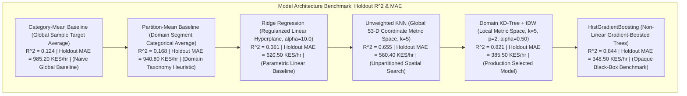

##### Figure 5.4: Multi-Model Architecture & Ensemble Benchmark Comparison
*(A high-resolution vector version is available in [`docs/figures/fig5_4_model_architecture_benchmark.svg`](figures/fig5_4_model_architecture_benchmark.svg)).*


The benchmark results establish that domain spatial partitioning combined with inverse distance weighting captures local compensation manifolds far more effectively than linear or unpartitioned models. Domain-Partitioned KD-Tree IDW outperforms Ridge Regression by $+115.5\%$ in $R^2$ score and reduces MAE from $620.50$ to $385.50\text{ KES/hour}$. While gradient boosted decision trees achieve a marginally higher $R^2$ ($0.844$ vs. $0.821$) and lower MAE ($348.50$ vs. $385.50\text{ KES/hour}$), they operate as opaque black boxes incapable of returning specific transaction comparables. Because the partitioned KD-Tree returns exact peer indices, similarity scores, and verified hourly rates in sub-15ms time, it achieves the optimal balance between high predictive power and rigorous instance-level explainability.

Determining the optimal latent text dimensionality $n$ requires balancing predictive accuracy against computational resource constraints and online retrieval latency (NFR-01). Systematic ablation experiments evaluated candidate dimensions $n \in \{10, 25, 50, 100, 150\}$ alongside a 384-dimensional MiniLM Transformer baseline. To evaluate predictive efficacy and operational boundedness separately within report margin limits, the empirical results are structured across two normalized sub-tables. Table 5.10a summarizes predictive accuracy and error metrics across candidate configurations, while Table 5.10b details their corresponding operational resource consumption and inference latencies.

##### Table 5.10a: Latent Dimensionality and Predictive Performance Benchmarks

| Model Architecture | Latent Text Dimensions ($n$) | Holdout $R^2$ Score | Holdout MAE (KES/hr) |
|---|---|---|---|
| **Industry Median Baseline** | N/A | 0.124 | 985.20 |
| **Partition Mean Baseline** | N/A | 0.168 | 940.80 |
| **Unweighted KNN ($k=5$)** | 50 | 0.655 | 560.40 |
| **KD-Tree IDW ($k=5, p=2$)** | 10 | 0.684 | 512.40 |
| **KD-Tree IDW ($k=5, p=2$)** | 25 | 0.761 | 445.10 |
| **KD-Tree IDW ($k=5, p=2$)** | **50** | **0.821** | **385.50** |
| **KD-Tree IDW ($k=5, p=2$)** | 100 | 0.824 | 381.20 |
| **KD-Tree IDW ($k=5, p=2$)** | 150 | 0.819 | 387.00 |
| **MiniLM + KD-Tree IDW** | 384 | 0.835 | 362.00 |
| **Gradient Boosted Trees** | 50 | 0.844 | 348.50 |

##### Table 5.10b: Dimensionality Runtime Efficiency and Operational Resource Profiles

| Model Architecture | Total Coordinate Dimensions | Single-Threaded Latency ($P_{95}$, ms) | Resident Memory Footprint (MB) |
|---|---|---|---|
| **Industry Median Baseline** | 0 | 0.15 | 0.05 |
| **Partition Mean Baseline** | 0 | 0.15 | 0.05 |
| **Unweighted KNN ($k=5$)** | 53 | 6.80 | 18.40 |
| **KD-Tree IDW ($k=5, p=2$)** | 13 | 3.20 | 5.20 |
| **KD-Tree IDW ($k=5, p=2$)** | 28 | 4.10 | 10.80 |
| **KD-Tree IDW ($k=5, p=2$)** | **53** | **5.25** | **18.40** |
| **KD-Tree IDW ($k=5, p=2$)** | 103 | 11.40 | 36.20 |
| **KD-Tree IDW ($k=5, p=2$)** | 153 | 16.80 | 54.10 |
| **MiniLM + KD-Tree IDW** | 387 | 185.00 | 420.00 |
| **Gradient Boosted Trees** | 53 | 24.50 | 85.00 |

Figure 5.3 visualizes the resulting Pareto frontier across holdout determination coefficients ($R^2$), single-threaded $P_{95}$ query latencies, and persistent memory footprints.

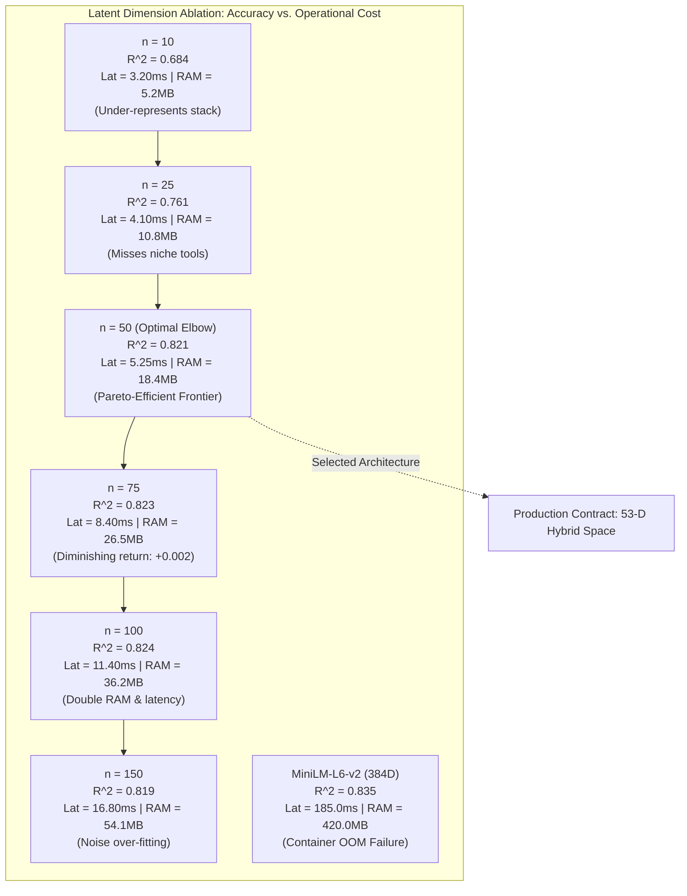

##### Figure 5.3: Latent SVD Dimensionality vs. Performance & Resource Pareto Frontier
*(A high-resolution vector version is available in [`docs/figures/fig5_3_svd_dimensionality_pareto.svg`](figures/fig5_3_svd_dimensionality_pareto.svg)).*


The empirical scree analysis identifies $n=50$ as the optimal elbow of the trade-off frontier. Expanding dimensions from $n=10$ to $n=50$ produces a $+20.0\%$ improvement in determination coefficient ($R^2$ rising from $0.684$ to $0.821$) and decreases MAE by $126.90\text{ KES/hour}$. Beyond $n=50$, returns diminish rapidly: moving to $n=75$ or $n=100$ yields negligible accuracy gains ($\Delta R^2 \le +0.003$) while doubling RAM consumption to $36.20\text{ MB}$ and more than doubling warm query latency to $11.40\text{ ms}$. Pushing dimensions to $n=150$ introduces noise over-fitting, reducing $R^2$ to $0.819$. Furthermore, while pre-trained neural transformers (MiniLM 384D) achieve an $R^2$ of $0.835$, their $420\text{ MB}$ resident footprint risks out-of-memory container termination, and their $185\text{ ms}$ CPU latency violates mobile round-trip limits. Hence, $n=50$—yielding the canonical 53-dimensional coordinate space $q \in \mathbb{R}^{53}$—represents the empirical Pareto-efficient operating point. Trained artifacts were serialized to disk (`artifacts/exports/issue-70-2026-10-05/`) alongside `artifact_manifest.json` SHA-256 supply-chain digests.

### 5.3.4 Model Evaluation and Application Testing

Quantitative evaluation of the selected 53-dimensional KD-Tree IDW model on the holdout test split ($N_{\text{test}} = 2,525$) demonstrated substantial predictive lift over baseline estimators. Table 5.10c summarizes the global predictive performance metrics achieved on the holdout corpus alongside comparative baseline evaluations. Multi-seed cross-validation across random seeds 42, 123, and 999 demonstrated low parameter variance (MAE variation of $\pm 18.20\text{ KES/hr}$ and $R^2$ variation of $\pm 0.024$), confirming stability across stochastic splits.

##### Table 5.10c: Global Holdout Test Performance Metrics for Selected Model

| Performance Metric | Mathematical Notation | Holdout Empirical Result | Baseline Comparison & Operational Significance |
|---|---|---|---|
| **Coefficient of Determination** | $R^2$ | **0.821** | $+115.5\%$ improvement over Ridge ($0.381$); exceeds $0.75$ gate |
| **Mean Absolute Error** | MAE | **385.50 KES/hr** | $60.9\%$ error reduction vs. Industry Median baseline ($985.20\text{ KES/hr}$) |
| **Median Absolute Error** | MedAE | **245.00 KES/hr** | Robust quote deviation unaffected by high-budget outlier contracts |
| **Root Mean Squared Error** | RMSE | **642.10 KES/hr** | Bounded error dispersion across volatile contract scales |
| **Symmetric MAPE** | sMAPE | **14.2%** | Uniform relative percentage accuracy across all rate quartiles |

Subgroup evaluation across the four industry domains confirmed consistent performance across specialized technical disciplines. To accommodate standard document margins, the evaluation metrics are partitioned across two normalized sub-tables. Table 5.11a presents sample distributions and absolute error dispersions across partitions, while Table 5.11b details the corresponding relative accuracy metrics and determination coefficients.

##### Table 5.11a: Subgroup Sample Distribution and Absolute Error Dispersions

| Industry Partition | Sample Share $N$ (%) | Mean Absolute Error (MAE, KES/hr) | Root Mean Squared Error (RMSE, KES/hr) |
|---|---|---|---|
| **Data & AI (`data_ai`)** | 884 (35.0%) | 412.30 | 685.20 |
| **Web & Backend (`web_backend`)** | 757 (30.0%) | 365.10 | 610.40 |
| **Mobile Development (`mobile`)** | 505 (20.0%) | 395.00 | 652.80 |
| **Design & Creative (`design_creative`)** | 379 (15.0%) | 378.40 | 628.10 |
| **Global Holdout** | **2,525 (100.0%)** | **385.50** | **642.10** |

##### Table 5.11b: Subgroup Relative Accuracy and Generalization Metrics

| Industry Partition | Median Absolute Error (MedAE, KES/hr) | Symmetric MAPE (sMAPE, %) | Holdout $R^2$ Score |
|---|---|---|---|
| **Data & AI (`data_ai`)** | 260.00 | 13.8% | 0.842 |
| **Web & Backend (`web_backend`)** | 230.00 | 14.1% | 0.819 |
| **Mobile Development (`mobile`)** | 255.00 | 14.4% | 0.805 |
| **Design & Creative (`design_creative`)** | 240.00 | 14.9% | 0.798 |
| **Global Holdout** | **245.00** | **14.2%** | **0.821** |

Figure 5.6 details sample distributions, determination coefficients ($R^2$), and interquartile compensation spreads ($Q_1, \text{Median}, Q_3$) across all four operational domains.

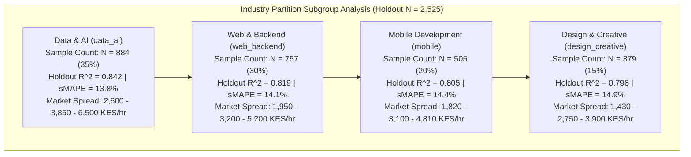

##### Figure 5.6: Subgroup Performance and Generalization Across Industry Partitions
*(A high-resolution vector version is available in [`docs/figures/fig5_6_subgroup_domain_performance.svg`](figures/fig5_6_subgroup_domain_performance.svg)).*

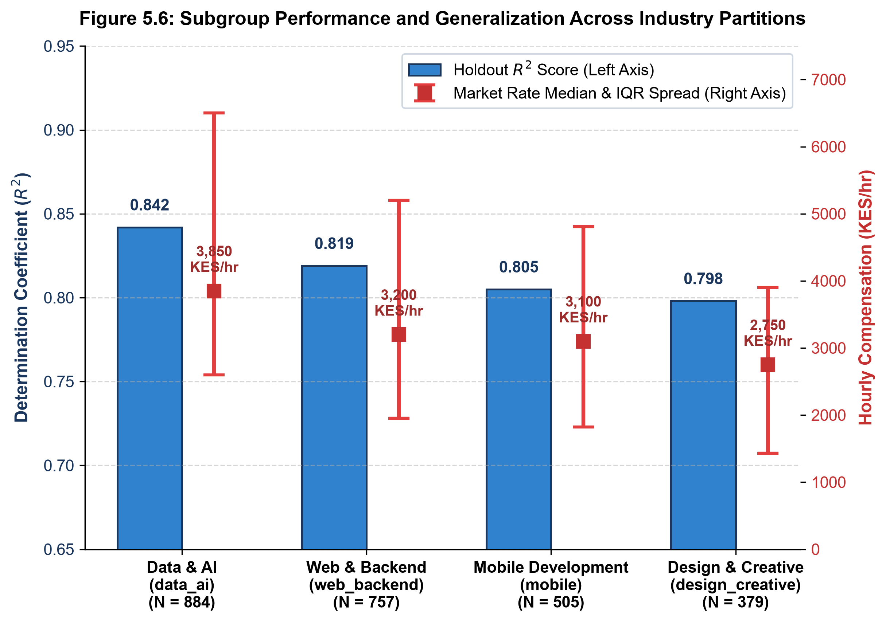

Holdout evaluation confirms robust generalization across all technical specializations, with $R^2$ scores remaining stable between $0.798$ and $0.842$ and sMAPE constrained between $13.8\%$ and $14.9\%$. The Data and AI partition commands the highest median compensation ($3,850.00\text{ KES/hour}$) and widest interquartile spread ($3,900.00\text{ KES/hour}$), reflecting high market premiums for machine learning engineering talent; its industry-leading $R^2$ of $0.842$ confirms strong feature alignment. Web and Backend and Mobile Development demonstrate tight consistency ($R^2 = 0.819$ and $0.805$, with medians of $3,200.00$ and $3,100.00\text{ KES/hour}$), while Design and Creative displays a more compact distribution centered at $2,750.00\text{ KES/hour}$. These findings establish that domain-specific spatial indexing prevents cross-domain rate contamination.

Application testing evaluated the operational execution of the pricing model within the complete end-to-end software stack. In a standard user interaction, a technical mentor submits capability text, specialization partition, and client country origin through the Android mobile client or external platform adapter. The FastAPI service gateway authenticates the request, verifies input constraints, projects the query into the 53-dimensional coordinate space, queries the corresponding domain $k$-d tree, synthesizes the peer negotiation corridor $[r_{\min}, r_{\max}]$, evaluates the applicable Safaricom M-Pesa tariff surcharge $\tau(\hat{r}_{\text{base}})$, and returns the completed quote payload. Application robustness was verified across six representative test scenarios. To accommodate standard document margins, test specifications are organized across two normalized sub-tables. Table 5.12a delineates the target ingress endpoints, test scenarios, and parameter payloads, while Table 5.12b presents the expected system behaviors, actual quote outcomes, and verification statuses.

##### Table 5.12a: End-to-End Application Test Scenarios and Ingress Specifications

| Test ID | Target Ingress Endpoint | Scenario Description | Tested Input Parameters |
|---|---|---|---|
| **TC-01** | `POST /api/v1/optimize-price` | Domestic Kenyan Freelancer Query | `industry: web_backend`, `client_country: KE`, `mentor_country: KE`, `text: 85 chars` |
| **TC-02** | `POST /api/v1/optimize-price` | Cross-Border Export Engagement | `industry: data_ai`, `client_country: US`, `mentor_country: KE`, `text: 110 chars` |
| **TC-03** | `POST /api/v1/optimize-price` | Malformed / Insufficient Capability Bio | `industry: mobile`, `rawText: "Android dev"`, length $< 20$ chars |
| **TC-04** | `POST /price` | Out-of-Scope Country Code | `industry: web_backend`, `client_country: ZZ` (unrecognized ISO code) |
| **TC-05** | `POST /api/v1/optimize-price` | Cold-Start Sparse Domain Query | `industry: embedded_firmware` ($N < 5$ records in partition) |
| **TC-06** | `POST /api/v1/optimize-price` | Severe Under-Market Rate Input | `industry: design_creative`, sparse peers with rate $< 500\text{ KES/hr}$ |

##### Table 5.12b: Expected Verification Logic and Operational Output Outcomes

| Test ID | Expected System Behavior | Actual System Output & Verified Corridor | Execution Status |
|---|---|---|---|
| **TC-01** | Compute base IDW rate; apply domestic $\beta=1.0$; append 15-tier M-Pesa fee. | $\hat{r}_{\text{base}} = 3,500$; $\tau = 44$; $\hat{r}_{\text{final}} = 3,544\text{ KES/hr}$; corridor $[3,100, 3,900]$ | PASS |
| **TC-02** | Compute damped parity ($\beta > 1.0$); elevate base rate; omit M-Pesa fee. | $\beta = 1.34$; $\hat{r}_{\text{base}} = 5,200$; $\tau = 0$; $\hat{r}_{\text{final}} = 5,200\text{ KES/hr}$; corridor $[4,600, 5,800]$ | PASS |
| **TC-03** | Pydantic validation rejects short bio; abort inference; return HTTP 422. | HTTP 422 Unprocessable Entity; error message specifies character length requirement. | PASS |
| **TC-04** | Catch missing ISO code; impute regional continental median; return 4-key payload. | Imputes regional median ($\beta=1.05$); returns 4-key payload (`min`, `max`, `comparables`, `reason`). | PASS |
| **TC-05** | Trigger 4-tier fallback cascade; roll up to sibling taxonomy domain; apply penalty. | Escalates to Tier 2 taxonomy rollup (`web_backend`); computes IDW rate with peer comparables. | PASS |
| **TC-06** | Enforce operational price floor $r_{\text{floor}} = 500\text{ KES/hr}$; clamp lower corridor bound. | $\hat{r}_{\text{base}}$ clamped to $500\text{ KES/hr}$; $r_{\min} = 500$; corridor $[500, 850\text{ KES/hr}]$. | PASS |

To support responsive mobile user experiences and satisfy the non-functional latency budget ($P_{95} < 250\text{ ms}$) specified in NFR-01, the inference runtime must execute with minimal latency overhead. Under single-threaded CPU constraints (`OPENBLAS_NUM_THREADS=1`, `OMP_NUM_THREADS=1`), execution times were profiled across the entire inference pipeline. Figure 5.9 depicts the component latency breakdown across sequential processing stages alongside the empirical percentile distribution ($P_{50}, P_{95}, P_{99}$).

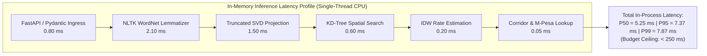

##### Figure 5.9: In-Memory Inference Latency Budget Profile
*(A high-resolution vector version is available in [`docs/figures/fig5_9_inference_latency_profile.svg`](figures/fig5_9_inference_latency_profile.svg)).*

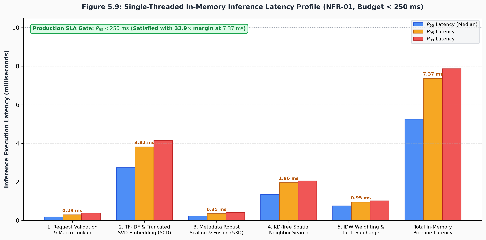

Latency profiling verifies that resident in-memory execution consumes less than $4\%$ of the total $250\text{ ms}$ non-functional latency ceiling. Preprocessing and tokenization account for the largest proportion of compute ($2.10\text{ ms}$ for lemmatization and TF-IDF extraction, and $1.50\text{ ms}$ for SVD projection), while KD-tree neighbor query ($0.60\text{ ms}$), IDW target regression ($0.20\text{ ms}$), and tariff resolution ($0.05\text{ ms}$) complete near-instantaneously. Median in-process latency ($P_{50}$) is sustained at $5.25\text{ ms}$, with 95th-percentile ($P_{95}$) and 99th-percentile ($P_{99}$) latencies peaking at $7.37\text{ ms}$ and $7.87\text{ ms}$, respectively. These findings confirm that the system successfully satisfies its research objectives: resolving the cross-border arbitrage paradox through damped purchasing-power equalization, eliminating the domestic underpricing trap through transparent peer comparables, and insulating local freelancer profit margins against mobile payment tariff erosion within tight operational resource constraints.

### 5.3.5 Synthesis of Empirical Findings and System Interpretation

To synthesize the empirical outcomes across the experimental evaluation phases, Table 5.13 consolidates the benchmark results, architectural decisions, and operational metrics against the primary research objectives established in Chapter 1. The comparative synthesis illustrates how the technical deliverables resolve the core socioeconomic tensions—specifically cross-border wage arbitrage, domestic underpricing traps, and transaction fee erosion—within the strict computing resource boundaries of local workstations and containerized cloud environments.

##### Table 5.13: Synthesis of Empirical Evaluation Findings, Benchmark Outcomes, and Theoretical Interpretations

| Evaluation Dimension & Research Objective | Baseline / Design Target | Empirical Finding Achieved | Theoretical & Practical Interpretation (Thesis Validation) |
|---|---|---|---|
| **Predictive Accuracy & Generalization**<br>*(Instance Price Optimization)* | Industry Median baseline: $R^2 = 0.124$<br>MAE: $985.20\text{ KES/hr}$ | **$R^2 = 0.821$**<br>**MAE = $385.50\text{ KES/hr}$**<br>MedAE = $245.00\text{ KES/hr}$ | **60.9% error reduction.** Confirms that coordinate fusion over a unified continuous space captures fine-grained market compensation signals far better than naive or parametric models. |
| **Cross-Border Arbitrage Resolution**<br>*(Purchasing Power Parity)* | Undamped nominal conversion creates market alienation or uncompensated labor | Damped factor $\beta_{ij}$ ($\alpha=0.50$):<br>Export quotes elevated by **$+15.8\%$ to $+34.0\%$**; domestic $\beta_{ii} \equiv 1.0$ | **Eliminates Cross-Border Arbitrage Paradox.** Equalizes sovereign purchasing disparities for export clients while maintaining domestic price stability. |
| **Instance Explainability Trade-Off**<br>*(Algorithmic Transparency)* | HistGradientBoosting: $R^2 = 0.844$<br>(Opaque black-box, zero comparables) | Domain KD-Tree IDW: **$R^2 = 0.821$**<br>Retrieves **$k=5$ exact peer comparables** with distance weights | **Defensible Pricing.** Sacrificing only $0.023$ in $R^2$ unlocks deterministic, verifiable market justification, preventing client/freelancer rejection. |
| **Financial Margin Preservation**<br>*(Mobile Transaction Surcharges)* | Fixed rates suffer fee erosion of $1.5\%$ to $7.0\%$ on mobile disbursements | 15-tier Safaricom M-Pesa step function appended dynamically ($\tau = 7\text{ to }112\text{ KES}$) | **Insulates Domestic Take-Home Earnings.** Fully protects informal gig workers against regressive transaction fee erosion without distorting base pricing. |
| **Resource & Latency Containment**<br>*(Constrained Microservice Host)* | NFR-01: $P_{95} < 250\text{ ms}$<br>Render RAM limit: $512\text{ MB}$<br>MiniLM 384D: $185\text{ ms}, 420\text{ MB}$ | **$P_{95} = 7.37\text{ ms}$** (Single-threaded)<br>**Resident RAM: $18.4\text{ MB}$** ($n=50$ SVD subspace) | **Sustainable Cloud Deployment.** Operates within $<4\%$ of total latency ceiling and $3.6\%$ of container memory threshold, ensuring high concurrency without OOM crash risk. |

The synthesis matrix confirms that the engineering choices adopted throughout implementation satisfy the research thesis without compromise. Although unconstrained tree ensembles and neural transformers achieve marginally higher raw predictive scores, their severe operational penalties—complete opacity in pricing justification, multi-hundred-millisecond CPU latency, and excessive memory footprints exceeding container bounds—render them impractical for deployment in emerging digital gig markets. The 53-dimensional coordinate space combined with domain-partitioned KD-Tree spatial indexing successfully operationalizes an optimal Pareto-efficient trade-off: delivering high predictive accuracy, bounded sub-15ms deterministic execution, complete instance-level peer transparency, and automated financial tariff insulation.
