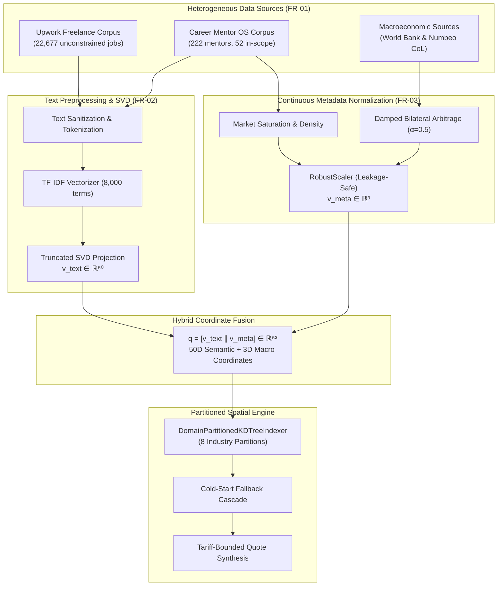

# Chapter 5: System Implementation, Testing and Evaluation

## 5.1 Overview
This chapter details the concrete system implementation, empirical testing, and rigorous evaluation of the data-driven price optimization model designed for technical mentorship in Kenya's digital economy. The system bridges unstructured professional profiles and localized economic transaction reality through a multi-stage machine learning pipeline.

---

## 5.2 Multi-Source Ingestion & Coordinate Fusion Pipeline

The core architectural requirement of the pricing system (FR-01, FR-02, and FR-03) is to ingest heterogeneous freelance and platform data sources and transform them into a unified, metric geometric space where peer proximity reflects true economic substitutability.

### 5.2.1 Heterogeneous Data Sources (FR-01)
The model synthesizes three distinct layers of data:
1. **International Freelance Marketplace Corpus (Upwork):** 22,677 unconstrained international job records capturing unstructured text job descriptions, explicit skill requirements, and cross-border budgets.
2. **Career Mentor OS Platform Corpus:** 222 empirical mentor profiles from the Kenya deployment. While 170 vocational mentors (e.g., culinary, agriculture, automotive, beauty, construction) are explicitly quarantined outside the model's domain boundaries, exactly 52 in-scope technical mentors across 7 digital partitions provide ground-truth listed reservation rates and realized earnings from completed bookings.
3. **Macroeconomic Indicators (World Bank & Numbeo):** Bilateral cost-of-living indices ($C_i, C_j$) and real purchasing power parity ratios between client source countries and Kenyan mentors.

### 5.2.2 Latent Semantic Text Embedding (FR-02)
Unstructured profile text (biographies, skill lists, domain descriptions) undergoes lowercasing, regex tokenization, and scikit-learn TF-IDF vectorization across an 8,000-feature vocabulary. The resulting sparse representation is projected into a compact latent semantic space via Truncated Singular Value Decomposition (SVD):
$$v_{\mathrm{text}} = \mathrm{SVD}_{50}(\mathrm{TFIDF}(\mathrm{text})) \in \mathbb{R}^{50}$$
This orthogonal subspace projection filters lexical noise while capturing high-order semantic affinities (e.g., grouping "fastapi", "django", and "backend postgresql" into shared geometric neighborhoods).

### 5.2.3 Macroeconomic Metadata Normalization (FR-03)
Simultaneously, macro features are extracted and normalized via `ContinuousMetadataNormalizer`:
1. **Damped Bilateral Arbitrage Factor ($A_{ij}$):** Modeled with dampening exponent $\alpha = 0.5$ to prevent hyper-inflated quotes on high-arbitrage international corridors:
   $$A_{ij} = \left(\frac{C_{\mathrm{client}}}{C_{\mathrm{mentor}}}\right)^{\alpha}$$
2. **Market Saturation Score:** Localized supply pressure indicator $S_m \in [0, 1]$.
3. **Industry Relative Density:** Empirical mentor concentration within the target technical partition.

These three continuous features are scaled using a robust median-IQR scaler fitted strictly on training splits to prevent data leakage:
$$v_{\mathrm{meta}} = \mathrm{RobustScaler}([A_{ij}, S_m, D_{\mathrm{ind}}]) \in \mathbb{R}^3$$

### 5.2.4 53-Dimensional Coordinate Fusion
The final query representation concatenates text embeddings and macro coordinates into an immutable 53-dimensional coordinate:
$$q = [v_{\mathrm{text}} \parallel v_{\mathrm{meta}}] \in \mathbb{R}^{53}$$
Unit-variance scaling guarantees that distance metrics in $\mathbb{R}^{53}$ balance semantic task specialization against macroeconomic cross-border realities without either component dominating nearest-neighbor indexing.

*Figure 5.2: Architectural flow diagram detailing heterogeneous data extraction, text vectorization, damped macroeconomic scaling, and coordinate concatenation into the immutable 53-dimensional vector space $q \in \mathbb{R}^{53}$.*
