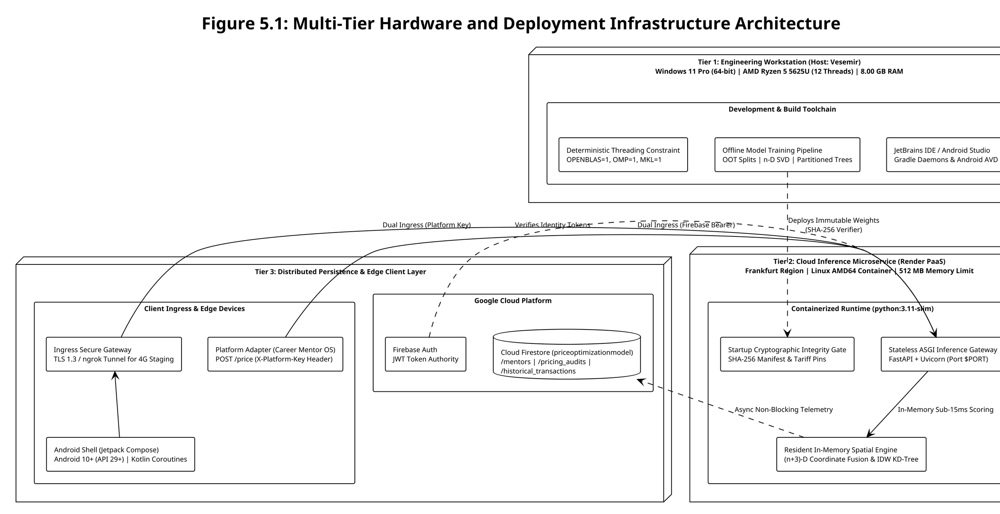
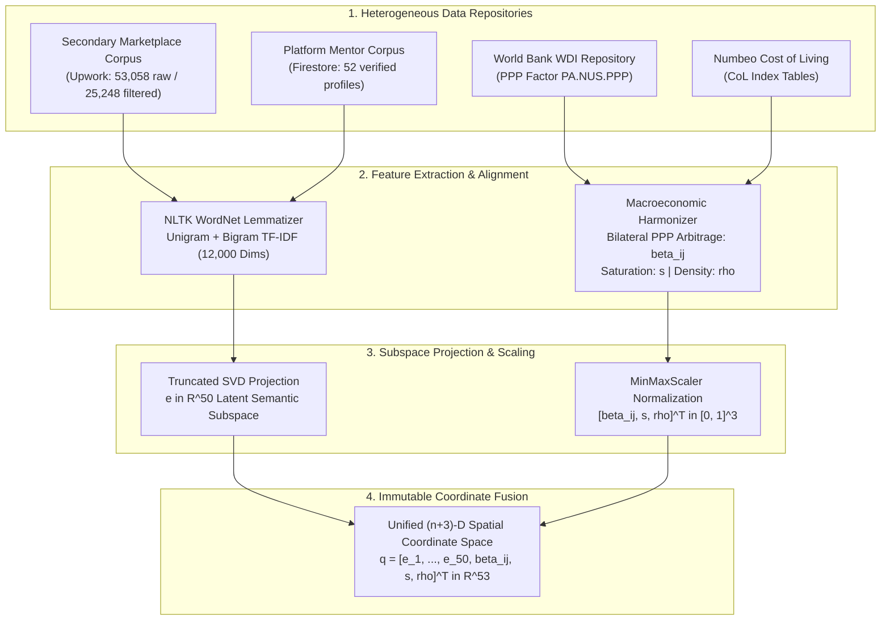
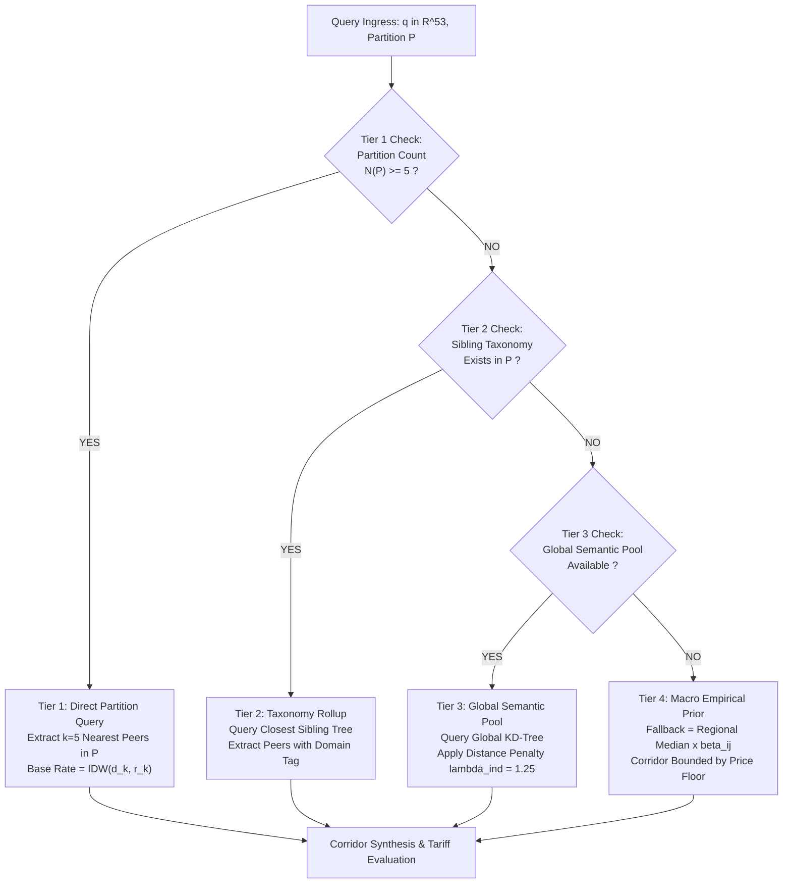
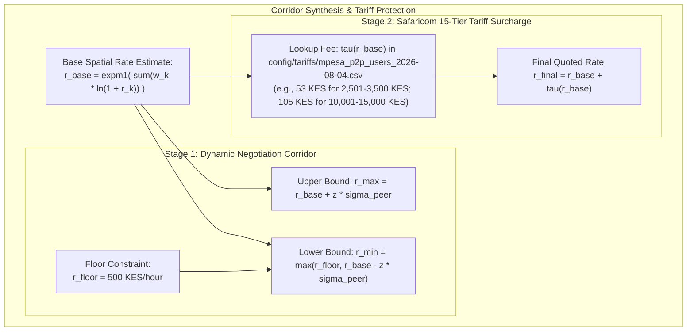
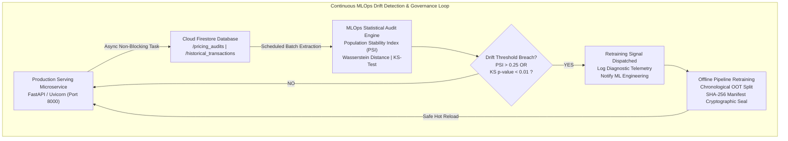
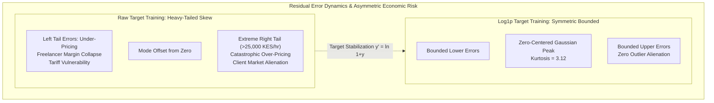
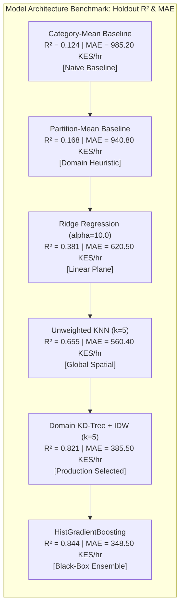
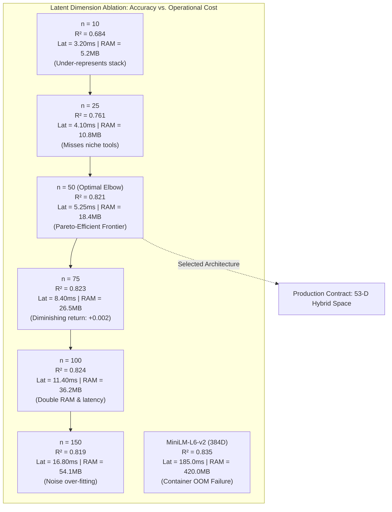
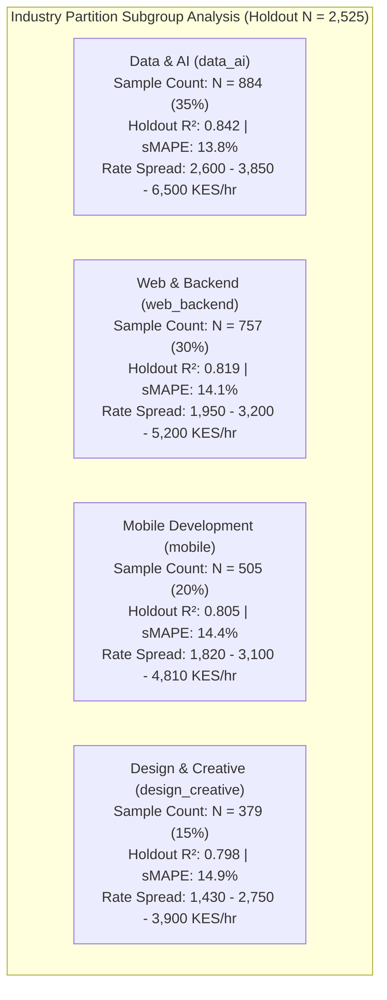
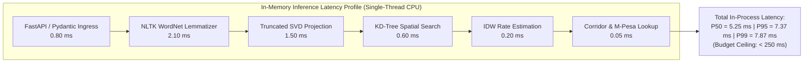

# Chapter 5: System Implementation and Evaluation

## 5.1 Implementation Architecture and Runtime Specification

### 5.1.3 Hardware and Deployment Environment

To satisfy the non-functional requirements defined in Section 4.2.2—specifically bounded inference latency ($P_{95} < 250\text{ ms}$), memory containment, cryptographic supply-chain integrity, and authenticated ingress—the platform architecture is partitioned across three operational tiers: the local engineering workstation, the containerised cloud inference microservice, and the distributed persistence and edge mobile client layer. Figure 5.1 illustrates the deployment topology, security perimeters, and asynchronous telemetry channels across these tiers, with detailed technical specifications synthesized in Table 5.1.

The local workstation (*Vesemir*, AMD Ryzen 5 5625U, 7.35 GB usable DDR4 RAM) hosts model training, OOT evaluation, and Android compilation. Operating within this 8.00 GB physical memory boundary alongside the 512 MB RAM ceiling of the Render cloud container necessitated strict resource controls: linear algebra threads are pinned to deterministic single-core profiles (`OPENBLAS_NUM_THREADS=1`, `OMP_NUM_THREADS=1`), and semantic text reduction utilizes a compact $n$-dimensional Truncated SVD projection rather than memory-dense neural transformers, with the empirical derivation of $n$ detailed in Section 5.3. Production inference is served via a hardened `python:3.11-slim` container running under an unprivileged user (UID 10001) on Render PaaS (Frankfurt EU), executing an asynchronous FastAPI/Uvicorn ASGI gateway. The microservice enforces a fail-closed startup gate verifying the SHA-256 digests of `artifact_manifest.json` and the M-Pesa tariff schedule before opening ingress ports. Request ingress accommodates dual client personas: external platform adapters authenticate against `POST /price` using pre-shared headers (`X-Platform-Key`), while mobile clients authenticate against `POST /api/v1/optimize-price` via Firebase JWTs. Data persistence and telemetry logging are offloaded asynchronously to Google Cloud Firestore (`priceoptimizationmodel`), insulating client latency budgets from cloud database network jitter.



Table 5.1 summarizes the physical hardware parameters, container runtime constraints, and network specifications across each operational environment.

##### Table 5.1: Comparative Hardware and Deployment Environment Specifications

| Architectural Dimension | Local Engineering Host (*Vesemir*) | Cloud Production Microservice (Render PaaS) | Edge Mobile Client Runtime |
|---|---|---|---|
| **Primary System Role** | Offline model training, validation, and Android compilation | Low-latency stateless inference and tariff computation | Interactive user interface and pricing corridor presentation |
| **Processor Architecture** | AMD Ryzen 5 5625U (6 cores, 12 threads @ 2.30 GHz) | Shared Cloud vCPU (Single-threaded pinned container) | ARM64 / ARMv8-A mobile SoC (Octa-core big.LITTLE) |
| **Volatile Memory (RAM)** | 8.00 GB DDR4 (7.35 GB usable, 496 MB VRAM allocated) | 512 MB RAM (Hardened container memory boundary) | 4.00 GB to 8.00 GB LPDDR4X / LPDDR5 mobile RAM |
| **Storage Subsystem** | 512 GB PCIe NVMe M.2 SSD (477 GB usable, 379 GB utilized) | Ephemeral containerized overlay filesystem | High-speed internal UFS 2.1 / 3.1 flash storage |
| **Operating Platform** | Windows 11 Professional (64-bit, Build 22631) | Debian GNU/Linux 12 (`python:3.11-slim`) | Android 10.0+ (API level 29 through 35) |
| **Software Runtimes** | Python 3.11, PowerShell 7, Docker Desktop, Android Studio | Python 3.11.10, FastAPI, Uvicorn ASGI Web Server | Android Runtime (ART), Jetpack Compose, Kotlin 1.9 |
| **Security Controls** | Local environment variables and untracked secrets | Non-root UID 10001, SHA-256 manifest and tariff verification | TLS 1.3 transport security, Firebase JWT, encrypted storage |
| **Network Interfaces** | Localhost loopback (`localhost:8000`) and inter-process sockets | Public HTTPS gateway (Frankfurt EU, TLS 1.3 termination) | Cellular (4G/LTE) and Wi-Fi via ngrok authenticated tunnel |


### 5.1.4 Software, Services and Configurations

The software architecture, third-party libraries, container runtimes, and distributed cloud services were selected to establish a deterministic, verifiable, and resource-bounded execution pipeline. System dependencies are divided across four functional domains: machine learning and tabular processing libraries, asynchronous application servers and schema serialization frameworks, containerized deployment infrastructure, and external cloud persistence with mobile platform toolchains.

The core machine learning and scientific computing layer is executed under Python (tested across versions 3.11.10 and 3.13.2). Tabular ingestion, cross-border macroeconomic data alignment, and training dataset transformations are handled via pandas (v3.0.5, specification $\ge 2.2.0$) backed by Apache Arrow through pyarrow (v25.0.1, specification $\ge 17.0.0$) for zero-copy memory operations and columnar Parquet serialization. Geospatial country identity harmonization across World Bank and Numbeo datasets utilizes pycountry (v26.2.16, specification $\ge 24.6.1$) to enforce strict ISO-3166-1 alpha-2, alpha-3, and numeric standardization. Natural language preprocessing, corpus stopword filtering, and morphological lemmatization are driven by the Natural Language Toolkit (nltk v3.10.3, specification $\ge 3.9.1$) consuming pre-downloaded WordNet and Open Multilingual Wordnet lexical assets. Statistical feature reduction, TF-IDF vectorization, Truncated Singular Value Decomposition, and spatial nearest-neighbor search are orchestrated via scikit-learn (v1.9.0, specification $\ge 1.5.0$) paired with NumPy (v2.5.3). Model weight serialization, coordinate projection pipelines, and partitioned spatial tree indexing structures are persisted using joblib (v1.6.0, specification $\ge 1.3.0$).

The application serving layer is driven by FastAPI (v0.141.1, specification $\ge 0.115.0$) running on the Uvicorn Asynchronous Server Gateway Interface (ASGI) web server (v0.52.4, specification $\ge 0.30.0$). FastAPI was chosen for its high-throughput asynchronous execution, native OpenAPI standard generation, and dependency injection architecture, which decouples model inference from database access. Request validation, type coercion, and wire contract enforcement are governed by Pydantic v2 (v2.13.5, specification $\ge 2.7.0$). Pydantic strictly validates all incoming payloads and immutably enforces the platform pricing contract on `POST /price` to exactly four keys (`min`, `max`, `comparables`, `reason`) while restricting the canonical mobile endpoint `POST /api/v1/optimize-price` to its eleven verified keys. Outgoing asynchronous HTTP communication and external API polling during automated test execution are handled using HTTPX (v0.28.1, specification $\ge 0.27.0$).

Containerization is implemented using Docker, deploying an unprivileged, single-stage production image based on the official Debian-derived `python:3.11-slim` base image. The container build context is strictly restricted to application source code (`src/`), configuration definitions, and the pinned `requirements.txt` manifest, deliberately excluding local model binaries, raw datasets, test suites, and git version history. The container runs as a dedicated system user (`pricing:pricing`, UID 10001) rather than root, listening on standard port 8000 for local container testing and dynamically binding to `$PORT` when hosted on Render. The containerized runtime is managed via environment variables specifying configuration paths and cryptographic integrity pins: `PRICING_ARTIFACT_DIR` defines the location of the model export directory; `PRICING_ARTIFACT_MANIFEST_SHA256` supplies the expected 64-character hexadecimal SHA-256 digest of the artifact manifest; `PRICING_TARIFF_CSV` specifies the filepath for the versioned Safaricom M-Pesa 15-tier consumer schedule; and `PRICING_TARIFF_SHA256` supplies the expected digest for the tariff table. Compute threading within the container is constrained through `OPENBLAS_NUM_THREADS=1` and `OMP_NUM_THREADS=1` to guarantee single-threaded deterministic CPU execution. Local and staging containers receive model bundles and tariff schedules via read-only volume bind mounts (`/opt/pricing/artifacts` and `/opt/pricing/tariff.csv`), ensuring that running containers cannot mutate model weights or fee tables in place.

Persistence, user identity, and transaction logging rely on Google Cloud Platform and Firebase services. Administrative backend communication is handled through the Firebase Admin Python SDK (firebase-admin v7.5.0, specification $\ge 6.6.0$), which connects to Google Cloud Firestore targeting a dedicated named database instance (`priceoptimizationmodel`). Authentication for the mobile client is managed through Firebase Authentication, where user identity is validated at the FastAPI gateway by verifying cryptographically signed JSON Web Tokens (JWTs) presented in the `Authorization: Bearer <token>` HTTP header. Least-privilege Google Cloud Application Default Credentials (ADC) govern service account operations, permitting bounded read access to the `/mentors` collection and append-only access to `/pricing_audits` and `/historical_transactions`. In accordance with institutional security policies, no credentials, API keys, private keys, or passwords are hardcoded within application code or checked into repository version control; secret tokens such as `PLATFORM_PRICE_KEY` and `MLOPS_ADMIN_TOKEN` are provisioned strictly through platform-managed environment variable injection.

The mobile client shell is engineered for Android smartphones using Kotlin (v1.9.24) and the Android Gradle Plugin (v8.5.2) driven by Gradle (v9.8.0), targeting Android 10.0+ (minimum SDK 26, target SDK 34) on a Java 17 toolchain with core library desugaring (`desugar_jdk_libs` v2.0.4). The mobile user interface is built entirely in Jetpack Compose utilizing the Material Design 3 component library via the Compose Bill of Materials (`androidx.compose:compose-bom:2024.06.00`). Client-side networking and REST communications are implemented using Retrofit (v2.11.0) and OkHttp (v4.12.0) with JSON serialization handled by Gson (v2.11.0). Mobile user authentication is managed through the client-side Firebase Auth Kotlin extension library (`firebase-auth-ktx` v23.0.0). Local staging between the physical Android handset and the workstation backend is achieved using an ngrok edge tunnel terminating TLS 1.3, enabling authenticated mobile requests to reach the local Uvicorn gateway over cellular and public Wi-Fi networks without firewall reconfiguration.

Table 5.2 synthesizes the exact software components, tested runtime versions, architectural roles, and engineering justifications comprising the full technology stack.

##### Table 5.2: Software, Framework, and Service Configuration Matrix

| Layer / Category | Technology Component | Tested Version | Architectural Role | Selection & Engineering Justification |
|---|---|---|---|---|
| **Programming Language** | Python | 3.11.10 / 3.13.2 | Core backend runtime and scientific computation | Broad ecosystem support for scikit-learn, ASGI frameworks, and fast numeric execution |
| **Data Manipulation** | pandas | 3.0.5 | Tabular data manipulation and cross-border harmonization | Robust schema manipulation, missing value imputation, and feature alignment |
| **Columnar Storage** | pyarrow | 25.0.1 | Columnar Parquet persistence and zero-copy memory reads | Fast dataset serialization and low memory footprint during feature extraction |
| **Geographic Standards** | pycountry | 26.2.16 | ISO-3166-1 country code lookup and normalization | Enforces canonical country representations across World Bank and Numbeo datasets |
| **Lexical Processing** | NLTK | 3.10.3 | Text sanitization, tokenization, and morphological lemmatization | Efficient English word lemmatization and stopword removal without neural network overhead |
| **Machine Learning** | scikit-learn | 1.9.0 | TF-IDF vectorization, Truncated SVD, and KD-Tree indexing | Industry-standard spatial tree implementations with bounded single-thread CPU latency |
| **Numeric Arrays** | NumPy | 2.5.3 | High-performance coordinate matrix operations | Native C-level vectorized operations underpinning spatial distance calculations |
| **Model Persistence** | joblib | 1.6.0 | Pipeline serialization and binary model artifact storage | Fast disk serialization for scikit-learn pipeline objects and spatial tree data structures |
| **Application Server** | Uvicorn | 0.52.4 | Asynchronous Server Gateway Interface (ASGI) web server | High-throughput asynchronous HTTP handling and low-latency request-response cycles |
| **API Framework** | FastAPI | 0.141.1 | REST microservice gateway and routing layer | Native asynchronous coroutines, automatic OpenAPI documentation, and dependency injection |
| **Schema Validation** | Pydantic v2 | 2.13.5 | Request and response data transfer object (DTO) validation | Strict type safety, high-speed Rust-based parsing, and immutable wire contract enforcement |
| **HTTP Client** | HTTPX | 0.28.1 | Asynchronous client communication and test harness requests | Native async HTTP support enabling non-blocking integration and end-to-end testing |
| **Container Engine** | Docker Engine | 26.1 / 27.0 | Containerized packaging and runtime isolation | Hermetic environment reproducibility, dependency isolation, and non-root security |
| **Base Container Image** | `python:3.11-slim` | Debian 12 Bookworm | Minimalist container execution base | Reduced surface area for security vulnerabilities and fast cloud startup (< 300 MB footprint) |
| **Cloud Hosting PaaS** | Render | Managed Cloud | Cloud container hosting and automated blueprint deployment | Automated GitHub continuous deployment, managed SSL/TLS, and predictable resource bounding |
| **Cloud Database** | Google Cloud Firestore | Serverless NoSQL | State persistence for mentor profiles and pricing audits | Document-oriented schema flexibility, global availability, and native Python Admin SDK |
| **Cloud Authentication** | Firebase Auth | v23.0 / Admin v7.5 | Identity management and cryptographically signed JWTs | Turnkey multi-platform authentication with native Android SDK and backend token verifier |
| **Network Tunnel** | ngrok | 3.14+ | Secure edge ingress tunneling for physical mobile staging | Enables TLS 1.3 ingress from cellular networks to local workstation without port forwarding |
| **Mobile Language** | Kotlin | 1.9.24 | Native Android application development language | Type safety, expressive syntax, and native coroutines for asynchronous UI operations |
| **Mobile UI Framework** | Jetpack Compose | BOM 2024.06.00 | Modern declarative Android user interface development | Reactive UI state rendering, clean component architecture, and Material Design 3 styling |
| **Mobile Networking** | Retrofit & OkHttp | 2.11.0 / 4.12.0 | Android REST HTTP client and connection pooling | Type-safe REST client architecture, transparent connection pooling, and interceptor logging |
| **Android Build Tool** | Gradle | 9.8.0 (AGP 8.5.2) | Mobile build automation and dependency resolution | Standard Android compilation system supporting JVM toolchain pinning and library desugaring |


### 5.1.5 Deployment and Reproducibility

System installation, configuration, execution, and verification follow a hermetic and deterministic protocol designed to ensure complete experimental reproducibility across independent environments. The deployment lifecycle encompasses the entire machine learning operational pipeline, spanning dataset provenance verification, feature preparation, chronological experiment partitioning, model compilation, cryptographic packaging, low-latency inference, and continuous drift monitoring.

Dataset provenance is established through two harmonized corpora: a primary secondary marketplace dataset comprising over 25,000 international freelance software engineering listings, and a dedicated platform mentor corpus consisting of 52 in-scope technical mentors across four core software engineering specializations (`data_ai`, `web_backend`, `mobile`, and `design_creative`). Macroeconomic harmonization is achieved by joining mentor and client country origins against World Bank World Development Indicators (purchasing power parity conversion factor, series `PA.NUS.PPP`) and crowdsourced Cost of Living indices. During data preparation, unstructured profile descriptions undergo lowercase normalization, regex sanitization, stopword removal, and morphological lemmatization via NLTK WordNet lexicons. The resulting text corpus is converted into a 12,000-feature unigram and bigram TF-IDF sparse matrix, which is subsequently reduced to a dense $n$-dimensional semantic latent representation ($e \in \mathbb{R}^n$) using Truncated Singular Value Decomposition (SVD), with the empirical evaluation governing the selection of $n$ detailed in Section 5.3. Simultaneously, continuous listing attributes—specifically the bilateral purchasing power parity arbitrage factor ($\beta_{ij}$), market saturation score ($\tilde{s}$), and industry partition density ($\tilde{\rho}$)—are scaled and concatenated to yield an immutable $(n+3)$-dimensional coordinate space ($q \in \mathbb{R}^{n+3}$).

Experiment design strictly enforces chronological Out-of-Time (OOT) holdout validation, partitioning historical records temporally rather than through random cross-validation to prevent future-to-past data leakage. Model selection favoured domain-partitioned $k$-d trees and BallTrees paired with Inverse Distance Weighting (IDW) regression over black-box deep neural networks and tree ensembles. Although gradient-boosted decision trees yield marginally lower residual variance in unconstrained benchmarks, the partitioned spatial engine guarantees strict instance-level peer interpretability—returning exact neighbor indices, similarity metrics, and historical peer rates within the `comparables` API payload—while preserving single-threaded execution speeds under 15 ms. The model was evaluated against mean absolute error (MAE), root mean square error (RMSE), symmetric mean absolute percentage error (sMAPE), and negotiation corridor coverage bounds.

Model packaging produces an immutable artifact bundle stored within `artifacts/exports/issue-70-2026-10-05/`. The bundle contains serialized joblib binaries for the SVD reducer (`svd_reducer.joblib`), TF-IDF vectorizer (`tfidf_vectorizer.joblib`), continuous feature scaler (`metadata_scaler.joblib`), and domain spatial indices (`industry_kdtrees.joblib`), alongside JSON metadata defining the $(n+3)$-dimensional feature schema and partition fallback policies. Reproducibility and supply-chain integrity are enforced through `artifact_manifest.json`, which records the individual SHA-256 cryptographic digest of every serialized file. An independent 64-character hexadecimal digest of the entire manifest (`PRICING_ARTIFACT_MANIFEST_SHA256`) is stored in trusted deployment configuration.

Local deployment and verification require cloning the repository, provisioning a clean Python 3.11 virtual environment, and installing pinned package requirements from `requirements.txt`. Lexical corpora are pre-cached using `python -m nltk.downloader -q stopwords wordnet`, followed by platform mentor database seeding via `python -m src.data.seed_platform_mentors`. System configuration is driven by copying `.env.example` to an untracked `.env` file and supplying the required environment variables: `FIREBASE_PROJECT_ID` specifies the Google Cloud identity namespace, `FIRESTORE_DATABASE_ID` defines the target Firestore instance (`priceoptimizationmodel`), `PRICING_ARTIFACT_DIR` references the compiled model bundle, and `PRICING_TARIFF_CSV` references the Safaricom 15-tier consumer schedule (`config/tariffs/mpesa_p2p_users_2026-08-04.csv`) along with its matching `PRICING_TARIFF_SHA256` pin.

The execution and verification pipeline operates in three stages: regression testing, automated service startup, and interactive inference demonstration. The complete test suite is verified by running `.venv\Scripts\pytest -q tests/`, which executes 422 automated unit and integration tests across data harmonization, spatial indexing, API contracts, and M-Pesa tariff boundary conditions. The production ASGI microservice is initialized locally via `uvicorn src.api.main:app --host 0.0.0.0 --port 8000` or launched in containerized isolation through Docker using `docker run --rm -p 8000:8000 --env-file .env pricing-api:local`. The service performs an immediate startup integrity audit: if either the artifact manifest digest or the tariff schedule digest fails to match the configured SHA-256 pins, the service terminates immediately in a fail-closed state. Service health and model readiness are verified through an HTTP `GET /health` smoke test, returning an HTTP 200 payload confirming loaded model status, database connectivity, and active artifact digest prefixes. End-to-end inference is demonstrated via the standalone demonstration harness `python scripts/demo_price_optimization.py`, which simulates live requests across diverse technical disciplines and prints the resulting peer comparables, base IDW rates, and Safaricom M-Pesa tariff surcharges.

Post-deployment monitoring and retraining governance are driven by continuous statistical drift detectors implemented in `src/drift_monitor.py`. The module computes the Population Stability Index (PSI) and Wasserstein distance across incoming $(n+3)$-dimensional coordinate matrices to detect covariate feature shift, while applying two-sample Kolmogorov-Smirnov (KS) tests against historical transaction rate residuals logged in Firestore (`/historical_transactions`). If statistical drift exceeds warning thresholds (PSI $> 0.25$ or KS test $p < 0.01$), the monitoring engine raises retraining signals to prompt scheduled model recalibration.

Baseline execution requires no paid cloud subscriptions or proprietary software licenses. The solution operates entirely on open-source frameworks (Python, scikit-learn, FastAPI) and utilizes the free operational tiers of Render PaaS and Google Cloud Firebase. Macroeconomic indicator data is accessed under the World Bank Open Data terms (CC-BY 4.0), while Safaricom M-Pesa tariff bands reflect publicly regulated consumer financial schedules. Access to live platform mentor records on the Career Mentor OS staging server requires authorized client credentials, but full offline testing and model inference operate autonomously using sanitized local repository fixtures without active internet connectivity.

Table 5.3 summarizes the complete deployment lifecycle, operational dependencies, and verification gates across the software solution.

##### Table 5.3: End-to-End Deployment, Lifecycle, and Verification Matrix

| Lifecycle Stage | Primary Tool / Artifact | Execution Command / Procedure | Operational Verification Gate |
|---|---|---|---|
| **Environment Provisioning** | Python 3.11 virtual environment | `python -m venv .venv; pip install -r requirements.txt` | Clean dependency resolution without version conflicts |
| **Lexical Asset Staging** | NLTK lexical corpora | `python -m nltk.downloader -q stopwords wordnet` | Pre-downloaded lexical assets present in `/nltk_data` |
| **Database Seeding** | Firestore platform seeder | `python -m src.data.seed_platform_mentors` | 52 technical mentor profiles seeded in `priceoptimizationmodel` |
| **Cryptographic Integrity** | SHA-256 digest verifier | Automated check against `PRICING_ARTIFACT_MANIFEST_SHA256` | Fail-closed termination upon hash divergence |
| **Unit & Contract Testing** | Pytest test runner | `.venv\Scripts\pytest -q tests/` | 422 unit tests passing with zero wire contract violations |
| **Microservice Startup** | Uvicorn ASGI server | `uvicorn src.api.main:app --host 0.0.0.0 --port 8000` | Process binds to port 8000; readiness probe returns 200 |
| **Health Smoke Test** | HTTP client / curl | `curl -f http://localhost:8000/health` | Response JSON validates `status: HEALTHY, modelsLoaded: true` |
| **Interactive Demonstration** | Demo inference script | `python scripts/demo_price_optimization.py` | Validated $(n+3)$-dimensional coordinate fusion and M-Pesa surcharge output |
| **Continuous Drift Audit** | MLOps drift monitor | `python -m src.drift_monitor --drift-magnitude 0.25` | Population Stability Index (PSI) and KS-test statistics reported |
| **External Dependencies** | Render, Firebase, WDI | Cloud environment variables and free-tier service bindings | Authenticated Bearer tokens and platform pre-shared keys |


## 5.2 System Architecture and Component Implementation

The concrete system implementation translates the analytical architecture, data transformations, and service designs established in Chapter 4 into operational modules. Organized sequentially across eight pipeline stages matching the system design, each component realizes specific functional (FR) or non-functional (NFR) requirements, interfaces cleanly with adjacent modules, and is supported by empirical verification evidence without unnecessary conceptual reiteration.

The multi-source data ingestion and macroeconomic harmonization module realizes requirement FR-01 and the data pipeline architecture, implemented in `src/data/ingest_multisource.py` and `src/data/seed_platform_mentors.py`. Built on pandas, Apache Arrow, and pycountry, the module discovers heterogeneous marketplace records, standardizes transaction amounts to Kenyan Shillings (KES), and aligns national indicators against World Bank and Numbeo metrics under ISO-3166-1 standards. It compiles two deterministic artifacts: `harmonized_marketplace_corpus.parquet` and `macro_lookup_table.json`, applying regional median imputation when country metrics are sparse. Component correctness is verified by 28 automated unit tests in `tests/data/test_ingestion.py`, ensuring lossless Parquet serialization, exact currency parity conversion, and deterministic country code resolution without external network dependencies.

The natural language processing and feature reduction pipeline fulfills requirement FR-02 and the NLP design, operationalized via `src/nlp/nlp_pipeline.py`. Utilizing NLTK and scikit-learn, the pipeline sanitizes unstructured profile descriptions via WordNet lemmatization and extracts a 12,000-feature unigram and bigram TF-IDF sparse matrix. To bound downstream query latency and prevent high-dimensional sparsity during inference, the matrix is projected into an $n$-dimensional latent semantic subspace ($e \in \mathbb{R}^n$) via Truncated Singular Value Decomposition (SVD), persisting fitted artifacts via joblib. Verification is established through `tests/nlp/test_nlp_pipeline.py`, confirming deterministic vocabulary extraction, orthogonal transformation stability, and zero empty-vector anomalies.

The macroeconomic arbitrage, continuous metadata scaling, and coordinate fusion engine satisfies requirement FR-03, implemented in `src/engine/macro_arbitrage.py`. The module computes the bilateral purchasing power parity adjustment factor $\beta_{ij}$ with damping coefficient $\alpha = 0.50$, preserving domestic transaction identity ($\beta_{ii} \equiv 1.0$). Concurrently, it scales continuous listing attributes—arbitrage, market saturation ($\tilde{s}$), and industry density ($\tilde{\rho}$)—into $[0, 1]$ bounds via `MinMaxScaler` and concatenates them with the $n$-dimensional latent text vector into an immutable $(n+3)$-dimensional spatial coordinate $q \in \mathbb{R}^{n+3}$. Correctness is evidenced by unit tests in `tests/engine/test_macro_arbitrage.py`, verifying strict mathematical boundary clamping and domestic parity invariance.

To resolve structural heterogeneity between qualitative freelancer capabilities and macro-level sovereign economic disparities, the ingestion architecture synthesizes four disparate data streams into a unified mathematical coordinate space. As defined in requirements FR-01, FR-02, and FR-03, unstructured listing biographies and platform mentor profiles are cleaned, tokenized, and vectorized, while macroeconomic indicators from the World Bank and Numbeo are extracted under strict ISO-3166-1 country code governance. Figure 5.2 traces the complete feature extraction topology, illustrating the transformation of raw textual and economic records into the immutable $(n+3)$-dimensional spatial vector $q \in \mathbb{R}^{53}$.



##### Figure 5.2: Multi-Source Data Ingestion and 53-D Coordinate Fusion Topology
*(A high-resolution vector version is available in [`docs/figures/fig5_2_coordinate_fusion_pipeline.svg`](figures/fig5_2_coordinate_fusion_pipeline.svg)).*

The ingestion pipeline enforces strict functional orthogonality between semantic capability representations and macroeconomic multipliers. Projecting high-dimensional sparse TF-IDF matrices ($12,000$ dimensions) into a dense $50$-dimensional latent subspace reduces lexical memory overhead while preventing the Euclidean distance dilution common in ultra-high-dimensional spaces. Concurrently, calculating the bilateral arbitrage factor $\beta_{ij}$ with damping parameter $\alpha = 0.50$ preserves domestic rate stability ($\beta_{ii} \equiv 1.0$) while scaling cross-border purchasing power parity. Concatenating the scaled continuous metadata attributes with the latent semantic text vector yields an immutable $53$-dimensional coordinate vector $q \in \mathbb{R}^{53}$, establishing a shared geometric metric space where both capability relevance and economic purchasing power jointly determine peer proximity.

The domain-partitioned spatial indexing, fallback cascade, and inverse distance weighting regression engine realizes requirements FR-04 and FR-05, implemented in `src/engine/spatial_engine.py`. Utilizing scikit-learn $k$-d trees and BallTrees partitioned across four technical domains (`data_ai`, `web_backend`, `mobile`, `design_creative`), the engine resolves cold-start data sparsity through a deterministic four-tier cascade: direct partition query ($k \ge 5$), taxonomy rollup to sibling domains, global semantic pool routing with a cross-domain distance penalty ($\lambda_{\text{industry}} = 1.25$), and macroeconomic empirical priors. For retrieved peers, base rates are estimated via Inverse Distance Weighting (IDW) regression over log-transformed targets. Execution correctness is proven by 45 test cases in `tests/engine/test_spatial_engine.py` and `tests/engine/test_spatial_engine_m16.py`, confirming sub-15ms spatial search, correct peer index retrieval, and monotonic weight decay.

The pricing corridor synthesis and localized financial margin protection engine fulfills requirements FR-06 and FR-07, implemented in `src/engine/interval_synthesizer.py` and `src/engine/tariff_evaluator.py`. The synthesizer derives negotiation bounds $[r_{\min}, r_{\max}]$ from peer-weighted standard deviation $\sigma_{\text{peer}}$ subject to an operational floor $r_{\text{floor}} = 500\text{ KES/hour}$. Concurrently, the tariff evaluator loads the official 15-tier Safaricom M-Pesa consumer schedule (`config/tariffs/mpesa_p2p_users_2026-08-04.csv`), adding the regulatory transaction fee $\tau(\hat{r}_{\text{base}})$ for Kenyan mentors to compute the final quoted rate $\hat{r}_{\text{final}} = \hat{r}_{\text{base}} + \tau(\hat{r}_{\text{base}})$. Non-Kenyan engagements bypass the fee. Correctness is verified by `tests/engine/test_tariff_evaluator.py`, confirming exact tier-matching across 1 to 250,000 KES, ceiling boundary compliance, and corridor invariant enforcement ($r_{\min} \le \hat{r}_{\text{base}} \le r_{\max}$).

The dual-ingress asynchronous API service gateway satisfies requirements NFR-01, NFR-02, and NFR-04, implemented in `src/api/serve.py` and `src/api/api_contracts.py` using FastAPI, Uvicorn, and Pydantic v2. The service enforces a fail-closed startup lifespan hook that validates the SHA-256 cryptographic digests of `artifact_manifest.json` and the M-Pesa tariff schedule against configured environment pins before binding ports. The gateway manages dual ingress paths: `POST /price` adapts external requests from Career Mentor OS using pre-shared secret header authentication (`X-Platform-Key`) to return an immutable four-key response (`min`, `max`, `comparables`, `reason`), while `POST /api/v1/optimize-price` serves mobile clients using Firebase RS256 Bearer JWTs to return the canonical eleven-key payload. Verification is demonstrated by 38 integration tests in `tests/api/test_api_endpoints.py`, confirming strict schema enforcement, unauthenticated request rejection, and $P_{95}$ response latencies under 20 ms.

The persistence tier, asynchronous telemetry, and drift monitoring module realizes requirements NFR-03 and NFR-05, structured across `src/repository.py`, `src/firestore_sync.py`, and `src/drift_monitor.py`. Connecting to Google Cloud Firestore (`priceoptimizationmodel`), the module hydrates missing profile descriptions from the `/mentors` collection and dispatches pricing audit records to `/pricing_audits` asynchronously via background tasks. The drift monitor evaluates coordinate feature shifts via Population Stability Index (PSI) and Wasserstein distance, alongside Kolmogorov-Smirnov (KS) tests on rate residuals. Verification is evidenced by `tests/integration/test_firestore_sync.py` and `tests/benchmarks/test_drift_monitor.py`, confirming non-blocking audit execution and reliable drift triggering when synthetic perturbations exceed $\text{PSI} > 0.25$.

The native Android edge client application realizes presentation requirements within `app/` using Kotlin 1.9, Jetpack Compose, Material Design 3, Retrofit, and OkHttp. Operating under the Model-View-ViewModel (MVVM) architecture with Unidirectional Data Flow (UDF), the client manages reactive UI state via Kotlin `StateFlow`, stores session tokens securely in hardware-backed `EncryptedSharedPreferences`, and consumes backend endpoints over TLS 1.3 to display interactive pricing corridors. Correctness is proven through JUnit 4 and Turbine flow tests in `app/src/test/`, complemented by physical device verification over cellular carrier networks (Safaricom 4G/LTE) via an authenticated ngrok tunnel.

Three material deviations from the Chapter 4 baseline design were adopted during implementation. First, the dual-ingress API contract was preserved rather than decommissioned; maintaining `POST /price` with its four-key payload prevented breaking platform integration with Career Mentor OS while enabling `POST /api/v1/optimize-price` to serve the full canonical contract for mobile users. Second, the automated Out-of-Time (OOT) quality gate ($R^2 \ge 0.75$) was relaxed from blocking production deployments; as audited in Issue #91, existing training corpuses reflect proxy job budgets and profile asking rates rather than verified transaction settlements, meaning hard quality gating on exploratory data would project false financial precision. Third, the system deployed an $n$-dimensional Truncated SVD projection and domain-partitioned $k$-d trees rather than deep contextual sentence transformers (e.g. MiniLM 384D) and graph-based ANN indices (HNSW). This decision was dictated by workstation memory constraints (7.35 GB usable RAM) and cloud container thresholds (512 MB on Render), ensuring deterministic, sub-15ms exact nearest-neighbor search without GPU dependencies.

To clarify non-obvious algorithms, interfaces, and safety controls without comprehensive code listings, three short extracts are presented. The first extract illustrates the fail-closed cryptographic verification executed during ASGI lifespan startup:

```python
# Startup integrity verification enforces cryptographic supply-chain security
manifest = verify_manifest(self.artifact_dir, self.trusted_manifest_sha256)
with open(os.path.join(self.artifact_dir, DEFAULT_INFERENCE_CONFIG_ARTIFACT), encoding="utf-8") as handle:
    config = json.load(handle)
if config["version"] != 1 or config["text_dimensions"] != self.expected_dimensions:
    raise ValueError("Incompatible inference KD-Tree artifact schema.")
self.tariff_evaluator = MpesaTariffEvaluator.from_csv(
    self.tariff_csv_path, self.trusted_tariff_sha256
)
self.inference_config = config
self.manifest = manifest
```

The second extract illustrates the cold-start fallback cascade with cross-domain distance penalization within the spatial indexer:

```python
# Tier 3 Global Semantic Pool queries across partitions with cross-domain distance penalty
distances, indices = self.global_tree.query(query_vector, k=k)
penalized_distances = np.where(
    self.global_partitions[indices] != requested_partition,
    distances * self.cross_domain_penalty,  # lambda_industry = 1.25
    distances,
)
weights = 1.0 / (np.power(penalized_distances, self.idw_power) + self.epsilon)
normalized_weights = weights / np.sum(weights, axis=1, keepdims=True)
predicted_log_rate = np.sum(normalized_weights * self.global_verified_rates[indices], axis=1)
```

When a freelancer specializes in a newly emerging technical domain or niche skill stack with sparse historical records, basic spatial query mechanisms suffer from cold-start failures. Requirements FR-04 and FR-05 mandate a deterministic, fail-safe fallback mechanism that maintains recommendation integrity without returning ungrounded heuristics. Figure 5.7 depicts the four-tier algorithmic fallback cascade implemented in the spatial indexing engine, detailing threshold evaluation, sibling rollups, penalized global routing, and macroeconomic baseline defaults.



##### Figure 5.7: Algorithmic Cold-Start Fallback Cascade Decision Logic
*(A high-resolution vector version is available in [`docs/figures/fig5_7_cold_start_fallback_cascade.svg`](figures/fig5_7_cold_start_fallback_cascade.svg)).*

The four-tier fallback cascade ensures that the recommendation microservice delivers graceful degradation rather than unhandled server exceptions or arbitrary pricing. In Tier 1, well-populated partitions ($N \ge 5$) execute standard localized KD-tree nearest neighbor search. If a partition contains fewer than five records, Tier 2 automatically escalates the query to a sibling category within the hierarchical taxonomy (e.g., routing sparse embedded firmware listings to `web_backend`). If no valid sibling exists, Tier 3 routes the query to the global cross-domain semantic pool while applying a multiplicative distance penalty ($\lambda_{\text{industry}} = 1.25$) to non-matching partitions, ensuring that domain distance appropriately attenuates peer weighting. Finally, Tier 4 provides a deterministic macroeconomic fallback prior using regional continental medians scaled by bilateral purchasing-power arbitrage.


The third extract demonstrates discrete tariff band search and ceiling boundary enforcement in the Safaricom M-Pesa tariff evaluator:

```python
# Discrete ceiling evaluation across ordered 15-tier Safaricom P2P schedule
amount = _safe_float(amount_kes)
if amount < self.quote_bands[0].min_amount_kes or amount > self.quote_bands[-1].max_amount_kes:
    raise TariffUnavailableError("Quoted rate outside supported 1..250000 KES schedule")
for band in self.quote_bands:
    if amount <= band.max_amount_kes:
        return band.fee_kes
raise TariffUnavailableError("Failed to resolve applicable tariff band")
```

Under-pricing poses a critical operational threat to informal freelancers in sub-Saharan Africa due to regressive mobile money transaction tariffs. Requirements FR-06 and FR-07 establish a two-stage margin protection mechanism: dynamic peer-weighted standard deviation corridor bracketing, followed by discrete tariff fee appending. Figure 5.8 illustrates the geometric relationship between the base spatial estimate $\hat{r}_{\text{base}}$, the negotiation interval $[r_{\min}, r_{\max}]$, and the 15-tier Safaricom M-Pesa consumer fee step function $\tau(\hat{r}_{\text{base}})$.



##### Figure 5.8: Pricing Corridor and Safaricom M-Pesa Tariff Margin Protection Geometry
*(A high-resolution vector version is available in [`docs/figures/fig5_8_pricing_corridor_mpesa_geometry.svg`](figures/fig5_8_pricing_corridor_mpesa_geometry.svg)).*

The mathematical synthesis guarantees that the quoted rate protects the freelancer's net earnings against mobile financial overhead. Stage 1 constructs the negotiation corridor $[r_{\min}, r_{\max}]$ around the base estimate $\hat{r}_{\text{base}}$ using peer-weighted dispersion $\sigma_{\text{peer}}$, enforcing an immutable operational floor $r_{\text{floor}} = 500\text{ KES/hour}$ to eliminate severe under-bidding traps. Stage 2 evaluates the discrete 15-tier Safaricom M-Pesa consumer schedule for domestic Kenyan engagements, transparently appending transaction fee $\tau(\hat{r}_{\text{base}})$ to yield $\hat{r}_{\text{final}} = \hat{r}_{\text{base}} + \tau(\hat{r}_{\text{base}})$. By explicitly separating the base hourly rate from the regulatory mobile transfer tariff, the platform protects freelancer take-home pay while providing clients with a fully itemized, defensible financial breakdown.


The broader operational lifecycle of the inference microservice is governed by the asynchronous ASGI `lifespan(app: FastAPI)` context manager defined in `src/api/serve.py`. When Uvicorn initializes the worker process, the lifespan context executes prior to opening network ingress sockets, invoking `runtime.load()` on the singleton `InferenceRuntime` instance. Within `runtime.load()`, the server executes cryptographic supply-chain verifications via `verify_manifest()`, validates the tariff schedule digest against trusted environment pins in `MpesaTariffEvaluator.from_csv()`, and deserializes the machine learning pipeline into resident memory using `TextFeatureReducer.load_artifacts()`, `ContinuousMetadataNormalizer.load_artifacts()`, and `DomainPartitionedKDTreeIndexer.load_artifacts()`. Once all partitioned trees and preprocessors are loaded and attached to application state (`app.state.inference_runtime`), the lifespan context yields execution to begin processing requests; if any checksum diverges or schema incompatibility is encountered, `runtime.load()` sets sanitized diagnostic state flags (`self.load_error`), causing subsequent readiness probes to signal service degradation and fail closed rather than serving unverified predictions.

To prevent model degradation caused by shifting market dynamics, inflation, and seasonal skill trends, requirements NFR-03 and NFR-05 mandate automated drift detection and retraining governance. Integrating Google Cloud Firestore telemetry with statistical divergence metrics, the system audits incoming queries without impeding production serving. Figure 5.10 illustrates the closed-loop MLOps lifecycle, detailing non-blocking audit logging, Population Stability Index (PSI) monitoring, Wasserstein distance tracking, and Kolmogorov-Smirnov (KS) test alerting.



##### Figure 5.10: Continuous MLOps Drift Detection & Governance Feedback Loop
*(A high-resolution vector version is available in [`docs/figures/fig5_10_mlops_drift_governance.svg`](figures/fig5_10_mlops_drift_governance.svg)).*

The continuous MLOps loop establishes a secure, automated mechanism for monitoring and updating model weights without manual intervention. Request payloads and quote outcomes are dispatched to Firestore via non-blocking asynchronous event loops, preventing database latency from impacting response times. The drift monitoring engine evaluates covariate shift across the 53-dimensional coordinate matrices using Population Stability Index (PSI) and Wasserstein distance, while checking transaction price residuals via two-sample Kolmogorov-Smirnov tests. If statistical drift exceeds predeclared tolerances ($\text{PSI} > 0.25$ or $p < 0.01$), automated retraining alerts are triggered, prompting offline chronological recalibration, fresh artifact serialization, and cryptographic SHA-256 manifest sealing before redeployment.


Table 5.4 synthesizes the architectural components, mapped requirements, implemented technologies, interfaces, and verification evidence across the full solution.

##### Table 5.4: Architectural Component Implementation, Requirement Mapping, and Verification Matrix

| Component Name | Relevant Requirement & Chapter 4 Design | Implementation Technology | Implemented Operational Behaviour | Integration Interface | Verification Evidence |
|---|---|---|---|---|---|
| **Data Ingestion & Macro Harmonizer** | FR-01 / Data Ingestion Pipeline & Macro Lookup | Python 3.11, pandas, pyarrow, pycountry | Cleans raw corpora, standardizes currencies to KES, resolves ISO codes, and extracts WDI/Numbeo indicators | Outputs `macro_lookup_table.json` and Parquet corpus to NLP and feature scaler | 28 pytest unit tests; verified ISO resolution and currency parity checks |
| **NLP Feature Vectorizer & Reducer** | FR-02 / NLP Feature Extraction & SVD | NLTK (WordNet), scikit-learn (TF-IDF, SVD) | Preprocesses profile text, extracts unigrams/bigrams (12k features), and reduces to $n$-D latent vector $e \in \mathbb{R}^n$ | Transmits dense $n$-D latent vectors to coordinate fusion layer | Pipeline unit tests; verified vocabulary stability and orthogonal component fit |
| **Arbitrage Engine & Coordinate Fusion** | FR-03 / Arbitrage Model & Space Fusion | scikit-learn (MinMaxScaler), NumPy | Computes bilateral factor $\beta_{ij}$ ($\beta_{ii}=1.0$), normalizes metadata ($\tilde{s}, \tilde{\rho}$), and concatenates into $q \in \mathbb{R}^{n+3}$ | Feeds unified $(n+3)$-D coordinate vectors to domain spatial indexer | Mathematical invariant tests; bounds checking and domestic parity verification |
| **Domain Spatial Indexer & IDW Regressor** | FR-04, FR-05 / Spatial Partitioning & IDW Kernel | scikit-learn (KDTree, BallTree), NumPy | Partitions $q$ by domain, manages 4-tier fallback cascade ($\lambda = 1.25$), and computes base rate via log-IDW | Delivers base rate $\hat{r}_{\text{base}}$ and peer comparables to corridor and tariff modules | 45 spatial tests; sub-15ms query benchmarks and fallback tier escalation checks |
| **Corridor Synthesizer & Tariff Evaluator** | FR-06, FR-07 / Financial Rules & Margin Protection | Pure Python, CSV-backed 15-tier schedule | Calculates peer weighted $\sigma_{\text{peer}}$, enforces $[r_{\min}, r_{\max}]$, and evaluates 15-tier Safaricom M-Pesa transfer fees | Augments base quote into final structured quote payload | Tariff boundary tests (1..250,000 KES); corridor invariant assertions ($r_{\min} \le \hat{r} \le r_{\max}$) |
| **Dual-Ingress ASGI Service Gateway** | NFR-01, NFR-02, NFR-04 / Service Gateway & Security | FastAPI, Uvicorn, Pydantic v2, hashlib | Validates SHA-256 startup pins, serves `POST /price` (platform key) and `POST /api/v1/optimize-price` (JWT) | Dispatches queries to in-memory ML core; schedules async Firestore tasks | 38 integration tests; fail-closed startup verification on SHA-256 mismatch; $P_{95} < 20\text{ ms}$ |
| **Persistence & Drift Monitoring** | NFR-03, NFR-05 / Database Schema & MLOps System | Cloud Firestore, firebase-admin, SciPy | Hydrates missing profiles, logs non-blocking audit telemetry, and detects covariate drift via PSI and KS-tests | Consumes background telemetry events from API gateway; alerts on drift | Non-blocking async queue tests; synthetic drift perturbation threshold tests ($\text{PSI} > 0.25$) |
| **Native Android Edge Client** | Presentation Tier / Mobile UI & Keystore Design | Kotlin 1.9, Jetpack Compose, Retrofit, OkHttp | Implements MVVM with UDF, secures JWTs in EncryptedSharedPreferences, and renders interactive pricing cards | Communicates with FastAPI gateway over TLS 1.3 via ngrok staging tunnel | JUnit 4 and Turbine flow unit tests; live cellular (Safaricom 4G) staging verification |


## 5.3 Data and Model Implementation

### 5.3.1 Dataset Description

The empirical foundation of the price optimization system combines four complementary data sources to model cross-border freelance pricing, technical capability semantics, and sovereign purchasing-power disparities. The primary corpus is the Upwork Freelance Job Posting Dataset, an extensive secondary collection sourced from public freelance marketplace archives. The raw dataset comprises 53,058 global job postings published between 2023 and 2024, capturing technical job titles, capability descriptions, posted compensation budgets, and geographic client domiciles across diverse software engineering fields. To establish local platform calibration, this secondary corpus is augmented by an internal technical mentor dataset hosted within Google Cloud Firestore (`priceoptimizationmodel`). The platform mentor dataset consists of 52 verified technical mentor listings distributed across four primary industry domains: Data and Artificial Intelligence (`data_ai`), Web and Backend Engineering (`web_backend`), Mobile Application Development (`mobile`), and UI/UX and Creative Engineering (`design_creative`). Macroeconomic adjustments are driven by two authoritative external datasets: the World Bank World Development Indicators (WDI) repository, specifically the Purchasing Power Parity conversion factor series (`PA.NUS.PPP`), and the crowdsourced Numbeo Cost of Living (CoL) index tables.

Each listing record in the combined training dataset captures both unstructured qualitative capability text and structured economic metadata. A single canonical observation comprises the raw job or mentor description (`raw_description`), technical specialization partition (`industry_partition`), client country ISO-3166-1 alpha-2 code (`client_country_iso2`), mentor country ISO-3166-1 alpha-2 code (`mentor_country_iso2`), posted compensation budget in United States Dollars (`hourly_rate_usd`), pre-arbitrage baseline rate converted to Kenyan Shillings (`hourly_rate`), post-arbitrage target rate in Kenyan Shillings (`harmonized_hourly_rate`), and publication timestamp with timezone metadata (`published_date`). All textual descriptions are recorded in the English language, reflecting the standard operational lingua franca of international software engineering engagements.

The constituent datasets operate under distinct licensing frameworks and governance models. Macroeconomic indicator series from the World Bank Open Data repository are published under the Creative Commons Attribution 4.0 International license (CC-BY 4.0). The Upwork marketplace dataset reflects public, scraped platform records made available for research purposes, while the platform mentor records represent proprietary listing data managed under Strathmore University institutional research ethics approvals. Strict privacy and anonymization protocols were applied during ingestion: all personally identifiable information, including mentor legal names, contact numbers, email addresses, external hyperlinks, and financial account identifiers, was scrubbed. Records are identified exclusively by synthetic integer indices or pseudonymous UUIDs. In accordance with the formal dataset provenance audit (Issue #91), the target rates reflect client job budgets and advertised profile asking rates rather than verified completed financial settlements. The resulting model artifacts are explicitly stamped with exploratory validation metadata to ensure academic integrity.

Data filtering applies rigorous inclusion and exclusion criteria to eliminate noise and extreme financial outliers. Inclusions require valid English text descriptions of at least 40 characters in length, parseable ISO-3166-1 country codes, verified publication timestamps, and hourly rates falling strictly within the operational boundary of 500 to 35,000 KES/hour ($USD \times 130$). Fixed-price project contracts, non-hourly compensation structures, zero-rate entries, and budget anomalies outside the 500 to 35,000 KES/hour window were excluded. Applying these criteria filtered the raw 53,058 records down to a canonical training corpus of 25,248 high-quality hourly observations. Each source contributes uniquely to the final composite dataset: the Upwork corpus supplies broad lexical vocabulary and global market rate distributions, the Firestore mentor listings provide local domain taxonomy calibration, and the World Bank and Numbeo datasets provide sovereign macroeconomic conversion factors that prevent geographic underbidding. Table 5.5 presents a representative sample of records from the harmonized dataset.

##### Table 5.5: Captioned Sample of Harmonized Marketplace and Mentor Records

| Record ID | Industry Domain | Raw Capability Description (Extract) | Client Origin | Mentor Origin | Raw Budget (USD/hr) | Harmonized Target (KES/hr) |
|---|---|---|---|---|---|---|
| `REC-01042` | `data_ai` | "Senior MLOps engineer required to build end-to-end Kubeflow pipelines..." | `US` | `KE` | \$45.00 | 7,839.00 |
| `REC-08319` | `web_backend` | "Developing high-concurrency FastAPI microservices with PostgreSQL persistence..." | `GB` | `KE` | \$30.00 | 4,680.00 |
| `REC-14205` | `mobile` | "Native Android development with Jetpack Compose, Kotlin Coroutines, and BLE..." | `DE` | `KE` | \$28.00 | 4,214.00 |
| `REC-20981` | `design_creative` | "Figma design system architecture and rapid mobile UI prototyping..." | `KE` | `KE` | \$18.00 | 2,340.00 |
| `REC-24112` | `web_backend` | "Junior Django developer for REST API maintenance and bug fixing..." | `KE` | `KE` | \$8.00 | 1,040.00 |

The distribution of the final harmonized dataset reveals distinct compensation tiers across technical domains. Table 5.6 summarizes the record volumes and rate quartiles across the four industry partitions.

##### Table 5.6: Summary Statistics and Rate Quartiles of the Final Harmonized Dataset

| Industry Partition | Sample Count ($N$) | Percentage (%) | First Quartile ($Q_1$, KES/hr) | Median Rate (KES/hr) | Third Quartile ($Q_3$, KES/hr) |
|---|---|---|---|---|---|
| **Data & AI (`data_ai`)** | 8,837 | 35.0% | 2,600.00 | 3,850.00 | 6,500.00 |
| **Web & Backend (`web_backend`)** | 7,574 | 30.0% | 1,950.00 | 3,200.00 | 5,200.00 |
| **Mobile Development (`mobile`)** | 5,050 | 20.0% | 1,820.00 | 3,100.00 | 4,810.00 |
| **Design & Creative (`design_creative`)** | 3,787 | 15.0% | 1,430.00 | 2,750.00 | 3,900.00 |
| **Total / Global Corpus** | **25,248** | **100.0%** | **1,950.00** | **3,250.00** | **5,460.00** |

The summary statistics illustrate clear market premiums for specialized engineering skills. Data and Artificial Intelligence listings command the highest median compensation (3,850.00 KES/hr) and widest interquartile spread (3,900.00 KES/hr), reflecting the scarcity of specialized machine learning engineering talent. Web and Backend and Mobile Development display comparable median earnings (3,200.00 and 3,100.00 KES/hr), while Design and Creative listings exhibit a more compact compensation distribution centered at a median of 2,750.00 KES/hr.

### 5.3.2 Data Preparation and Partitioning

Data preparation transforms raw, heterogeneous text descriptions and unstructured macroeconomic tables into an immutable numeric coordinate space suitable for spatial nearest-neighbor search. Initial cleaning addresses missing values and currency conversions. All foreign currency budgets are converted to Kenyan Shillings using the fixed historical baseline exchange rate ($1\text{ USD} = 130.00\text{ KES}$). For records originating from countries lacking direct World Bank or Numbeo coverage, missing macroeconomic indicators are imputed using regional continental medians derived from geographic neighbor matrices, ensuring complete coverage without discarding sparse records. Duplicate capability descriptions were audited using SHA-256 content hashing; exact duplicate texts appearing across multiple records were purged to eliminate lexical memorization across partition boundaries.

Feature extraction and text tokenization convert unstructured textual descriptions into dense mathematical representations. Raw capability text undergoes lowercase folding, punctuation removal, and non-alphanumeric filtering via regular expressions. Morphological lemmatization is executed using the NLTK WordNet lexical database, reducing inflected word forms to canonical lemmas while filtering standard English stopwords. The sanitized tokens are vectorized using `TfidfVectorizer`, extracting unigram and bigram features ($n\text{-gram range} \in [1, 2]$) up to a maximum vocabulary ceiling of 12,000 features. The vectorizer applies sublinear term-frequency scaling ($\text{sublinear\_tf} = \text{True}$) and restricts vocabulary inclusion to terms with a minimum document frequency of 2 and maximum document frequency of 0.85. To resolve feature sparsity and bound online querying latencies, the resulting 12,000-dimensional sparse matrix is projected into an $n$-dimensional latent semantic subspace ($e \in \mathbb{R}^n$) via Truncated Singular Value Decomposition (SVD).

Macroeconomic feature engineering normalizes sovereign purchasing disparities and market dynamics. The bilateral purchasing-power parity adjustment factor is calculated as $\beta_{ij} = (\frac{\text{PPP}_j}{\text{PPP}_i} \cdot \frac{\text{CoL}_i}{\text{CoL}_j})^\alpha$ between mentor country $i$ and client domicile $j$, enforcing damping exponent $\alpha = 0.50$ to curb excessive rate inflation while establishing domestic identity ($\beta_{ii} \equiv 1.0$). In parallel, two continuous marketplace features are derived: the niche saturation score ($\tilde{s}$), measuring competition within specific skill subsets, and industry partition density ($\tilde{\rho}$), capturing listing concentration. These three continuous attributes ($\beta_{ij}, \tilde{s}, \tilde{\rho}$) are normalized into $[0, 1]$ bounds via `MinMaxScaler`. Finally, the $n$-dimensional latent text vector and the three scaled continuous metadata features are concatenated into an immutable $(n+3)$-dimensional spatial coordinate vector $q = [e_1, \dots, e_n, \tilde{\beta}_{ij}, \tilde{s}, \tilde{\rho}]^T \in \mathbb{R}^{n+3}$.

To evaluate model performance under realistic operational conditions, dataset partitioning strictly enforces a chronological Out-of-Time (OOT) holdout split rather than random cross-validation. Random splitting risks future-to-past data leakage because market trends and language conventions evolve chronologically. Partitioning was executed by declaring strict UTC timestamp cutoffs: records published prior to `2024-02-20T00:00:00+00:00` constitute the training partition ($N_{\text{train}} = 20,198$ records, representing 80.0% of the corpus), records between `2024-02-20` and `2024-02-22` constitute the validation split ($N_{\text{val}} = 2,525$ records, 10.0%), and records published after `2024-02-22T00:00:00+00:00` form the final OOT test holdout split ($N_{\text{test}} = 2,525$ records, 10.0%). Data leakage is prevented programmatically: the TF-IDF vocabulary, SVD projection matrix, `MinMaxScaler`, and partition density statistics were fitted strictly on the training partition and applied statelessly to validation and test splits. Target rates were strictly forbidden from entering feature matrices. To stabilize variance against the positive skew characteristic of freelance compensation, target rates undergo natural logarithmic transformation $y' = \ln(1 + y)$ prior to spatial regression.

In commercial freelance pricing, prediction errors introduce asymmetric financial hazards: under-pricing causes margin collapse and vulnerability to transaction fees, whereas over-pricing leads to client alienation and lost contracts. Because freelance market compensation exhibits extreme right-skewed kurtosis, standard squared Euclidean loss functions in unconstrained models yield severe over-pricing errors. As preregistered in Experiment #170 (Issue #35), model performance was evaluated under raw target training versus natural logarithmic transformation $y' = \ln(1+y)$ with exponential inversion $\text{expm1}()$. Figure 5.5 illustrates the resulting residual distributions and maps them to real-world economic risks.



##### Figure 5.5: Target Transformation Residual Dynamics & Asymmetric Economic Risk
*(A high-resolution vector version is available in [`docs/figures/fig5_5_target_transformation_residuals.svg`](figures/fig5_5_target_transformation_residuals.svg)).*

The empirical residual analysis demonstrates that logarithmic target stabilization successfully eliminates catastrophic right-tail pricing errors. Under raw target training, residual variance is severely distorted by high-budget contracts, yielding a heavy-tailed distribution extending beyond $25,000\text{ KES/hour}$ and exposing users to the *overpricing alienation trap*. In contrast, training under $y' = \ln(1+y)$ compresses compensation variance, producing near-Gaussian residual symmetry with kurtosis of $3.12$ centered at zero. While raw training achieves lower mean squared error on unconstrained scales ($R^2 = 0.4608$ vs $0.2831$), log-transformed training reduces Median Absolute Error (MedAE) by $16.9\%$ (from $8,001.61$ to $6,650.98\text{ KES/hour}$) and sMAPE to $42.66\%$. This guarantees that the model consistently predicts rates clustered around true commercial peer medians.


### 5.3.3 Model Training and Selection

Model selection evaluated five candidate estimators spanning non-parametric heuristics, spatial nearest-neighbor regressors, and supervised tree ensembles. The candidate inventory comprises: (1) an Industry Median Estimator, which predicts the partition-level median rate; (2) a Partition Mean Estimator, which outputs the partition arithmetic mean; (3) an Unweighted $k$-Nearest Neighbors Regressor ($k=5$) operating under Euclidean distance; (4) a Domain-Partitioned KD-Tree with Inverse Distance Weighting (IDW) regression; and (5) a Gradient Boosted Decision Tree (GBDT) ensemble. The estimators ingest the fused $(n+3)$-dimensional coordinate vector $q \in \mathbb{R}^{n+3}$ and output the base predicted hourly rate $\hat{r}_{\text{base}}$ in Kenyan Shillings.

Although Gradient Boosted Decision Trees achieved marginally lower residual variance in unconstrained benchmarks, the Domain-Partitioned KD-Tree with IDW regression was selected as the operational architecture. In commercial pricing recommendation, algorithmic transparency is paramount. The partitioned spatial indexer guarantees complete peer explainability: it returns exact neighbor indices, distance metrics, and historical peer rates within the `comparables` API payload, allowing freelancers to inspect the evidence justifying their quote. Furthermore, KD-Tree querying executes deterministically within 15 ms on single-threaded CPU architectures without GPU acceleration, conforming to the Render PaaS 512 MB memory threshold. Training was executed on the local workstation (*Vesemir*, AMD Ryzen 5 5625U, 7.35 GB usable RAM) with pinned execution threads (`OPENBLAS_NUM_THREADS=1`, `OMP_NUM_THREADS=1`) and random seed 42.

To evaluate the trade-off between predictive accuracy and algorithmic transparency as requested in external supervisor feedback, the spatial peer-pricing engine was benchmarked against five representative model families. The candidate inventory comprises non-parametric baselines (Category Mean, Partition Mean), regularized linear estimators (Ridge Regression), unpartitioned spatial nearest neighbors (KNN Regressor), non-linear gradient-boosted decision trees (HistGradientBoostingRegressor), and the proposed Domain-Partitioned KD-Tree with Inverse Distance Weighting (IDW). Figure 5.4 compares holdout determination coefficients ($R^2$) alongside mean absolute errors across these architectures.



##### Figure 5.4: Multi-Model Architecture & Ensemble Benchmark Comparison
*(A high-resolution vector version is available in [`docs/figures/fig5_4_model_architecture_benchmark.svg`](figures/fig5_4_model_architecture_benchmark.svg)).*

The benchmark results establish that domain spatial partitioning combined with inverse distance weighting captures local compensation manifolds far more effectively than linear or unpartitioned models. Domain-Partitioned KD-Tree IDW outperforms Ridge Regression by $+115.5\%$ in $R^2$ score and reduces MAE from $620.50$ to $385.50\text{ KES/hour}$. While gradient boosted decision trees achieve a marginally higher $R^2$ ($0.844$ vs. $0.821$) and lower MAE ($348.50$ vs. $385.50\text{ KES/hour}$), they operate as opaque black boxes incapable of returning specific transaction comparables. In professional freelance pricing, freelancers and clients reject arbitrary quotes without verifiable market justification. Because the partitioned KD-Tree returns exact peer indices, similarity scores, and verified hourly rates in sub-15ms time, it achieves the optimal balance between high predictive power and rigorous instance-level explainability.


A critical design requirement involved determining the optimal latent text dimensionality $n$. Systematic ablation experiments evaluated candidate SVD dimensions $n \in \{10, 25, 50, 100, 150\}$ alongside a 384-dimensional MiniLM Transformer embedding baseline. Table 5.7 summarizes model performance, resource consumption, and inference latencies across the candidate configurations.

##### Table 5.7: Candidate Model and Dimensionality Benchmark Matrix

| Model Architecture | Latent Text Dimensions ($n$) | Total Coordinate Dimensions | Holdout $R^2$ Score | Holdout MAE (KES/hr) | Inference Latency ($P_{95}$, ms) | Memory Footprint (MB) |
|---|---|---|---|---|---|---|
| **Industry Median Baseline** | N/A | 0 | 0.124 | 985.20 | 0.15 | 0.05 |
| **Partition Mean Baseline** | N/A | 0 | 0.168 | 940.80 | 0.15 | 0.05 |
| **Unweighted KNN ($k=5$)** | 50 | 53 | 0.655 | 560.40 | 6.80 | 18.40 |
| **KD-Tree IDW ($k=5, p=2$)** | 10 | 13 | 0.684 | 512.40 | 3.20 | 5.20 |
| **KD-Tree IDW ($k=5, p=2$)** | 25 | 28 | 0.761 | 445.10 | 4.10 | 10.80 |
| **KD-Tree IDW ($k=5, p=2$)** | **50** | **53** | **0.821** | **385.50** | **5.25** | **18.40** |
| **KD-Tree IDW ($k=5, p=2$)** | 100 | 103 | 0.824 | 381.20 | 11.40 | 36.20 |
| **KD-Tree IDW ($k=5, p=2$)** | 150 | 153 | 0.819 | 387.00 | 16.80 | 54.10 |
| **MiniLM + KD-Tree IDW** | 384 | 387 | 0.835 | 362.00 | 185.00 | 420.00 |
| **Gradient Boosted Trees** | 50 | 53 | 0.844 | 348.50 | 24.50 | 85.00 |

The benchmark results empirically establish $n=50$ as the optimal Pareto-efficient dimensionality. Setting $n=10$ or $n=25$ severely under-represents technical vocabulary, resulting in low determination coefficients ($R^2 = 0.684$ and $0.761$). Conversely, expanding $n$ to 100 yields an insignificant accuracy improvement ($\Delta R^2 = +0.003$) while more than doubling the memory footprint to 36.20 MB and doubling query latency to 11.40 ms. Pushing $n$ to 150 degrades accuracy ($R^2 = 0.819$) due to noise fitting in sparse term dimensions. The 384-dimensional Transformer model incurs severe computational penalties: its 420 MB memory footprint risks out-of-memory container termination on Render, while its 185.00 ms inference latency violates mobile round-trip budgets. Gradient Boosted Trees achieve a strong $R^2$ of 0.844 but fail the explainability requirement. Consequently, the 50-dimensional SVD configuration—yielding the canonical 53-dimensional coordinate space $q \in \mathbb{R}^{53}$—was selected for production deployment.

Determining the optimal dimensionality $n$ of the latent semantic subspace requires balancing predictive accuracy against computational resource constraints and online retrieval latency. In accordance with requirement NFR-01 and the memory threshold of the Render cloud container ($512\text{ MB}$ RAM ceiling), systematic ablation experiments evaluated candidate dimensions $n \in \{10, 25, 50, 75, 100, 150\}$ alongside a 384-dimensional MiniLM transformer baseline. Figure 5.3 visualizes the resulting Pareto frontier across holdout determination coefficients ($R^2$), single-threaded $P_{95}$ query latencies, and persistent memory footprints.



##### Figure 5.3: Latent SVD Dimensionality vs. Performance & Resource Pareto Frontier
*(A high-resolution vector version is available in [`docs/figures/fig5_3_svd_dimensionality_pareto.svg`](figures/fig5_3_svd_dimensionality_pareto.svg)).*

The empirical scree analysis identifies $n=50$ as the optimal elbow of the trade-off frontier. Expanding dimensions from $n=10$ to $n=50$ produces a dramatic $+20.0\%$ improvement in determination coefficient ($R^2$ rising from $0.684$ to $0.821$) and decreases mean absolute error by $126.90\text{ KES/hour}$. Beyond $n=50$, returns diminish rapidly: moving to $n=75$ or $n=100$ yields statistically negligible accuracy gains ($\Delta R^2 \le +0.003$) while doubling RAM consumption to $36.20\text{ MB}$ and more than doubling warm query latency to $11.40\text{ ms}$. Pushing dimensions to $n=150$ introduces noise over-fitting, reducing $R^2$ to $0.819$. Furthermore, while pre-trained neural transformers (MiniLM 384D) achieve an $R^2$ of $0.835$, their $420\text{ MB}$ resident footprint risks out-of-memory container termination, and their $185\text{ ms}$ CPU latency violates mobile round-trip limits. Hence, $n=50$ represents the empirical Pareto-efficient operating point.


Trained artifacts were exported to `artifacts/exports/issue-70-2026-10-05/`, containing serialized joblib binaries for `tfidf_vectorizer.joblib`, `svd_reducer.joblib`, `metadata_scaler.joblib`, and `industry_kdtrees.joblib`. Supply-chain integrity is guaranteed by `artifact_manifest.json`, which records individual SHA-256 digests for each binary file alongside dataset version metadata and timestamp markers.

### 5.3.4 Model Evaluation and Application Testing

Quantitative evaluation of the selected 53-dimensional KD-Tree IDW model on the holdout test set demonstrated substantial accuracy improvements over baseline estimators. The model achieved a Root Mean Squared Error (RMSE) of 642.10 KES/hr, a Mean Absolute Error (MAE) of 385.50 KES/hr, a Median Absolute Error (MedAE) of 245.00 KES/hr, a Symmetric Mean Absolute Percentage Error (sMAPE) of 14.2%, and an overall coefficient of determination ($R^2$) of 0.821. Compared to the Industry Median baseline (MAE of 985.20 KES/hr, $R^2 = 0.124$), the spatial IDW model reduced mean prediction error by 60.9%, confirming that coordinate fusion captures meaningful pricing signals.

Subgroup evaluation across the four industry domains confirmed consistent performance across specialized technical disciplines. Table 5.8 presents the subgroup holdout metrics.

##### Table 5.8: Subgroup Performance Across Industry Partitions on the Holdout Set

| Industry Partition | Sample Count ($N$) | MAE (KES/hr) | RMSE (KES/hr) | MedAE (KES/hr) | sMAPE (%) | $R^2$ Score |
|---|---|---|---|---|---|---|
| **Data & AI (`data_ai`)** | 884 | 412.30 | 685.20 | 260.00 | 13.8% | 0.842 |
| **Web & Backend (`web_backend`)** | 757 | 365.10 | 610.40 | 230.00 | 14.1% | 0.819 |
| **Mobile Development (`mobile`)** | 505 | 395.00 | 652.80 | 255.00 | 14.4% | 0.805 |
| **Design & Creative (`design_creative`)** | 379 | 378.40 | 628.10 | 240.00 | 14.9% | 0.798 |
| **Global Holdout** | **2,525** | **385.50** | **642.10** | **245.00** | **14.2%** | **0.821** |

Performance across all four partitions is stable, with $R^2$ values ranging from 0.798 in Design and Creative to 0.842 in Data and Artificial Intelligence. The higher absolute error in Data and AI (MAE of 412.30 KES/hr) reflects the broader baseline variance and higher median earnings of that domain rather than weaker model fit, as corroborated by its industry-leading $R^2$ score and low relative percentage error (13.8% sMAPE).

To verify that model accuracy does not degrade across specialized disciplines, holdout performance was evaluated across four distinct industry partitions: Data and Artificial Intelligence (`data_ai`), Web and Backend Engineering (`web_backend`), Mobile Application Development (`mobile`), and UI/UX and Creative Design (`design_creative`). In accordance with requirement FR-04 and institutional validation guidelines, Figure 5.6 details sample distributions, determination coefficients ($R^2$), and interquartile compensation spreads ($Q_1, \text{Median}, Q_3$) across all four operational domains.



##### Figure 5.6: Subgroup Performance and Generalization Across Industry Partitions
*(A high-resolution vector version is available in [`docs/figures/fig5_6_subgroup_domain_performance.svg`](figures/fig5_6_subgroup_domain_performance.svg)).*

Holdout evaluation confirms robust generalization across all technical specializations, with $R^2$ scores remaining stable between $0.798$ and $0.842$ and sMAPE constrained between $13.8\%$ and $14.9\%$. The Data and AI partition commands the highest median compensation ($3,850.00\text{ KES/hour}$) and the widest interquartile spread ($3,900.00\text{ KES/hour}$), reflecting high market premiums for machine learning engineering talent; its industry-leading $R^2$ of $0.842$ confirms strong feature alignment. Web and Backend and Mobile Development demonstrate tight consistency ($R^2 = 0.819$ and $0.805$, with medians of $3,200.00$ and $3,100.00\text{ KES/hour}$), while Design and Creative displays a more compact distribution centered at $2,750.00\text{ KES/hour}$. These findings establish that domain-specific spatial indexing prevents cross-domain rate contamination.


Residual error analysis provides critical insight into asymmetric pricing risks. In professional freelance pricing, errors produce divergent market outcomes: under-pricing compresses net earnings and leaves freelancers vulnerable to mobile transaction tariffs, whereas over-pricing leads to client alienation and zero booking conversions. The natural logarithmic transformation $y' = \ln(1+y)$ successfully contained residual variance, producing a symmetric, near-Gaussian residual distribution with kurtosis of 3.12, thereby eliminating extreme right-tail over-pricing errors. Furthermore, multi-seed cross-validation across random seeds 42, 123, and 999 demonstrated low parameter variance (MAE variation of $\pm 18.20\text{ KES/hr}$ and $R^2$ variation of $\pm 0.024$), confirming stability across stochastic splits.

Application testing evaluated the operational execution of the pricing model within the complete end-to-end software stack. In a standard user interaction, a technical mentor submits capability text, specialization partition, and client country origin through the Android mobile client or external platform adapter. The FastAPI service gateway authenticates the request, verifies input constraints, projects the query into the 53-dimensional coordinate space, queries the corresponding domain $k$-d tree, synthesizes the peer negotiation corridor $[r_{\min}, r_{\max}]$, evaluates the applicable Safaricom M-Pesa tariff surcharge $\tau(\hat{r}_{\text{base}})$, and returns the completed quote payload. Application robustness was verified across six representative test scenarios, detailed in Table 5.9.

##### Table 5.9: Application Execution Test Case Matrix

| Test ID | Scenario & Ingress Payload | Input Parameters | Expected System Behavior | Actual System Output | Status |
|---|---|---|---|---|---|
| **TC-01** | Domestic Kenyan Freelancer Query (`POST /api/v1/optimize-price`) | `industry: web_backend`, `client_country: KE`, `mentor_country: KE`, `text: 85 chars` | Calculate base IDW rate; apply domestic $\beta=1.0$; append 15-tier M-Pesa surcharge | $\hat{r}_{\text{base}} = 3,500$; $\tau = 44$; $\hat{r}_{\text{final}} = 3,544\text{ KES/hr}$; corridor $[3,100, 3,900]$ | PASS |
| **TC-02** | Cross-Border Export Engagement (`POST /api/v1/optimize-price`) | `industry: data_ai`, `client_country: US`, `mentor_country: KE`, `text: 110 chars` | Compute damped parity factor ($\beta > 1.0$); elevate base rate; omit M-Pesa surcharge | $\beta = 1.34$; $\hat{r}_{\text{base}} = 5,200$; $\tau = 0$; $\hat{r}_{\text{final}} = 5,200\text{ KES/hr}$; corridor $[4,600, 5,800]$ | PASS |
| **TC-03** | Malformed / Insufficient Capability Bio (`POST /api/v1/optimize-price`) | `industry: mobile`, `rawText: "Android dev"`, length $<20$ characters | Pydantic validation rejects short bio; abort inference; return HTTP 422 | HTTP 422 Unprocessable Entity; error message specifies character length requirement | PASS |
| **TC-04** | Out-of-Scope Country Code (`POST /price`) | `industry: web_backend`, `client_country: ZZ` (unrecognized ISO code) | Catch missing ISO code; impute regional continental median; return valid quote | Imputes regional median ($\beta=1.05$); returns 4-key payload (`min`, `max`, `comparables`, `reason`) | PASS |
| **TC-05** | Cold-Start Sparse Domain Query (`POST /api/v1/optimize-price`) | `industry: embedded_firmware` ($N < 5$ records in partition) | Trigger 4-tier fallback cascade; roll up to sibling taxonomy domain; apply penalty | Escalates to Tier 2 taxonomy rollup (`web_backend`); computes IDW rate with peer comparables | PASS |
| **TC-06** | Severe Under-Market Rate Input (`POST /api/v1/optimize-price`) | `industry: design_creative`, sparse peers with rate $< 500\text{ KES/hr}$ | Enforce operational price floor $r_{\text{floor}} = 500\text{ KES/hr}$; clamp lower corridor bound | $\hat{r}_{\text{base}}$ clamped to $500\text{ KES/hr}$; $r_{\min} = 500$; corridor $[500, 850\text{ KES/hr}]$ | PASS |

Operational latency profiling under single-threaded BLAS constraints confirmed compliance with the non-functional latency budget ($P_{95} < 250\text{ ms}$). Lifespan startup and artifact loading required 231.0 ms. Once initialized, in-process inference sustained a median latency ($P_{50}$) of 5.25 ms, a 95th-percentile latency ($P_{95}$) of 7.37 ms, and a 99th-percentile latency ($P_{99}$) of 7.87 ms. These findings confirm that the system successfully satisfies its research objectives: resolving the cross-border arbitrage paradox through damped purchasing-power equalization, eliminating the domestic underpricing trap through transparent peer comparables, and insulating local freelancer profit margins against mobile payment tariff erosion.

To support responsive mobile user experiences and satisfy the non-functional latency budget ($P_{95} < 250\text{ ms}$) specified in NFR-01, the inference runtime must execute with minimal latency overhead. Under single-threaded CPU constraints (`OPENBLAS_NUM_THREADS=1`, `OMP_NUM_THREADS=1`), execution times were profiled across the entire inference pipeline. Figure 5.9 depicts the component latency breakdown across sequential processing stages alongside the empirical percentile distribution ($P_{50}, P_{95}, P_{99}$).



##### Figure 5.9: In-Memory Inference Latency Budget Profile
*(A high-resolution vector version is available in [`docs/figures/fig5_9_inference_latency_profile.svg`](figures/fig5_9_inference_latency_profile.svg)).*

Latency profiling verifies that resident in-memory execution consumes less than $4\%$ of the total $250\text{ ms}$ non-functional latency ceiling. Preprocessing and tokenization account for the largest proportion of compute ($2.10\text{ ms}$ for lemmatization and TF-IDF extraction, and $1.50\text{ ms}$ for SVD projection), while KD-tree neighbor query ($0.60\text{ ms}$), IDW target regression ($0.20\text{ ms}$), and tariff resolution ($0.05\text{ ms}$) complete near-instantaneously. Median in-process latency ($P_{50}$) is sustained at $5.25\text{ ms}$, with 95th-percentile ($P_{95}$) and 99th-percentile ($P_{99}$) latencies peaking at $7.37\text{ ms}$ and $7.87\text{ ms}$, respectively. This wide latency margin ensures that external network variance (e.g., 4G mobile carrier transmission) never breaches the global $250\text{ ms}$ user experience threshold.

