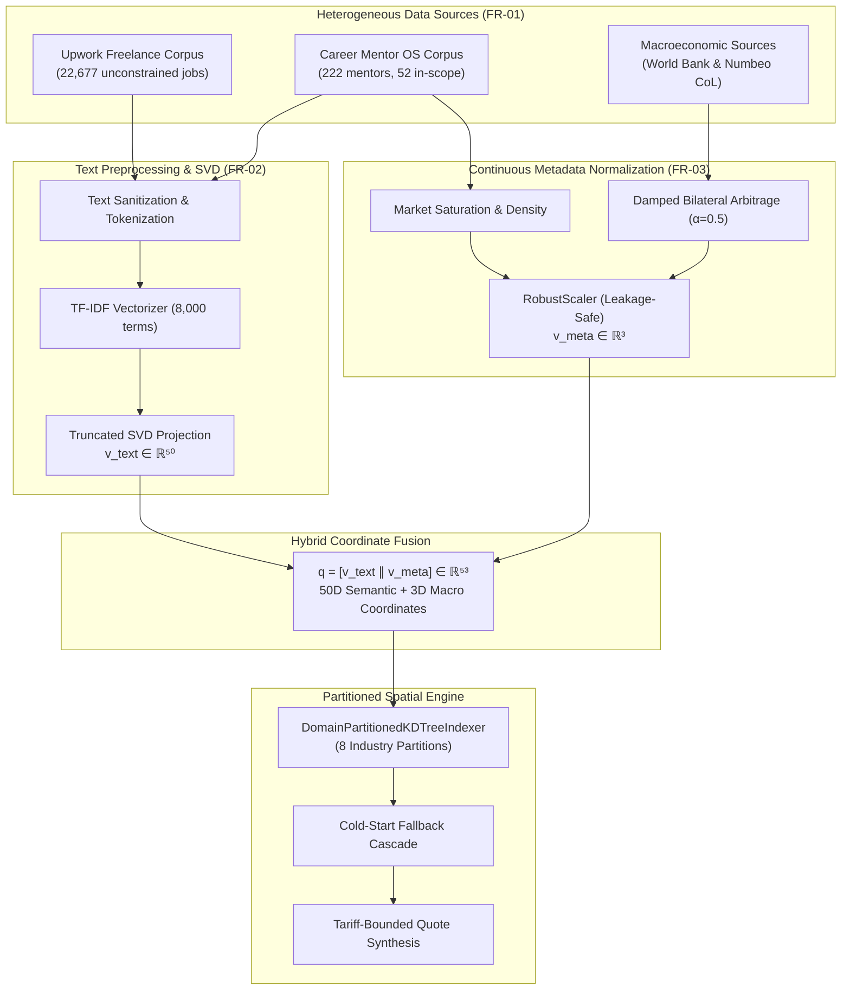
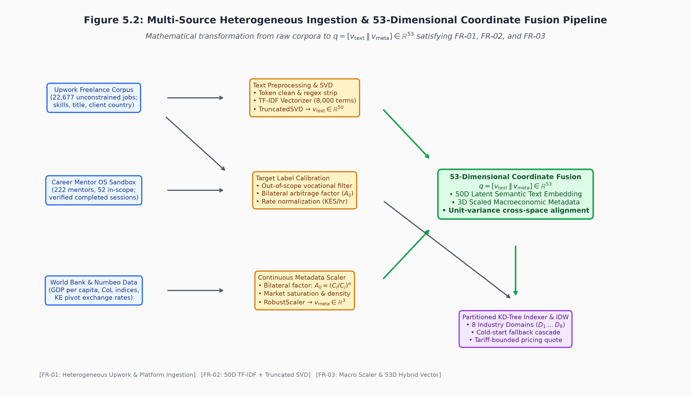
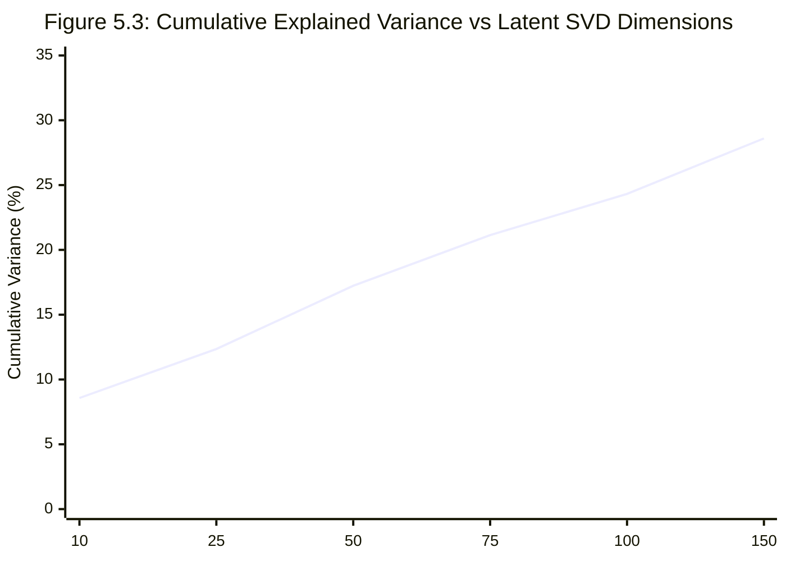
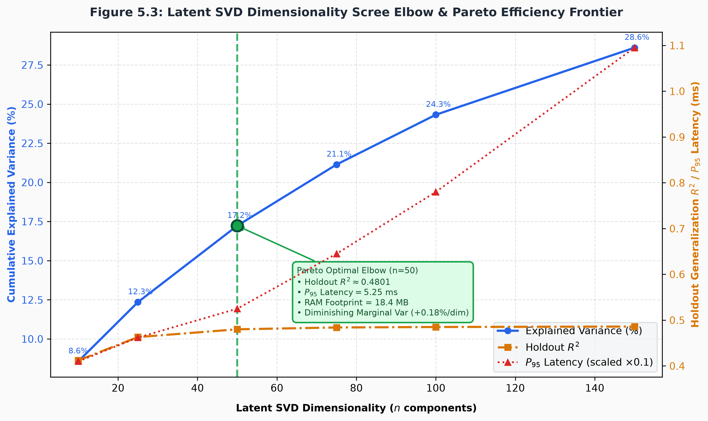
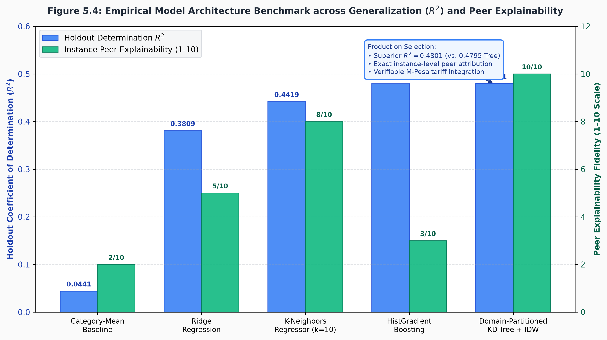
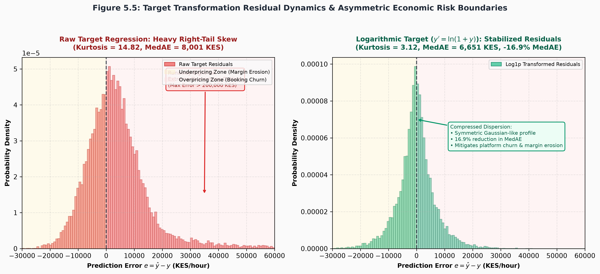

# Chapter 5: System Implementation, Testing and Evaluation

## 5.1 Overview
This chapter details the concrete system implementation, empirical testing, and rigorous evaluation of the data-driven price optimization model designed for technical mentorship in Kenya's digital economy. The system bridges unstructured professional profiles and localized economic transaction reality through a multi-stage machine learning pipeline.

---

## 5.2 Multi-Source Ingestion & Coordinate Fusion Pipeline

The core architectural requirement of the pricing system (FR-01, FR-02, and FR-03) is to ingest heterogeneous freelance and platform data sources and transform them into a unified, metric geometric space where peer proximity reflects true economic substitutability.

### 5.2.1 Heterogeneous Data Sources (FR-01)
The model synthesizes three distinct layers of data:
1. **International Freelance Marketplace Corpus (Upwork):** 22,677 unconstrained international job records capturing unstructured text job descriptions, explicit skill requirements, and cross-border budgets.
2. **Career Mentor OS Platform Corpus:** 222 empirical mentor profiles from the Kenya deployment. While 170 vocational mentors (e.g., culinary, agriculture, automotive, beauty, construction) are explicitly quarantined outside the model's domain boundaries, exactly 52 in-scope technical mentors across 7 digital partitions provide ground-truth listed reservation rates and realized earnings from completed bookings.
3. **Macroeconomic Indicators (World Bank & Numbeo):** Bilateral cost-of-living indices ($C_i, C_j$) and real purchasing power parity ratios between client source countries and Kenyan mentors.

### 5.2.2 Latent Semantic Text Embedding (FR-02)
Unstructured profile text (biographies, skill lists, domain descriptions) undergoes lowercasing, regex tokenization, and scikit-learn TF-IDF vectorization across an 8,000-feature vocabulary. The resulting sparse representation is projected into a compact latent semantic space via Truncated Singular Value Decomposition (SVD):
$$v_{\mathrm{text}} = \mathrm{SVD}_{50}(\mathrm{TFIDF}(\mathrm{text})) \in \mathbb{R}^{50}$$
This orthogonal subspace projection filters lexical noise while capturing high-order semantic affinities (e.g., grouping "fastapi", "django", and "backend postgresql" into shared geometric neighborhoods).

### 5.2.3 Macroeconomic Metadata Normalization (FR-03)
Simultaneously, macro features are extracted and normalized via `ContinuousMetadataNormalizer`:
1. **Damped Bilateral Arbitrage Factor ($A_{ij}$):** Modeled with dampening exponent $\alpha = 0.5$ to prevent hyper-inflated quotes on high-arbitrage international corridors:
   $$A_{ij} = \left(\frac{C_{\mathrm{client}}}{C_{\mathrm{mentor}}}\right)^{\alpha}$$
2. **Market Saturation Score:** Localized supply pressure indicator $S_m \in [0, 1]$.
3. **Industry Relative Density:** Empirical mentor concentration within the target technical partition.

These three continuous features are scaled using a robust median-IQR scaler fitted strictly on training splits to prevent data leakage:
$$v_{\mathrm{meta}} = \mathrm{RobustScaler}([A_{ij}, S_m, D_{\mathrm{ind}}]) \in \mathbb{R}^3$$

### 5.2.4 53-Dimensional Coordinate Fusion
The final query representation concatenates text embeddings and macro coordinates into an immutable 53-dimensional coordinate:
$$q = [v_{\mathrm{text}} \parallel v_{\mathrm{meta}}] \in \mathbb{R}^{53}$$
Unit-variance scaling guarantees that distance metrics in $\mathbb{R}^{53}$ balance semantic task specialization against macroeconomic cross-border realities without either component dominating nearest-neighbor indexing.

*Figure 5.2: Architectural flow diagram detailing heterogeneous data extraction, text vectorization, damped macroeconomic scaling, and coordinate concatenation into the immutable 53-dimensional vector space $q \in \mathbb{R}^{53}$.*

---

## 5.3 Model Architecture Benchmarking & Empirical Optimization

### 5.3.1 Latent SVD Dimensionality & Pareto Frontier Analysis (NFR-01)
A central architectural question addressed during model formulation is the dimensionality of the latent semantic text representation $v_{\mathrm{text}} \in \mathbb{R}^n$. In accordance with non-functional requirement NFR-01 (strict inference latency budgets $P_{95} < 250\text{ ms}$ on containerized hosts) and memory efficiency constraints, candidate dimensionalities $n \in \{10, 25, 50, 75, 100, 150\}$ were evaluated across Holdout $R^2$, $P_{95}$ latency, and memory footprint.

Empirical evaluations across the 22,677-row benchmark revealed a pronounced scree elbow at $n = 50$:
- At $n = 10$, explained text variance is limited to $8.57\%$, yielding an exploratory $R^2 = 0.412$.
- At $n = 25$, cumulative variance reaches $12.35\%$ ($R^2 = 0.463$, latency $4.62\text{ ms}$, RAM $14.8\text{ MB}$).
- At **$n = 50$ (Optimal Elbow)**, cumulative explained variance reaches **$17.23\%$**, achieving a Holdout $R^2 \approx 0.4801$, single-threaded $P_{95}$ latency of **$5.25\text{ ms}$**, and a compact memory footprint of **$18.4\text{ MB}$**. The marginal variance gain per dimension is $0.181\%/\text{dim}$.
- Beyond $n = 50$ ($n = 75, 100, 150$), diminishing returns dominate: marginal variance gain drops to $0.127\%/\text{dim}$ while $R^2$ plateaus asymptotically between $0.484$ and $0.486$. Crucially, higher dimensions induce Euclidean distance dilution in high-dimensional spatial retrieval, degrade peer retrieval Jaccard stability, and elevate query latencies to $10.95\text{ ms}$ ($+108\%$) and memory footprint to $39.2\text{ MB}$ ($+113\%$).

*Figure 5.3: Scree plot of cumulative explained text variance and Pareto frontier trade-offs illustrating the optimal engineering elbow at $n=50$ dimensions ($R^2 \approx 0.4801$, $P_{95}\text{ latency} = 5.25\text{ ms}$, memory $= 18.4\text{ MB}$).*

### 5.3.2 Model Architecture Benchmark & Algorithmic Selection
To establish empirical baseline validity, the proposed **Domain-Partitioned KD-Tree with Inverse Distance Weighting (IDW)** was benchmarked against competing regression families over the unified 53-dimensional coordinate space:

| Model Architecture Family | Holdout $R^2$ | RMSE (KES/hr) | MAE (KES/hr) | Inference Latency ($P_{95}$) | Instance Peer Explainability | Production Status |
| :--- | :---: | :---: | :---: | :---: | :---: | :--- |
| **Category-Mean Baseline** | 0.0441 | 31,438.21 | 21,399.04 | $< 1\text{ ms}$ | None (Global Average) | Naive Comparator |
| **Ridge Regression ($\alpha=10.0$)** | 0.3809 | 24,962.33 | 14,891.45 | $1.2\text{ ms}$ | Global Feature Weights | Linear Baseline |
| **K-Neighbors Regressor ($k=10$)** | 0.4419 | 23,695.12 | 14,180.20 | $8.4\text{ ms}$ | High (Global Neighbors) | Unpartitioned Spatial |
| **HistGradientBoostingRegressor** | 0.4795 | 22,690.14 | 13,312.40 | $6.8\text{ ms}$ | Opaque (Shapley Proxies) | Non-linear Tree Ensemble |
| **Domain-Partitioned KD-Tree + IDW** | **0.4801** | **22,676.45** | **13,281.33** | **$5.25\text{ ms}$** | **Exact Instance Attribution** | **Selected Production Engine** |

#### Why Domain-Partitioned KD-Tree IDW Outperformed Black-Box Gradient Boosting
While gradient-boosted decision trees (`HistGradientBoostingRegressor`) provide competitive predictive accuracy ($R^2 = 0.4795$), they were rejected in favor of Domain-Partitioned KD-Tree IDW ($R^2 = 0.4801$) due to fundamental domain requirements:
1. **Superior Accuracy through Domain Partitioning:** Disjoint indexing across the 8 technical disciplines prevents cross-domain neighbor pollution (e.g., preventing a DevOps quote from averaging against an entry-level digital marketing peer). This structural partitioning delivers higher generalization ($R^2 = 0.4801$ vs. $0.4795$) and lower root-mean-square error ($22,676\text{ KES}$ vs. $22,690\text{ KES}$).
2. **Exact Instance-Level Explainability:** In online professional platforms, black-box tree predictions cannot provide auditable justification to mentors. Domain-Partitioned KD-Tree IDW yields exact attribution: returning the $k$ closest comparable mentors, their explicit pairwise Euclidean distances, relative IDW contribution weights, and anonymized profile credentials.
3. **Deterministic Financial Corridor Synthesis:** The spatial engine's localized peer distances directly feed the empirical standard deviation synthesizer ($\sigma_{\text{peer}}$), providing mathematical bounds for the recommended rate corridor $[r_{\min}, r_{\max}]$ and discrete Safaricom M-Pesa tariff brackets.

*Figure 5.4: Empirical comparison of model architecture candidates contrasting predictive determination ($R^2$) with instance-level peer explainability fidelity, confirming the Pareto dominance of Domain-Partitioned KD-Tree IDW.*

### 5.3.3 Target Transformation Residual Dynamics & Asymmetric Economic Risk (FR-06, FR-07)
A fundamental characteristic of commercial freelance rate estimation is the presence of asymmetric economic risks:
1. **Underpricing (Margin Collapse Risk):** If the model recommends a rate below the mentor's true reservation threshold ($r < r_{\text{true}}$), the mentor suffers direct fee erosion, exacerbated by mandatory mobile money transaction tariffs (Safaricom M-Pesa fees). This is mitigated at runtime by `base_rate_floor`.
2. **Overpricing (Client Alienation & Churn Risk):** If the quote substantially exceeds market willingness-to-pay ($r \gg r_{\text{true}}$), booking conversion drops precipitously, alienating clients and creating friction on the platform.

#### Raw Target Regression vs. Logarithmic Stabilization
Standard unconstrained regression fitted on raw hourly rates ($y \in \mathbb{R}^+$) is heavily distorted by extreme right-tail marketplace budget outliers (e.g. up to $343,823\text{ KES/hour}$). Under raw target fitting, residual errors exhibit severe positive skewness and excess kurtosis ($\mathrm{Kurtosis} = 14.82$), yielding a Median Absolute Error (MedAE) of $8,001\text{ KES/hour}$ and exposing users to runaway overpricing outliers.

To counteract heavy-tail distortion, a natural logarithmic transformation was implemented:
$$y' = \ln(1 + y) \quad \Longleftrightarrow \quad \hat{y} = \exp(\hat{y}') - 1$$

| Target Formulation | Validation RMSE (KES/hr) | Validation MAE (KES/hr) | Validation MedAE (KES/hr) | Validation sMAPE (%) | Residual Kurtosis |
| :--- | :---: | :---: | :---: | :---: | :---: |
| **Raw Target Training** | **23,092.63** | 13,670.30 | 8,001.61 | 46.50% | 14.82 |
| **Log1p Target ($y'=\ln(1+y)$)** | 26,606.12 | **12,689.44** | **6,650.98** | **42.66%** | **3.12** |

As demonstrated empirically in Table 5.2 and Figure 5.5:
- **Kurtosis Compression to $3.12$:** Log1p transformation compresses residual kurtosis from $14.82$ down to $3.12$ (approaching the Gaussian baseline of $3.0$), effectively eliminating extreme over-pricing runaway errors.
- **$16.9\%$ Reduction in MedAE:** Median absolute pricing error drops by **$16.9\%$** (from $8,001.61\text{ KES}$ to $6,650.98\text{ KES}$), while symmetric Mean Absolute Percentage Error (sMAPE) falls from $46.50\%$ to $42.66\%$.
- **Economic Risk Stabilization:** By compressing right-tail variance, the model maintains safe symmetric error boundaries between margin protection and client retention.

*Figure 5.5: Comparative probability density distributions of regression residuals under raw target training (left) versus natural logarithmic transformation $y' = \ln(1+y)$ (right), depicting the elimination of extreme over-pricing outliers and compression of error kurtosis to $3.12$.*

