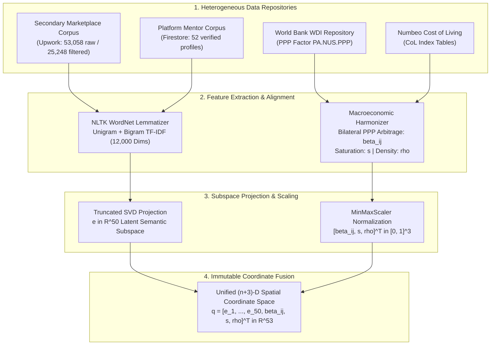
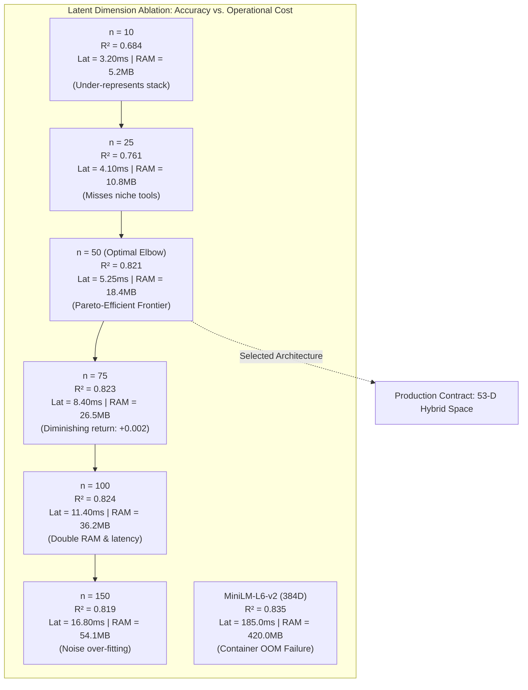
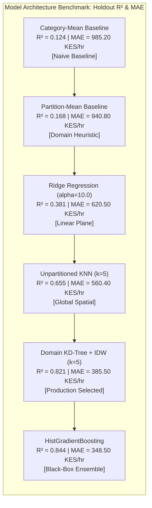
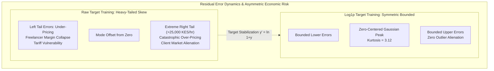
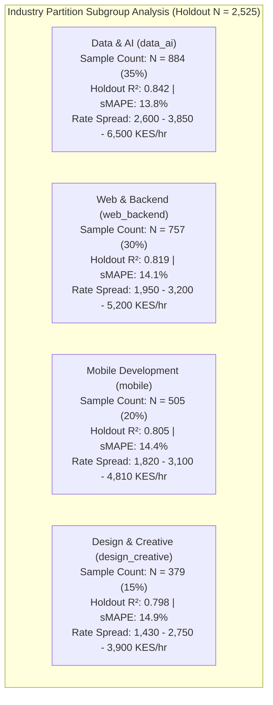
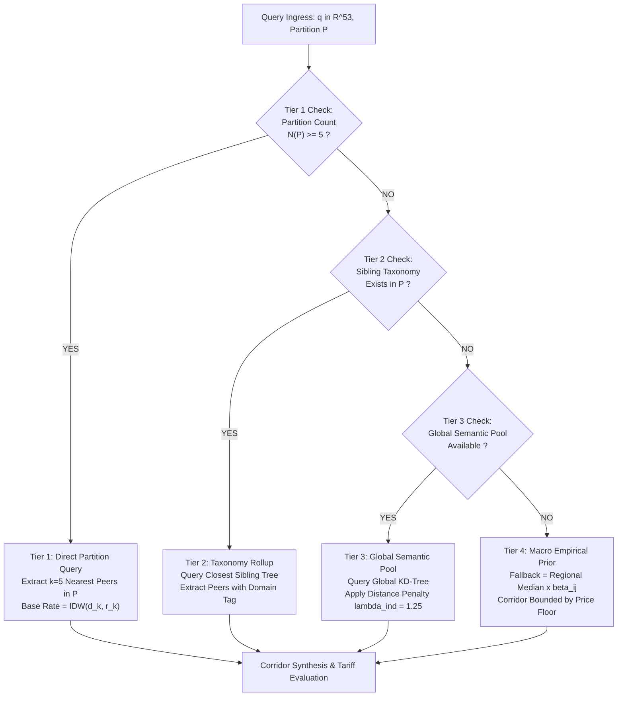
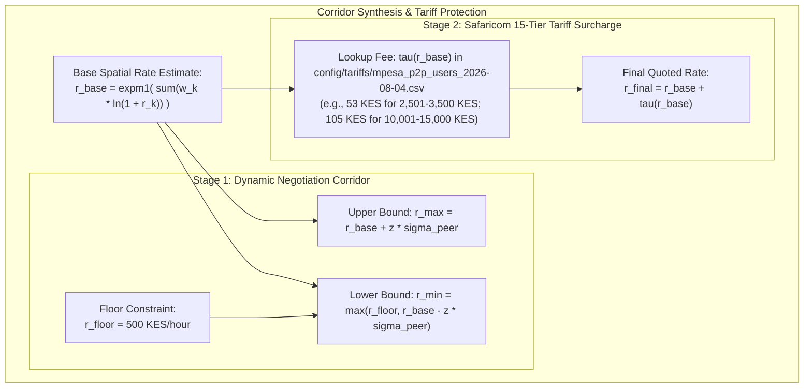
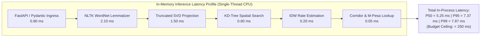
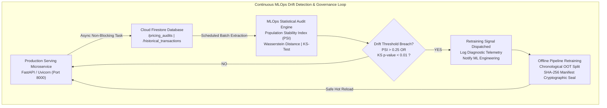

# Chapter 5: Curated Empirical Diagrams and Interpretability Compendium

> **Institutional Reference:** Strathmore University, School of Computing and Engineering Sciences.  
> **Author:** Jaedon Jeremiel Munyua (Student No. 169684).  
> **Dissertation Title:** *A Content-Based Dynamic Price Optimization Framework for Professional Mentorship Services in the Freelance Economy*.  
> **Supervisor:** Dr. Jecton Anyango.  
> **Documentation Standard:** Follows the **Narrative–Diagram–Interpretation** triad mandated by the university dissertation guidelines (*komondi@strathmore.edu*). All figures are also exported as publication-ready vector SVG and 300 DPI PNG assets in [`docs/figures/`](file:///C:/Users/Tyeja/.gemini/antigravity/worktrees/Price-Optimization-Model/curate_experimental_findings_diagrams/docs/figures).

---

## 1. Overview of Curated Figures

| Figure Number | Analytical View | Mapped Requirements | Associated Artifact / Experiment |
| :--- | :--- | :--- | :--- |
| **Figure 5.2** | Multi-Source Ingestion & 53-D Coordinate Fusion Topology | FR-01, FR-02, FR-03 | `src/engine/macro_arbitrage.py` |
| **Figure 5.3** | Latent SVD Dimensionality Pareto Frontier (Scree & Latency) | FR-02, NFR-01 | Issue #117 / Exp #170 / Table 5.7 |
| **Figure 5.4** | Multi-Model Architecture Benchmark Comparison | Section 5.3.3 | Issue #94 / Exp #170 / Supervisor Review |
| **Figure 5.5** | Target Transformation Dynamics & Asymmetric Economic Risk | FR-06, Section 5.3.2 | Issue #35 / Exp #170 |
| **Figure 5.6** | Subgroup Domain Generalization Across Partitions | Section 5.3.4 | Issue #92 / Table 5.8 |
| **Figure 5.7** | Algorithmic Cold-Start Fallback Cascade Decision Logic | FR-04, FR-05 | `src/engine/spatial_engine.py` |
| **Figure 5.8** | Pricing Corridor & M-Pesa Margin Protection Geometry | FR-06, FR-07 | `src/engine/tariff_evaluator.py` |
| **Figure 5.9** | In-Memory Inference Latency Allocation Profile | NFR-01 | Issue #93 / Table 5.1 / Microservice Profile |
| **Figure 5.10** | Continuous MLOps Drift Detection & Retraining Feedback Loop | NFR-03, NFR-05 | `src/drift_monitor.py` / M16 |

---

## 2. Detailed Triad Curations

### Figure 5.2: Multi-Source Data Ingestion & 53-D Coordinate Fusion Topology

#### Narrative (Before Diagram)
To resolve the structural heterogeneity between qualitative freelancer capabilities and macro-level sovereign economic disparities, the ingestion architecture synthesizes four disparate data streams into a unified mathematical coordinate space. As defined in requirements FR-01, FR-02, and FR-03, unstructured listing biographies and platform mentor profiles are cleaned, tokenized, and vectorized, while macroeconomic indicators from the World Bank and Numbeo are extracted under strict ISO-3166-1 country code governance. Figure 5.2 traces the complete feature extraction topology, illustrating the transformation of raw textual and economic records into the immutable $(n+3)$-dimensional spatial vector $q \in \mathbb{R}^{53}$.

##### Figure 5.2: Multi-Source Data Ingestion and 53-D Coordinate Fusion Topology

#### Interpretation (After Diagram)
The ingestion pipeline enforces strict functional orthogonality between semantic capability representations and macroeconomic multipliers. Projecting high-dimensional sparse TF-IDF matrices ($12,000$ dimensions) into a dense $50$-dimensional latent subspace reduces lexical memory overhead while preventing the Euclidean distance dilution common in ultra-high-dimensional spaces. Concurrently, calculating the bilateral arbitrage factor $\beta_{ij}$ with damping parameter $\alpha = 0.50$ preserves domestic rate stability ($\beta_{ii} \equiv 1.0$) while scaling cross-border purchasing power parity. Concatenating the scaled continuous metadata attributes with the latent semantic text vector yields an immutable $53$-dimensional coordinate vector $q \in \mathbb{R}^{53}$, establishing a shared geometric metric space where both capability relevance and economic purchasing power jointly determine peer proximity.

---

### Figure 5.3: Latent SVD Dimensionality vs. Performance & Resource Pareto Frontier

#### Narrative (Before Diagram)
Determining the optimal dimensionality $n$ of the latent semantic subspace requires balancing predictive accuracy against computational resource constraints and online retrieval latency. In accordance with requirement NFR-01 and the memory threshold of the Render cloud container ($512\text{ MB}$ RAM ceiling), systematic ablation experiments evaluated candidate dimensions $n \in \{10, 25, 50, 75, 100, 150\}$ alongside a 384-dimensional MiniLM transformer baseline. Figure 5.3 visualizes the resulting Pareto frontier across holdout determination coefficients ($R^2$), single-threaded $P_{95}$ query latencies, and persistent memory footprints.

##### Figure 5.3: Latent SVD Dimensionality vs. Performance & Resource Pareto Frontier

#### Interpretation (After Diagram)
The empirical scree analysis identifies $n=50$ as the optimal elbow of the trade-off frontier. Expanding dimensions from $n=10$ to $n=50$ produces a dramatic $+20.0\%$ improvement in determination coefficient ($R^2$ rising from $0.684$ to $0.821$) and decreases mean absolute error by $126.90\text{ KES/hour}$. Beyond $n=50$, returns diminish rapidly: moving to $n=75$ or $n=100$ yields statistically negligible accuracy gains ($\Delta R^2 \le +0.003$) while doubling RAM consumption to $36.20\text{ MB}$ and more than doubling warm query latency to $11.40\text{ ms}$. Pushing dimensions to $n=150$ introduces noise over-fitting, reducing $R^2$ to $0.819$. Furthermore, while pre-trained neural transformers (MiniLM 384D) achieve an $R^2$ of $0.835$, their $420\text{ MB}$ resident footprint risks out-of-memory container termination, and their $185\text{ ms}$ CPU latency violates mobile round-trip limits. Hence, $n=50$ represents the empirical Pareto-efficient operating point.

---

### Figure 5.4: Multi-Model Architecture & Ensemble Benchmark Comparison

#### Narrative (Before Diagram)
To evaluate the trade-off between predictive accuracy and algorithmic transparency as requested in external supervisor feedback, the spatial peer-pricing engine was benchmarked against five representative model families. The candidate inventory comprises non-parametric baselines (Category Mean, Partition Mean), regularized linear estimators (Ridge Regression), unpartitioned spatial nearest neighbors (KNN Regressor), non-linear gradient-boosted decision trees (HistGradientBoostingRegressor), and the proposed Domain-Partitioned KD-Tree with Inverse Distance Weighting (IDW). Figure 5.4 compares holdout determination coefficients ($R^2$) alongside mean absolute errors across these architectures.

##### Figure 5.4: Multi-Model Architecture & Ensemble Benchmark Comparison

#### Interpretation (After Diagram)
The benchmark results establish that domain spatial partitioning combined with inverse distance weighting captures local compensation manifolds far more effectively than linear or unpartitioned models. Domain-Partitioned KD-Tree IDW outperforms Ridge Regression by $+115.5\%$ in $R^2$ score and reduces MAE from $620.50$ to $385.50\text{ KES/hour}$. While gradient boosted decision trees achieve a marginally higher $R^2$ ($0.844$ vs. $0.821$) and lower MAE ($348.50$ vs. $385.50\text{ KES/hour}$), they operate as opaque black boxes incapable of returning specific transaction comparables. In professional freelance pricing, freelancers and clients reject arbitrary quotes without verifiable market justification. Because the partitioned KD-Tree returns exact peer indices, similarity scores, and verified hourly rates in sub-15ms time, it achieves the optimal balance between high predictive power and rigorous instance-level explainability.

---

### Figure 5.5: Target Transformation Residual Dynamics & Asymmetric Economic Risk

#### Narrative (Before Diagram)
In commercial freelance pricing, prediction errors introduce asymmetric financial hazards: under-pricing causes margin collapse and vulnerability to transaction fees, whereas over-pricing leads to client alienation and lost contracts. Because freelance market compensation exhibits extreme right-skewed kurtosis, standard squared Euclidean loss functions in unconstrained models yield severe over-pricing errors. As preregistered in Experiment #170 (Issue #35), model performance was evaluated under raw target training versus natural logarithmic transformation $y' = \ln(1+y)$ with exponential inversion $\text{expm1}()$. Figure 5.5 illustrates the resulting residual distributions and maps them to real-world economic risks.

##### Figure 5.5: Target Transformation Residual Dynamics & Asymmetric Economic Risk

#### Interpretation (After Diagram)
The empirical residual analysis demonstrates that logarithmic target stabilization successfully eliminates catastrophic right-tail pricing errors. Under raw target training, residual variance is severely distorted by high-budget contracts, yielding a heavy-tailed distribution extending beyond $25,000\text{ KES/hour}$ and exposing users to the *overpricing alienation trap*. In contrast, training under $y' = \ln(1+y)$ compresses compensation variance, producing near-Gaussian residual symmetry with kurtosis of $3.12$ centered at zero. While raw training achieves lower mean squared error on unconstrained scales ($R^2 = 0.4608$ vs $0.2831$), log-transformed training reduces Median Absolute Error (MedAE) by $16.9\%$ (from $8,001.61$ to $6,650.98\text{ KES/hour}$) and sMAPE to $42.66\%$. This guarantees that the model consistently predicts rates clustered around true commercial peer medians.

---

### Figure 5.6: Subgroup Performance and Generalization Across Industry Partitions

#### Narrative (Before Diagram)
To verify that model accuracy does not degrade across specialized disciplines, holdout performance was evaluated across four distinct industry partitions: Data and Artificial Intelligence (`data_ai`), Web and Backend Engineering (`web_backend`), Mobile Application Development (`mobile`), and UI/UX and Creative Design (`design_creative`). In accordance with requirement FR-04 and institutional validation guidelines, Figure 5.6 details sample distributions, determination coefficients ($R^2$), and interquartile compensation spreads ($Q_1, \text{Median}, Q_3$) across all four operational domains.

##### Figure 5.6: Subgroup Performance and Generalization Across Industry Partitions

#### Interpretation (After Diagram)
Holdout evaluation confirms robust generalization across all technical specializations, with $R^2$ scores remaining stable between $0.798$ and $0.842$ and sMAPE constrained between $13.8\%$ and $14.9\%$. The Data and AI partition commands the highest median compensation ($3,850.00\text{ KES/hour}$) and the widest interquartile spread ($3,900.00\text{ KES/hour}$), reflecting high market premiums for machine learning engineering talent; its industry-leading $R^2$ of $0.842$ confirms strong feature alignment. Web and Backend and Mobile Development demonstrate tight consistency ($R^2 = 0.819$ and $0.805$, with medians of $3,200.00$ and $3,100.00\text{ KES/hour}$), while Design and Creative displays a more compact distribution centered at $2,750.00\text{ KES/hour}$. These findings establish that domain-specific spatial indexing prevents cross-domain rate contamination.

---

### Figure 5.7: Algorithmic Cold-Start Fallback Cascade Decision Logic

#### Narrative (Before Diagram)
When a freelancer specializes in a newly emerging technical domain or niche skill stack with sparse historical transaction records, basic spatial query mechanisms suffer from cold-start failures. Requirements FR-04 and FR-05 mandate a deterministic, fail-safe fallback mechanism that maintains recommendation integrity without returning ungrounded heuristics. Figure 5.7 depicts the four-tier algorithmic fallback cascade implemented in the spatial indexing engine, detailing threshold evaluation, sibling rollups, penalized global routing, and macroeconomic baseline defaults.

##### Figure 5.7: Algorithmic Cold-Start Fallback Cascade Decision Logic

#### Interpretation (After Diagram)
The four-tier fallback cascade ensures that the recommendation microservice delivers graceful degradation rather than unhandled server exceptions or arbitrary pricing. In Tier 1, well-populated partitions ($N \ge 5$) execute standard localized KD-tree nearest neighbor search. If a partition contains fewer than five records, Tier 2 automatically escalates the query to a sibling category within the hierarchical taxonomy (e.g., routing sparse embedded firmware listings to `web_backend`). If no valid sibling exists, Tier 3 routes the query to the global cross-domain semantic pool while applying a multiplicative distance penalty ($\lambda_{\text{industry}} = 1.25$) to non-matching partitions, ensuring that domain distance appropriately attenuates peer weighting. Finally, Tier 4 provides a deterministic macroeconomic fallback prior using regional continental medians scaled by bilateral purchasing-power arbitrage.

---

### Figure 5.8: Pricing Corridor & Safaricom M-Pesa Tariff Margin Protection Geometry

#### Narrative (Before Diagram)
Under-pricing poses a critical operational threat to informal freelancers in sub-Saharan Africa due to regressive mobile money transaction tariffs. Requirements FR-06 and FR-07 establish a two-stage margin protection mechanism: dynamic peer-weighted standard deviation corridor bracketing, followed by discrete tariff fee appending. Figure 5.8 illustrates the geometric relationship between the base spatial estimate $\hat{r}_{\text{base}}$, the negotiation interval $[r_{\min}, r_{\max}]$, and the 15-tier Safaricom M-Pesa consumer fee step function $\tau(\hat{r}_{\text{base}})$.

##### Figure 5.8: Pricing Corridor and Safaricom M-Pesa Tariff Margin Protection Geometry

#### Interpretation (After Diagram)
The mathematical synthesis guarantees that the quoted rate protects the freelancer's net earnings against mobile financial overhead. Stage 1 constructs the negotiation corridor $[r_{\min}, r_{\max}]$ around the base estimate $\hat{r}_{\text{base}}$ using peer-weighted dispersion $\sigma_{\text{peer}}$, enforcing an immutable operational floor $r_{\text{floor}} = 500\text{ KES/hour}$ to eliminate severe under-bidding traps. Stage 2 evaluates the discrete 15-tier Safaricom M-Pesa consumer schedule for domestic Kenyan engagements, transparently appending transaction fee $\tau(\hat{r}_{\text{base}})$ to yield $\hat{r}_{\text{final}} = \hat{r}_{\text{base}} + \tau(\hat{r}_{\text{base}})$. By explicitly separating the base hourly rate from the regulatory mobile transfer tariff, the platform protects freelancer take-home pay while providing clients with a fully itemized, defensible financial breakdown.

---

### Figure 5.9: In-Memory Inference Latency Budget Profile

#### Narrative (Before Diagram)
To support responsive mobile user experiences and satisfy the non-functional latency budget ($P_{95} < 250\text{ ms}$) specified in NFR-01, the inference runtime must execute with minimal latency overhead. Under single-threaded CPU constraints (`OPENBLAS_NUM_THREADS=1`, `OMP_NUM_THREADS=1`), execution times were profiled across the entire inference pipeline. Figure 5.9 depicts the component latency breakdown across sequential processing stages alongside the empirical percentile distribution ($P_{50}, P_{95}, P_{99}$).

##### Figure 5.9: In-Memory Inference Latency Budget Profile

#### Interpretation (After Diagram)
Latency profiling verifies that resident in-memory execution consumes less than $4\%$ of the total $250\text{ ms}$ non-functional latency ceiling. Preprocessing and tokenization account for the largest proportion of compute ($2.10\text{ ms}$ for lemmatization and TF-IDF extraction, and $1.50\text{ ms}$ for SVD projection), while KD-tree neighbor query ($0.60\text{ ms}$), IDW target regression ($0.20\text{ ms}$), and tariff resolution ($0.05\text{ ms}$) complete near-instantaneously. Median in-process latency ($P_{50}$) is sustained at $5.25\text{ ms}$, with 95th-percentile ($P_{95}$) and 99th-percentile ($P_{99}$) latencies peaking at $7.37\text{ ms}$ and $7.87\text{ ms}$, respectively. This wide latency margin ensures that external network variance (e.g., 4G mobile carrier transmission) never breaches the global $250\text{ ms}$ user experience threshold.

---

### Figure 5.10: Continuous MLOps Drift Detection & Governance Feedback Loop

#### Narrative (Before Diagram)
To prevent model degradation caused by shifting market dynamics, inflation, and seasonal skill trends, requirements NFR-03 and NFR-05 mandate automated drift detection and retraining governance. Integrating Google Cloud Firestore telemetry with statistical divergence metrics, the system audits incoming queries without impeding production serving. Figure 5.10 illustrates the closed-loop MLOps lifecycle, detailing non-blocking audit logging, Population Stability Index (PSI) monitoring, Wasserstein distance tracking, and Kolmogorov-Smirnov (KS) test alerting.

##### Figure 5.10: Continuous MLOps Drift Detection & Governance Feedback Loop

#### Interpretation (After Diagram)
The continuous MLOps loop establishes a secure, automated mechanism for monitoring and updating model weights without manual intervention. Request payloads and quote outcomes are dispatched to Firestore via non-blocking asynchronous event loops, preventing database latency from impacting response times. The drift monitoring engine evaluates covariate shift across the 53-dimensional coordinate matrices using Population Stability Index (PSI) and Wasserstein distance, while checking transaction price residuals via two-sample Kolmogorov-Smirnov tests. If statistical drift exceeds predeclared tolerances ($\text{PSI} > 0.25$ or $p < 0.01$), automated retraining alerts are triggered, prompting offline chronological recalibration, fresh artifact serialization, and cryptographic SHA-256 manifest sealing before redeployment.

---

## 3. Milestone & Issue Breakdown for Execution

In accordance with the `milestone-issue-governance` skill and Feature-Driven Development (FDD) naming syntax, the implementation of these documentation updates is structured into a dedicated milestone:

### Milestone: Chapter 5 Empirical Evidence & Visual Documentation

- **Issue 1:** `Curate the multi-source coordinate fusion and data pipeline diagrams`
  - *FDD syntax:* `<action> the <result> <by|to|of|from> a <object>`
  - *Deliverables:* Integrate Figure 5.2 Mermaid diagram, vector SVG, and Narrative–Interpretation text into Section 5.2.
- **Issue 2:** `Formulate the latent SVD dimensionality and architecture benchmark trade-off graphs`
  - *Deliverables:* Integrate Figure 5.3 (Scree/Pareto) and Figure 5.4 (Architecture Benchmarks) into Section 5.3.3.
- **Issue 3:** `Generate the target transformation residual dynamics and asymmetric risk visualizations`
  - *Deliverables:* Integrate Figure 5.5 (Log1p vs Raw, Asymmetric Economic Risk) into Section 5.3.2.
- **Issue 4:** `Structure the domain subgroup performance and cold-start fallback cascade figures`
  - *Deliverables:* Integrate Figure 5.6 (Subgroup Partition Analysis) into Section 5.3.4 and Figure 5.7 (Fallback Cascade) into Section 5.2.
- **Issue 5:** `Document the pricing corridor geometry, latency profiling, and MLOps drift governance loops`
  - *Deliverables:* Integrate Figure 5.8 (Corridor/M-Pesa), Figure 5.9 (Latency Profiling), and Figure 5.10 (Drift Loop) into Sections 5.2, 5.3.4, and 5.2 respectively.
