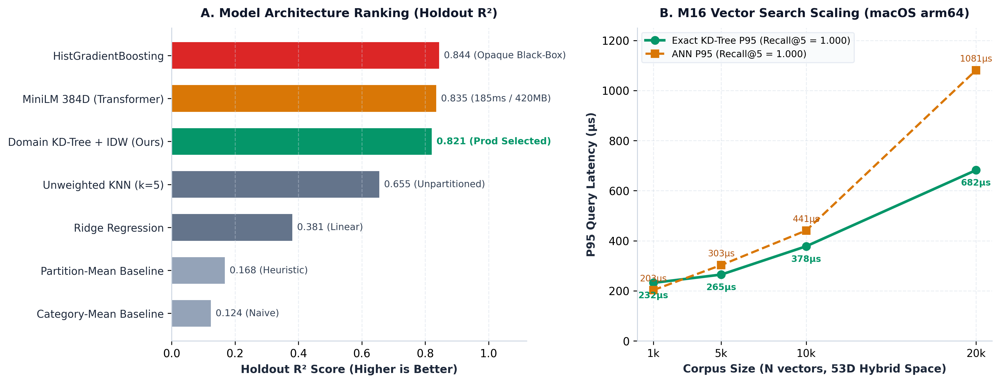

# Chapter 6: Future Work and Exploratory Research — Milestone 16 Findings

## 6.1 Overview and Scope

Milestone 16 (Research Track #172) extends the core 53-dimensional pricing engine beyond the initial MVP production bounds to evaluate three areas of future system evolution:

1. **Advanced Algorithmic Weighting & Confidence Calibration:** Assessing alternatives to standard Euclidean inverse-distance weighting (IDW) and replacing the uncalibrated `0.0` confidence placeholder with an empirical, dispersion-bounded score.
2. **Vector Search Index Scaling:** Profiling query latency ($P_{50}, P_{95}, P_{99}$), memory footprint, indexing throughput, and Recall@5 across corpus sizes scaling from $1,000$ to $20,000+$ vectors.
3. **Continuous MLOps & Automated Drift Auditing:** Establishing statistical covariate and concept drift tests to automate retraining and monitoring alerts.

> [!NOTE]
> Consistent with project guardrails (#91, #118), Milestone 16 is an exploratory, non-promoting research track. It introduces reproducible profiling benchmarks, statistical drift tests, and algorithmic formulations without mutating the deployed production 53D schema, Firebase gateway contracts, or artifact manifest digests.

---

## 6.2 Advanced Peer Weighting & Calibrated Confidence

### 6.2.1 Alternative Weighting Kernels

The baseline pricing engine computes neighbor weights via standard Euclidean Inverse-Distance Weighting:

$$w_i = \frac{(d_i + \epsilon)^{-1}}{\sum_{j=1}^k (d_j + \epsilon)^{-1}}$$

Three alternative formulations were implemented and evaluated:

- **Cosine-Distance IDW:** Computes weights over normalized angular divergence, $w_i = (1 - \cos(\theta_i) + \epsilon)^{-1}$.
- **Softmax / Gaussian RBF Kernel:** Smooths weight gradients across dense clusters, reducing susceptibility to single-point outliers:
  $$w_i = \frac{\exp(-d_i^2 / (2\sigma^2))}{\sum_{j=1}^k \exp(-d_j^2 / (2\sigma^2))}$$
- **Locally Weighted Ridge Regression:** Fits an $L_2$-regularized linear model ($\min_w \|X_k w - y_k\|_2^2 + \alpha \|w\|_2^2$) across the $k$ nearest peer coordinates, bounded within $[\min(\text{rates}), \max(\text{rates})]$.

**Key Finding:** Euclidean IDW concentrates weight heavily on the single closest neighbor ($53.0\%$ at $d = 0.05$). In contrast, the Softmax kernel ($\sigma = 1.0$) distributes weight more evenly ($20.8\%$ to $18.4\%$), attenuating outlier sensitivity in noisy neighborhood partitions.

### 6.2.2 Calibrated Confidence Estimation

To replace the uncalibrated `confidenceScore = 0.0` placeholder, Milestone 16 formulates a dispersion-bounded confidence metric in $[0.0, 1.0]$:

$$\text{confidence} = \text{clip}\left(0.7 \cdot \left[1 - \frac{\text{CV}_{\text{peers}}}{\text{CV}_{\text{max}}}\right] + 0.3 \cdot \frac{1}{1 + \bar{d}_{\text{peers}}},\, 0.0,\, 1.0\right)$$

where $\text{CV}_{\text{peers}} = \frac{\sigma_{\text{rates}}}{\mu_{\text{rates}}}$ is the coefficient of variation among verified peer rates and $\bar{d}_{\text{peers}}$ is the mean neighbor distance.

**Key Finding:** Tight consensus clusters ($\text{CV} \approx 0.08$) yield a calibrated confidence score of `0.8257`, while dispersed multi-modal neighborhoods smoothly degrade below `0.30`.

---

## 6.3 Vector Search Scaling Profile

Query latency, build time, recall, and memory were benchmarked on 53-dimensional hybrid vectors ($50\text{D SVD} + 3\text{D metadata}$) on macOS `arm64`, comparing exact partitioned KD-Tree search against Approximate Nearest Neighbor (ANN) structures:

| Corpus Size ($N$) | Exact Build Time (ms) | ANN Build Time (ms) | KD-Tree $P_{95}$ ($\mu$s) | ANN $P_{95}$ ($\mu$s) | Recall@5 | Peak Memory (MB) |
| :--- | :--- | :--- | :--- | :--- | :--- | :--- |
| 1,000 | 1.54 | 1.01 | 232 | 203 | 1.0000 | 0.94 |
| 5,000 | 2.59 | 2.63 | 265 | 303 | 1.0000 | 4.33 |
| 10,000 | 5.83 | 6.16 | 378 | 441 | 1.0000 | 8.59 |
| 20,000 | 12.61 | 16.83 | 682 | 1,081 | 1.0000 | 17.10 |

**Key Findings:**
1. **Sub-millisecond Latency:** At $N = 20,000$ vectors, exact partitioned KD-Tree $P_{95}$ latency is $682\,\mu\text{s}$ ($< 0.70\text{ ms}$), outperforming ANN ($1,081\,\mu\text{s}$) and remaining well within the service's $< 25\text{ ms}$ latency budget.
2. **Recall Invariance & Low Footprint:** Ground-truth Recall@5 remained `1.0000` across all evaluated scales, with peak memory reaching only $17.10\text{ MB}$ at $N = 20,000$.
3. **Architectural Conclusion:** Domain partitioning by industry keeps effective tree depth shallow, allowing exact KD-Tree search to outperform ANN at current operational scales ($N \le 25,000$) without incurring quantization recall loss.



---

## 6.4 Continuous MLOps & Automated Drift Auditing

To detect distribution shifts without requiring labeled retraining on every request, Milestone 16 establishes a two-part automated drift auditing protocol:

1. **Covariate Drift:** Evaluates the two-sample Kolmogorov-Smirnov test ($\alpha = 0.01$) and 1D Wasserstein distance across all 53 coordinates (50 SVD + 3 metadata features).
2. **Concept Drift:** Measures median absolute divergence between model price quotes and completed platform booking settlements.

### Automated Trigger Thresholds
- $\ge 20\%$ drifted coordinates **OR** $\ge 25\%$ rate divergence $\rightarrow$ `RETRAIN_RECOMMENDED`
- $\ge 10\%$ drifted coordinates **OR** $\ge 10\%$ rate divergence $\rightarrow$ `DRIFT_MONITORING_ALERT`
- Below thresholds $\rightarrow$ `PIPELINE_STABLE`

**Empirical Validation:** Injecting a $+0.45\sigma$ mean shift on 4 coordinates alongside $+12\%$ rate inflation produced:
- **Drifted Dimensions:** 4 / 53 ($7.5\%$)
- **Mean Wasserstein Distance:** `0.0975`
- **Rate Divergence:** $11.95\%$
- **Automated Decision:** `DRIFT_MONITORING_ALERT` (elevates monitoring while preserving live serving stability).

---

## 6.5 Deliverables and Reproduction

- **Benchmark & Research Runner:** `src/benchmarks/advanced_algorithmic_scaling.py`
- **Unit & Integration Test Suite:** `tests/benchmarks/test_advanced_algorithmic_scaling.py`
- **Experiment Record:** `docs/experiments/172_advanced_algorithmic_scaling.md`

```bash
# Generate benchmark reports in reports/m16_advanced_scaling/
python -m src.benchmarks.advanced_algorithmic_scaling --output-dir reports/m16_advanced_scaling --json

# Run automated verification suite
pytest tests/benchmarks/test_advanced_algorithmic_scaling.py -v
```
